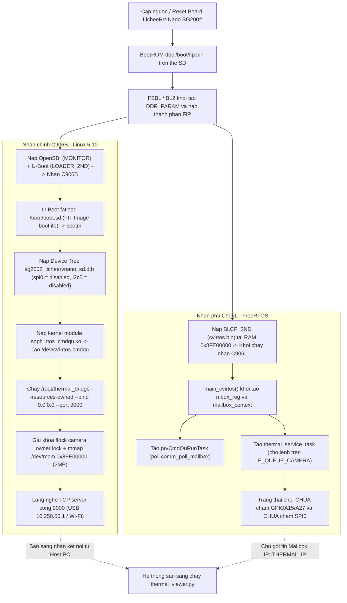
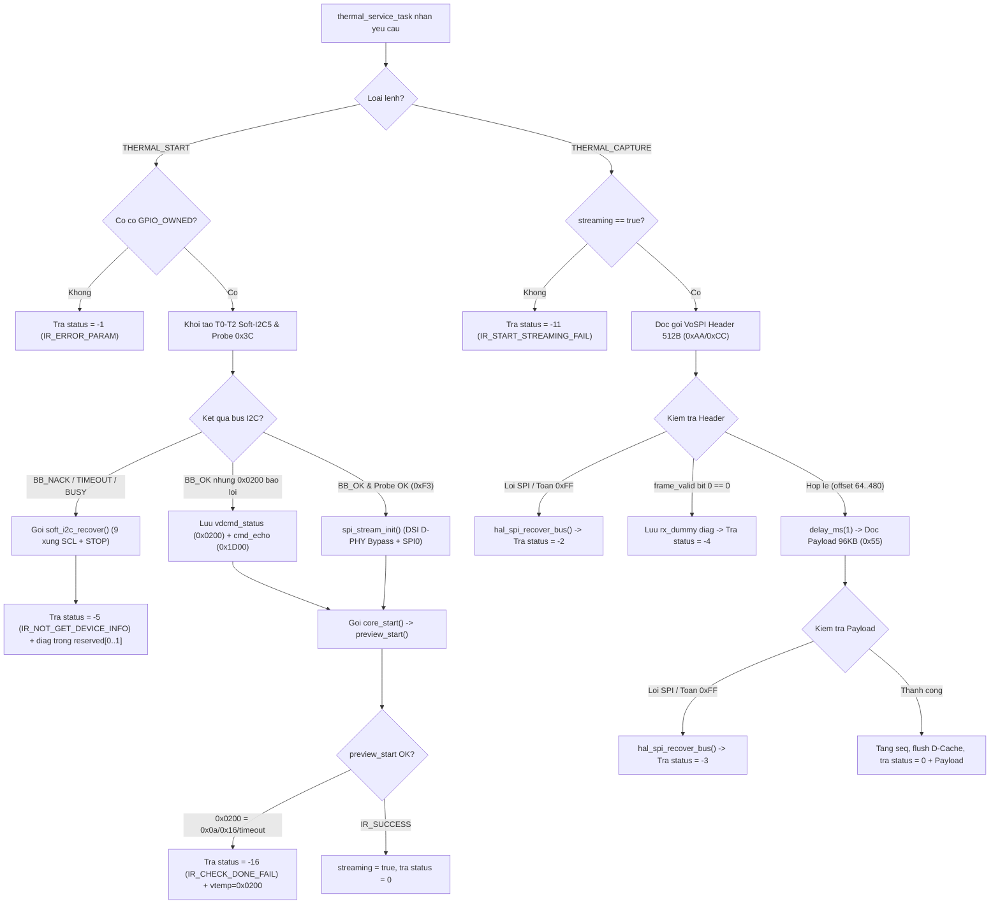

# Diagram 1: Luồng Chạy Hệ Thống (Execution & Runtime Flow)

Tài liệu này mô tả chi tiết trình tự thực thi của toàn bộ hệ thống camera nhiệt Tiny1C theo thời gian thực: từ lúc cấp nguồn board, khởi tạo thiết bị, vòng lặp thu khung hình liên tục, đến cơ chế phục hồi lỗi ở từng tầng T0 → App.

---

## 1.1. Luồng khởi động song song 2 nhân (Boot Sequence: C906B Linux + C906L FreeRTOS)



---

## 1.2. Trình tự thực thi toàn tuyến: `THERMAL_START` → `THERMAL_CAPTURE` → `FFC` / `STOP`

```mermaid
sequenceDiagram
    autonumber
    participant PC as "App PC (thermal_viewer.py)"
    participant BR as "App Linux (thermal_bridge)"
    participant MB as "Mailbox (soph_rtos_cmdqu + comm_main)"
    participant SVC as "App RTOS (thermal_service_task)"
    participant T3 as "Driver T3 (core / vdcmd / vospi)"
    participant T210 as "Driver T2-T1-T0 (Soft-I2C5 & SPI0)"
    participant CAM as "Module Tiny1C (ASIC-2121W)"

    Note over PC,CAM: GIAI DOAN 1: KHOI TAO & BAT LUONG (THERMAL_START = 0x40)
    PC->>BR: Gui 1 byte lenh ('t'=TEMP / 'i'=IMAGE / 'd'=DUAL) qua TCP :9000
    BR->>MB: ioctl(SEND_WAIT, ip=THERMAL_IP, cmd=0x40, param=mode|GPIO_OWNED)
    MB->>SVC: comm_poll_mailbox() nhan goi -> day vao E_QUEUE_CAMERA
    SVC->>T3: data_rw_set_gpioa_ownership(true) -> core_init(bus=5, addr=0x78)
    T3->>T210: bb_gpio_platform_init() -> soft_i2c_init() (GPIOA15/A27, pad pull-up)
    T3->>CAM: Probe DEV_INFO (CHIP_ID, PROJECT, FW, PN, SN) qua I2C 0x3C reg 0x1D00/0x0200
    CAM-->>T3: ACK + Du lieu thong tin thiet bi (probe_ok_mask=0xF3)
    SVC->>T3: spi_stream_init(spi=0, cs=GPIOC17)
    T3->>T210: hal_spi_platform_pinmux_init() (Mo khoa DSI D-PHY Bypass, FPC2 14/15/17/18, Mode 3)
    SVC->>T3: core_start(mode, fps=25) -> hal_spi_set_freq_hz(11.71875 MHz)
    T3->>CAM: preview_start(256x192/384, fps=25, mode=8) + y16_preview_start (neu MODE_TEMP)
    CAM-->>T3: Thanh ghi 0x0200 = IDLE | PASS (status=0)
    SVC->>MB: flush_dcache_range(reply) -> Gui dia chi &reply qua Mailbox (status=0)
    MB->>BR: rtos_cmdqu_send_wait() (poll 5ms) tra ve dia chi reply trong 0x8FE00000
    BR->>PC: memcpy tu mmap(/dev/mem) -> Gui 64B thermal_header_t (status=0) qua TCP

    Note over PC,CAM: GIAI DOAN 2: VONG LAP THU KHUNG HINH (THERMAL_CAPTURE = 0x41)
    loop Lap theo chu ky FPS (mac dinh 8 FPS)
        PC->>BR: Gui 1 byte 'c' (CAPTURE)
        BR->>MB: ioctl(SEND_WAIT, cmd=0x41)
        MB->>SVC: Danh thuc thermal_service_task
        SVC->>T3: spi_get_frame(reply.payload, 98304 hoac 196608, 0xAA)
        T3->>T210: Phien CS LOW #1: Gui 512B (0xAA + 511x 0x00) qua SPI0 Polling/DMA
        T210->>CAM: SCK 11.71875 MHz, MOSI=0xAA..., CS=GPIOC17 LOW
        CAM-->>T210: Tra 480B dummy 0x00 + 32B vospi_frame_header_t (offset 480..511)
        T3->>T3: Thu offset 64; neu bit valid bang 0, chon byte khac 0 dau tien den 480. Kiem tra all-FF va bit valid.
        T3->>T3: delay_ms(1) cho DDR cua ASIC san sang
        T3->>T210: Phien CS LOW #2: Doc 98,304B (dummy_fill=0x55) -> dst_96kb
        CAM-->>T210: Xuat 98,304B du lieu pixel (Y16 hoac YUYV422)
        Note over T3,CAM: Neu MODE_DUAL (196,608B): Lap them 1 luot voi 0xCC cho 96KB nhiet
        SVC->>MB: Dien 64B header (seq, vtemp, flags) + flush_dcache_range -> Tra Mailbox
        MB->>BR: Tra dia chi &reply
        BR->>PC: Doc 64B header + 98,304B/196,608B payload tu mmap -> Gui qua TCP
        PC->>PC: Giai ma Y16/YUYV -> RGB24 -> BMP -> Cap nhat /frame.bmp & /status.json
    end

    Note over PC,CAM: GIAI DOAN 3: HIEU CHUAN MAN TRAP (FFC = 0x43) HOAC DUNG (STOP = 0x42)
    PC->>BR: Gui 'f' (FFC) hoac 'x' (STOP)
    BR->>SVC: Chuyen qua Mailbox
    SVC->>CAM: trigger_shutter() -> ooc_b_update(B_UPDATE) hoac core_stop() -> preview_stop()
    SVC-->>PC: Tra 64B header xac nhan trang thai
```

---

## 1.3. Luồng trạng thái & xử lý lỗi / phục hồi (Error Handling & Recovery Flow)


