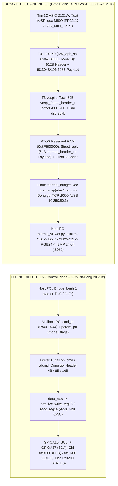
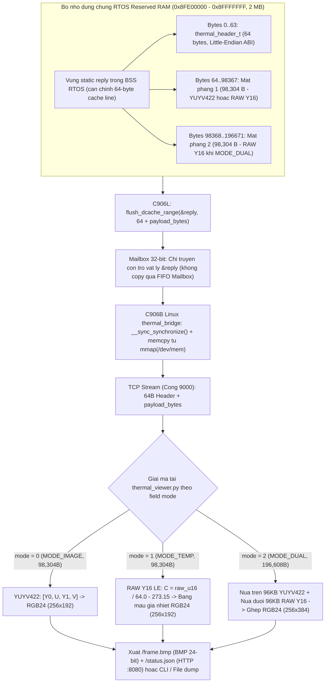

# Diagram 2: Luồng Dữ Liệu & Cấu Trúc Gói Tin (Data Flow & Memory Layout)

Tài liệu này mô tả chi tiết đường đi, biến đổi định dạng và bố cục byte của dữ liệu từ chân vật lý của cảm biến Tiny1C cho tới ảnh hiển thị trên trình duyệt Web/CLI ở Host PC.

---

## 2.1. Tổng thể 2 luồng dữ liệu song song (Control Plane I2C5 vs Data Plane SPI0)

---

## 2.2. Cấu trúc giao dịch trên đường dây vật lý (I2C5 VDCMD & SPI0 VoSPI)

```mermaid
flowchart TD
    subgraph I2C_FMT["1. Khung truyen I2C5 VDCMD (Slave 0x3C, Big-Endian Reg16)"]
        direction LR
        I1["START + 0x78 (W)"] --> I2["Reg16 HLD: 0x9D00 (Nap dem giu) hoac EXEC: 0x1D00 (Thuc thi)"]
        I2 --> I3["8B vdcmd_std_header_t (CmdType, SubCmd, Para, Addr, Len)"]
        I3 --> I4["0..8B Data (tai 0x1D08, kich hoat lenh)"]
        I4 --> I5["Poll Reg16 0x0200 (STATUS): Bit0=BUSY, Bit1=FAIL, Bits 7:2=ERR_CODE"]
        I5 --> I6["Neu lenh doc: Doc Data tai 0x1D08.. (toi da 256B/luot)"]
    end

    subgraph SPI_FMT["2. Khung truyen SPI0 VoSPI cho 1 mat phang 96 KB (Mode 3, MSB-first)"]
        direction LR
        S1["CS LOW #1 (GPIOC17=0)"] --> S2["MOSI: 0xAA (Anh/Nhiet don) hoac 0xCC (Nhiet Dual) + 511B 0x00"]
        S2 --> S3["MISO: 480B Dummy 0x00 + 32B vospi_frame_header_t (offset 480..511)"]
        S3 --> S4["CS HIGH + delay_ms(1)"]
        S4 --> S5["CS LOW #2 (GPIOC17=0)"]
        S5 --> S6["MOSI: 98,304B dummy_fill = 0x55"]
        S6 --> S7["MISO: 98,304B Pixel Data (256 x 192 x 2 bytes)"]
        S7 --> S8["CS HIGH (GPIOC17=1)"]
    end
```

### Bố cục 32-byte `vospi_frame_header_t` (tại offset `480..511` của gói 512B trên module thật)

| Offset trong 32B Header | Trường | Ý nghĩa thực tế |
| :---: | :--- | :--- |
| `0` | `frame_valid` | `bit 0 == 1` là khung hợp lệ (loại trừ trường hợp toàn `0xFF` do hở MISO). |
| `2..3` | `frame_index` (`uint16 LE`) | Chỉ số khung hình tăng dần từ ASIC (dùng phát hiện rớt khung & kiểm tra lệch `AA/CC`). |
| `4` | `shutter_state` | `0`: Màn trập đóng (đang FFC), `1`: Màn trập mở. |
| `5..6` | `vtemp` (`uint16 LE`) | Giá trị cảm biến nhiệt nội bộ FPA (ví dụ `9226..9344`). |
| `9` | `gain_state` | `1`: High Gain, `0`: Low Gain. |
| `12` | `pix_freeze_state` | `1`: Khung đang đóng băng (trong lúc FFC), `0`: Bình thường. |

---

## 2.3. Chuyển tiếp bộ nhớ liên nhân & cấu trúc gói tin TCP (`thermal_header_t` + Payload)

### Bố cục 64-byte `thermal_header_t` (Little-Endian ABI)

| Byte Offset | Trường | Kiểu | Mô tả |
| :---: | :--- | :---: | :--- |
| `0..11` | `magic`, `version`, `header_bytes` | `uint32[3]` | `0x314D4854` (`'THM1'`), `1`, `64`. |
| `12..15` | `status` | `int32` | `0` = thành công; `< 0` = mã lỗi (`-5` I2C/probe, `-16` VDCMD `0x0200`, `-11` chưa start, `-2/-3/-4` VoSPI). |
| `16..35` | `seq`, `mode`, `width`, `height`, `payload_bytes` | `uint32[5]` | Số thứ tự khung, chế độ (`0/1/2`), `256`, `192` hoặc `384`, `0` / `98304` / `196608`. |
| `36..55` | `timestamp_ms`, `index_image`, `index_temp`, `flags`, `vtemp` | `uint32[5]` | Mốc thời gian `rdtime`, chỉ số khung `AA`/`CC`, cờ (`HIGH_GAIN`, `FROZEN`, `SHUTTER_CLOSED`, `DUAL_INDEX_MISMATCH`), nhiệt FPA (hoặc dữ liệu chẩn đoán `0x0200`/`cmd_echo`/`rx_dummy` khi `status < 0`). |
| `56..63` | `reserved[0..1]` | `uint32[2]` | Chẩn đoán I2C: `reserved[0]` = mã `BB_*` có dấu; `reserved[1]` = `(stage << 24) \| (nack_phase << 16) \| reg`. |
