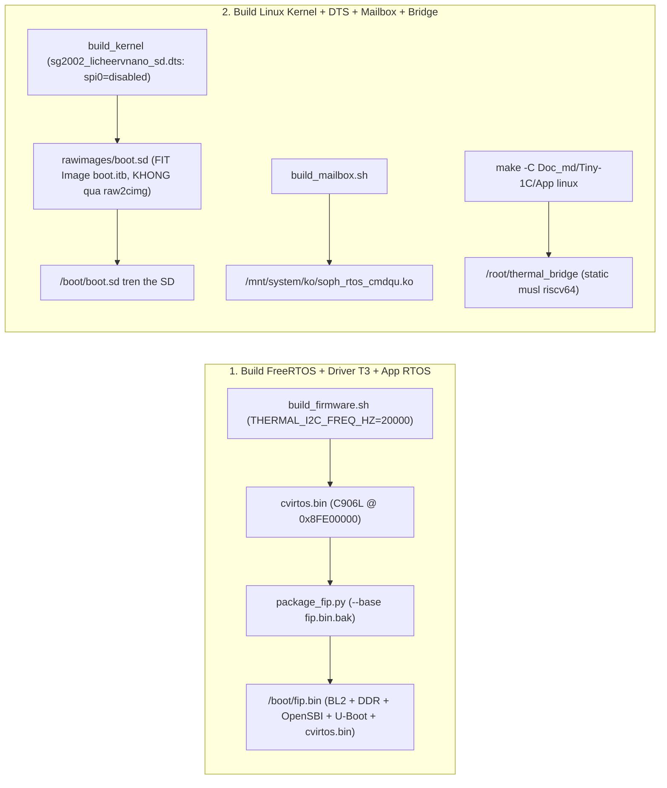

# Diagram 3: Tổng Quan Kiến Trúc Hệ Thống (System Architecture Overview)

Tài liệu này cung cấp cái nhìn toàn cảnh về kiến trúc phân tầng **T0 → T1 → T2 → T3 → App** của hệ thống camera nhiệt Tiny1C trên nền tảng dị thể 2 nhân **SG2002 (C906L FreeRTOS + C906B Linux)** kết nối với **Host PC**.

---

## 3.1. Sơ đồ kiến trúc tổng thể từ Tầng 0 đến Tầng App

```mermaid
flowchart TB
    subgraph PC["MIEN 4: HOST PC (Ubuntu / Client)"]
        WEB["Trinh duyet Web (http://127.0.0.1:8080) hoac Terminal CLI / Tkinter"]
        VIEWER["App Viewer: thermal_viewer.py (CameraWorker auto-reconnect, giai ma Y16/YUYV -> BMP, HTTP Server)"]
        WEB <--> VIEWER
    end

    subgraph LINUX["MIEN 3: NHAN CHINH C906B - LINUX 5.10 (boot.sd FIT Image, spi0 = disabled)"]
        L_APP["App Linux User-Space: /root/thermal_bridge (flock owner lock, TCP Server 0.0.0.0:9000, mmap /dev/mem)"]
        L_KO["Kernel Driver: soph_rtos_cmdqu.ko (/dev/cvi-rtos-cmdqu, rtos_cmdqu_send_wait poll 5ms)"]
        L_MEM["/dev/mem -> Anh xa RTOS Reserved RAM (0x8FE00000 .. 0x8FFFFFFF)"]
        L_APP <--> L_KO
        L_APP <--> L_MEM
    end

    subgraph RTOS["MIEN 2: NHAN PHU C906L - FREERTOS (fip.bin -> cvirtos.bin @ 0x8FE00000)"]
        subgraph APP_RTOS["Tang App RTOS (freertos/cvitek)"]
            COMM["comm_main.c: prvCmdQuRunTask + comm_poll_mailbox()"]
            THM_SVC["tiny1C/rtos/thermal_service.c: thermal_service_task (Dieu phoi START/CAPTURE/STOP/FFC/INFO + Buffer reply)"]
            COMM <--> THM_SVC
        end

        subgraph T3["Tang 3: Camera Driver (freertos/cvitek/driver/sensor/tiny1C)"]
            CORE["core.c (core_init, core_start, core_stop, trigger_shutter, probe)"]
            FALCON["falcon_cmd.c + vdcmd.c (Tap lenh ASIC-2121W, Mutex tinh, Short/Std/Long Cmd)"]
            DATARW["data_rw.c (I2C Reg16, poll 0x0200, rdtime 25MHz, diag)"]
            VOSPI["vospi.c + hal_spi.c (512B Header scan 64..480, chong 0xFF, 96KB/192KB Payload)"]
            CORE --> FALCON --> DATARW
            CORE --> VOSPI
        end

        subgraph T2["Tang 2: Driver Core (freertos/cvitek/driver)"]
            S_I2C["soft_i2c.c (soft_i2c_init, read_reg16, write_reg16, recover, Mutex)"]
            S_SPI["spi.c (spi_bus_init, spi_transfer_one, chon POLL/IRQ/DMA, Mutex)"]
        end

        subgraph T1["Tang 1: HAL Core (freertos/cvitek/hal/cv181x)"]
            H_I2C["hal_i2c_bitbang.c (May trang thai I2C bit-bang, clock stretching, nack_phase)"]
            H_SPI["hal_dw_spi.c (Dieu khien thanh ghi DW_apb_ssi: CTRLR0=0xC7, BAUDR=16, FIFO poll/IRQ/DMA)"]
        end

        subgraph T0["Tang 0: Platform & MMIO (freertos/cvitek/hal/cv181x)"]
            P_I2C["hal_i2c_gpio_platform.c (GPIOA15/A27 open-drain, IOBLK 0x03001908/1924 = 0x44 PU)"]
            P_SPI["hal_spi_platform_io.c + hal_spi_platform.c (CLK/RST SPI0, mo khoa DSI D-PHY 0x0A0D1000, Pinmux FPC2, CS GPIOC17)"]
        end

        THM_SVC --> CORE
        THM_SVC --> VOSPI
        DATARW --> S_I2C --> H_I2C --> P_I2C
        VOSPI --> S_SPI --> H_SPI --> P_SPI
    end

    subgraph HW["MIEN 1: PHAN CUNG VAT LY (SG2002 <-> Tiny1C ASIC-2121W)"]
        HW_I2C["Bus I2C5 (3.3V, 20 kHz): GPIOA15 (SCL) + GPIOA27 (SDA) -> Slave 0x3C"]
        HW_SPI["Bus SPI0 VoSPI (FPC2 1.8V, 11.71875 MHz, Mode 3): FPC2.15 SCK, FPC2.14 CS, FPC2.18 MOSI, FPC2.17 MISO"]
        TINY1C["Module InfiRay Tiny1C (Cam bien nhiet 256x192 + ISP ASIC-2121W + Man trap FFC)"]
        HW_I2C <--> TINY1C
        HW_SPI <--> TINY1C
    end

    VIEWER <== "TCP :9000 qua USB Ethernet 10.250.50.1 (0.57ms) hoac Wi-Fi" ==> L_APP
    L_KO <== "Hardware Mailbox SG2002" ==> COMM
    L_MEM -. "Zero-copy Shared RAM 0x8FE00000" .- THM_SVC
    P_I2C <== "MMIO GPIOA 0x03020000" ==> HW_I2C
    P_SPI <== "MMIO SPI0 0x04180000 + GPIOC 0x03022000" ==> HW_SPI
```

---

## 3.2. Phân chia tài nguyên phần cứng giữa 2 nhân (Resource Ownership)

Để tránh xung đột phần cứng giữa Linux (C906B) và FreeRTOS (C906L), hệ thống áp dụng ranh giới sở hữu rõ ràng:

| Tài nguyên phần cứng | Chủ sở hữu | Cấu hình cô lập & ghi chú |
| :--- | :---: | :--- |
| **SPI0 (`0x04180000`) & `PAD_MIPI_TX*` (FPC2 14/15/17/18)** | **FreeRTOS C906L** | Linux DTS đặt `&spi0 { status = "disabled"; };` (nạp qua `rawimages/boot.sd` FIT Image). RTOS mở khóa MIPI DSI D-PHY Bypass (`0x0A0D1000`), mux `SPI0` (Func 6) và `GPIOC17` CS (Func 3). |
| **I2C5 (`GPIOA15` SCL, `GPIOA27` SDA)** | **FreeRTOS C906L** | Linux tắt `i2c5`. T0 Soft-I2C chỉ khởi tạo khi `thermal_bridge` xác nhận cờ `--resources-owned` (`THERMAL_GPIO_OWNED`); bật pull-up nội (`0x44`) và giữ kiểu open-drain. |
| **RTOS Reserved RAM (`0x8FE00000..0x8FFFFFFF`)** | **C906L ghi / C906B đọc** | C906L chứa firmware `cvirtos.bin` + buffer `reply` (tối đa `64 + 196,608 B`) và `flush_dcache_range` trước khi trả Mailbox. C906B Linux chỉ đọc qua `mmap(/dev/mem)` sau khi nhận phản hồi Mailbox. |
| **Hardware Mailbox (`rtos_cmdqu`)** | **Dùng chung 2 nhân** | Kênh `THERMAL_IP`: Linux gọi `rtos_cmdqu_send_wait` (polling 5 ms), RTOS gọi `comm_poll_mailbox()` trong `prvCmdQuRunTask` (không sửa nhân `freertos/Source/...`). |
| **Mạng USB Ethernet (`usb0` = `10.250.50.1`) / Wi-Fi (`wlan0`)** | **Linux C906B** | Phục vụ SSH và TCP `:9000` của `thermal_bridge` truyền gói dữ liệu sang Host PC. |

---

## 3.3. Sơ đồ đóng gói Artifact triển khai lên thẻ nhớ SD

