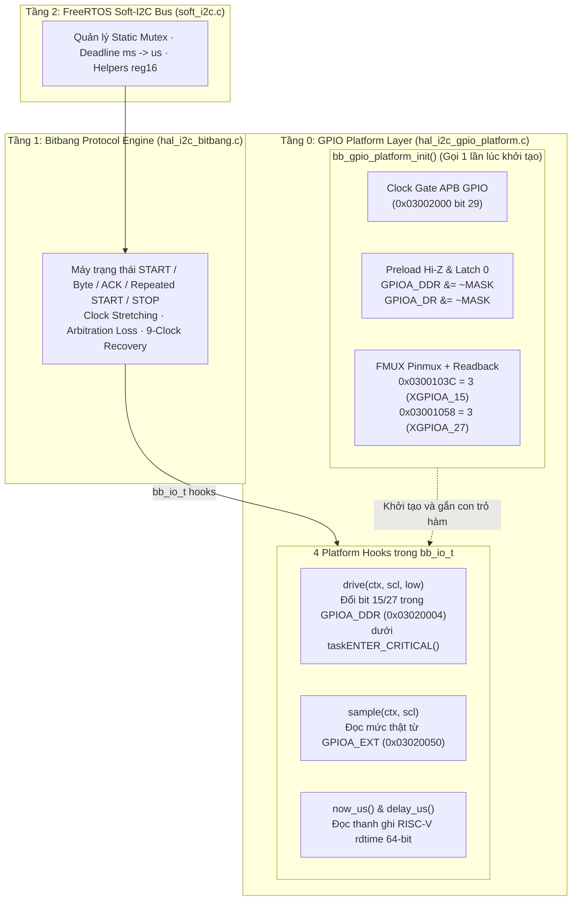

# Tài liệu Kiến trúc Chốt Tầng 0 (Platform SoC Layer) — I²C Bitbang trên SOPHGO SG2002 (CV181x)

Cập nhật chốt: **09-11-2026**  
Nền tảng phần cứng mục tiêu: **LicheeRV-Nano (SOPHGO SG2002 / CV181x — Nhân RISC-V 64-bit C906L chạy FreeRTOS, GPIOA15 = SCL, GPIOA27 = SDA)**.

---

## 1. Tổng quan Vai trò và Phạm vi của Tầng 0 (T0)

Trong kiến trúc ngăn xếp I²C Bitbang 3 tầng (`T0` $\rightarrow$ `T1` $\rightarrow$ `T2`), **Tầng 0 (Platform SoC Layer)** đóng vai trò là lớp trừu tượng phần cứng cấp hệ thống (SoC Integration Layer) kết nối giữa bộ máy trạng thái tạo xung phần mềm ở Tầng 1 (`hal_i2c_bitbang.c`) với hệ thống thanh ghi vật lý của SoC **SOPHGO SG2002**.

Tầng 0 **không** xử lý giao thức khung truyền I²C (START, STOP, địa chỉ 7-bit, ACK/NACK, Repeated START thuộc về Tầng 1) và **không** quản lý khóa tương tranh đa nhiệm (FreeRTOS Mutex thuộc về Tầng 2). Thay vào đó, Tầng 0 chịu trách nhiệm độc quyền với **4 nhóm tài nguyên phần cứng cấp SoC SG2002**:

1. **Clock Gate cho Khối GPIO (`CLKGEN`)**:
   - Mở cổng xung nhịp APB cho khối GPIO (`clk_apb_gpio` tại thanh ghi `0x03002000` bit `29`) để đảm bảo truy cập đọc/ghi các thanh ghi `GPIOA` hoạt động ổn định.
2. **Giả lập Cực máng Hở (Open-Drain Emulation) trên `GPIOA`**:
   - Khối GPIO Synopsys DesignWare (`dw_apb_gpio` tại `0x03020000`) không có chế độ phần cứng Open-Drain riêng biệt cho từng chân mà điều khiển qua cặp thanh ghi **Data Register (`GPIOA_DR` = `0x03020000`)** và **Data Direction Register (`GPIOA_DDR` = `0x03020004`)**.
   - Tầng 0 nạp cố định bit 15 và bit 27 của `GPIOA_DR` bằng `0`. Khi cần kéo đường dây xuống mức thấp (`LOW`), Tầng 0 đặt `DDR = 1` (Output 0V). Khi cần nhả đường dây lên mức cao (`HIGH`), Tầng 0 đặt `DDR = 0` (Input / Hi-Z) để điện trở kéo lên ngoài (External Pull-Up) đưa đường dây lên mức logic 1, **tuyệt đối không bao giờ phát xung mức cao chủ động (Push-Pull HIGH)** gây xung đột dòng điện với Slave.
3. **Cấu hình Pinmux Không Xung Giả (Glitch-Free Pinmux Initialization)**:
   - Nhả hướng `GPIOA_DDR` về `0` (Input) và nạp chốt `GPIOA_DR = 0` **trước khi** chuyển `FMUX` của hai chân `PAD_SPK_EN` (`0x0300103C` $\rightarrow$ `XGPIOA_15`) và `PAD_EMMC_DAT3` (`0x03001058` $\rightarrow$ `XGPIOA_27`) sang Function `3`, kèm kiểm tra đọc ngược (readback verification).
4. **Bộ đếm Thời gian Thực Monotonic (`rdtime`)**:
   - Cung cấp hai hàm hook `now_us()` và `delay_us()` dựa trên thanh ghi bộ đếm phần cứng 64-bit `time` của kiến trúc RISC-V (`__asm__ volatile("rdtime %0")`), đảm bảo thời gian nửa chu kỳ xung nhịp (`half_us`), thời gian chờ Clock Stretching (`stretch_us`) và tổng thời gian giao dịch (`deadline`) luôn chính xác tuyệt đối ngay cả khi Task bị ngắt (ISR) hoặc bộ lập lịch RTOS tạm dừng.

---

## 2. Cấu trúc File và Sơ đồ Kiến trúc Tầng 0

| File | Đường dẫn | Vai trò trong Tầng 0 |
| :--- | :--- | :--- |
| **`hal_i2c_gpio_platform.h`** | [`freertos/cvitek/hal/cv181x/i2c/include/hal_i2c_gpio_platform.h`](../../../freertos/cvitek/hal/cv181x/i2c/include/hal_i2c_gpio_platform.h) | Khai báo hàm khởi tạo nền tảng `bb_gpio_platform_init()` và hợp đồng cam kết quyền sở hữu `ownership_confirmed`. |
| **`hal_i2c_gpio_platform.c`** | [`freertos/cvitek/hal/cv181x/i2c/src/hal_i2c_gpio_platform.c`](../../../freertos/cvitek/hal/cv181x/i2c/src/hal_i2c_gpio_platform.c) | Thực thi khởi tạo phần cứng `GPIOA` (`A15`/`A27`), Pinmux, readback và xuất 4 hàm hook (`drive`, `sample`, `now_us`, `delay_us`) vào cấu trúc `bb_io_t` cho Tầng 1. |

---

## 3. Bản đồ Thanh ghi Phần cứng Tầng 0 (Đã đối chiếu TRM & SDK)

| Khối chức năng | Tên thanh ghi / Hằng số | Địa chỉ vật lý | Bit / Giá trị cấu hình | Căn cứ xác minh |
| :--- | :--- | :--- | :--- | :--- |
| **Clock Gate GPIO** | `CLK_EN_0` | `0x03002000` | Bit `29` (`1U << 29`): Mở `clk_apb_gpio` | [TRM Bảng 8-52](../../HW/TRM/TRM_v102.md) |
| **Pinmux SCL (A15)** | `PINMUX_SPK_EN` | `0x0300103C` | Bits `[2:0] = 3` (`SPK_EN__XGPIOA_15`) | [`cv181x_reg_fmux_gpio.h`](../../../freertos/cvitek/hal/cv181x/config/cv181x_reg_fmux_gpio.h) & [`cv181x_pinlist_swconfig.h`](../../../freertos/cvitek/hal/cv181x/config/cv181x_pinlist_swconfig.h) |
| **Pinmux SDA (A27)** | `PINMUX_EMMC_DAT3` | `0x03001058` | Bits `[2:0] = 3` (`EMMC_DAT3__XGPIOA_27`) | [`cv181x_reg_fmux_gpio.h`](../../../freertos/cvitek/hal/cv181x/config/cv181x_reg_fmux_gpio.h) & [`cv181x_pinlist_swconfig.h`](../../../freertos/cvitek/hal/cv181x/config/cv181x_pinlist_swconfig.h) |
| **GPIOA Data Latch** | `GPIOA_DR` (`gpio_swporta_dr`) | `0x03020000` | Bit `15` (SCL) & Bit `27` (SDA) luôn giữ bằng `0` | [TRM §21.4 GPIO](../../HW/TRM/TRM_v102.md) |
| **GPIOA Direction** | `GPIOA_DDR` (`gpio_swporta_ddr`) | `0x03020004` | Bit `15` & Bit `27`: - `1` = Output (kéo dây xuống `0V`) - `0` = Input Hi-Z (nhả dây lên `HIGH` qua trở kéo) | [TRM §21.4 GPIO](../../HW/TRM/TRM_v102.md) |
| **GPIOA External Port** | `GPIOA_EXT` (`gpio_ext_porta`) | `0x03020050` | Đọc trạng thái vật lý thực tế trên chân `A15` và `A27` | [TRM §21.4 GPIO](../../HW/TRM/TRM_v102.md) |

---

## 4. Chi tiết Thiết kế và Hoạt động của Các Hàm Tầng 0

### 4.1. Hàm Khởi tạo `bb_gpio_platform_init(bb_io_t *io, uint32_t timer_hz, bool ownership_confirmed)`

1. **Kiểm tra Điều kiện Đầu vào & Quyền Sở hữu (`Guards`)**:
   - Nếu `io == NULL` hoặc `timer_hz == 0`: trả về `BB_INVALID`.
   - Nếu `!ownership_confirmed` hoặc Tầng 0 đã được khởi tạo trước đó (`claimed == true`): trả về `BB_NOT_READY` trước khi chạm vào bất kỳ thanh ghi phần cứng nào.
2. **Trình tự Khởi tạo Không Xung Giả (Glitch-Free Sequence) trong `taskENTER_CRITICAL()`**:
   - Mở clock `0x03002000` bit `29`.
   - Xóa bit `15` và bit `27` trong `GPIOA_DDR` (`0x03020004`) về `0` (chế độ Input Hi-Z).
   - Xóa bit `15` và bit `27` trong `GPIOA_DR` (`0x03020000`) về `0` (nạp sẵn mức thấp vào thanh ghi chốt đầu ra).
   - Chuyển `FMUX` của `0x0300103C` (`A15`) và `0x03001058` (`A27`) sang Function `3` (`XGPIOA`).
3. **Đọc Kiểm chứng (`Readback Verification`)**:
   - Đọc lại cả hai thanh ghi `FMUX` (`0x0300103C` và `0x03001058`) để xác nhận giá trị bằng `3`, đồng thời đọc `GPIOA_DDR` để xác nhận cả hai chân đang ở trạng thái nhả (`(mmio_read_32(GPIOA_DDR) & MASK) == 0`). Nếu bất kỳ điều kiện nào sai, trả về `BB_NOT_READY`.
   - Đánh dấu `claimed = true` và xuất 4 con trỏ hàm (`drive`, `sample`, `time_us`, `delay_us`) ra cấu trúc `*io`.

### 4.2. Nhóm 4 Hàm Hook Phục vụ Tầng 1 (`bb_io_t`)

1. **`static void drive(void *p, bool scl, bool low)`**:
   - Chọn mặt nạ bit `1U << 15` (nếu `scl == true`) hoặc `1U << 27` (nếu `scl == false`).
   - Bảo vệ thao tác Read-Modify-Write trên thanh ghi `GPIOA_DDR` (`0x03020004`) bằng cặp `taskENTER_CRITICAL()` / `taskEXIT_CRITICAL()`:
     - `low == true`: bật bit `DDR |= bit` $\rightarrow$ chân GPIO kéo đường truyền xuống `0V`.
     - `low == false`: xóa bit `DDR &= ~bit` $\rightarrow$ chân GPIO chuyển sang Hi-Z, nhả đường truyền cho điện trở kéo ngoài đưa lên mức `HIGH`.
   - *Lưu ý:* Critical section chỉ bọc đúng 2 lệnh đọc/ghi MMIO (vài chục nano-giây), hoàn toàn không giữ khóa trong lúc delay bit hay toàn bộ byte truyền.
2. **`static bool sample(void *p, bool scl)`**:
   - Đọc trực tiếp thanh ghi `GPIOA_EXT` (`0x03020050`) và kiểm tra bit `15` hoặc `27`.
   - Cho phép Tầng 1 biết chính xác mức điện áp thực tế trên đường dây vật lý để xử lý **Clock Stretching** (Slave giữ SCL ở mức thấp), phát hiện **Arbitration Loss** (Master nhả SDA lên 1 nhưng dây vẫn bị kéo xuống 0), và đọc bit **ACK/NACK**.
3. **`static uint64_t time_us(void *p)`**:
   - Đọc thanh ghi `rdtime` 64-bit và quy đổi sang micro-giây bằng công thức chống tràn số nguyên 64-bit:
     $$\text{time\_us} = \left(\frac{t}{\text{tick\_hz}}\right) \times 10^6 + \frac{(t \bmod \text{tick\_hz}) \times 10^6}{\text{tick\_hz}}$$
4. **`static void delay_us(void *p, uint32_t us)`**:
   - Quay vòng lặp đọc `time_us(p)` cho đến khi đủ khoảng thời gian `us` yêu cầu.

---

## 5. Quyền Sở hữu Liên Nhân (Linux vs. FreeRTOS) và Lưu ý Điện học

1. **Quyền sở hữu Bank `GPIOA` giữa Linux và FreeRTOS**:
   - Node `i2c5` (sử dụng `porta 15` và `porta 27`) trong Device Tree của Linux ([`sg2002_licheervnano_sd.dts`](../../../build/boards/sg200x/sg2002_licheervnano_sd/dts_riscv/sg2002_licheervnano_sd.dts)) đã được đặt `status = "disabled"`.
   - Tuy nhiên, thanh ghi `GPIOA_DR` (`0x03020000`) và `GPIOA_DDR` (`0x03020004`) là thanh ghi 32-bit dùng chung cho toàn bộ 32 chân của Port A (trên board còn có `spi4` dùng GPIO A22..A25, `gpio-keys` dùng A30, LED dùng A14).
   - `taskENTER_CRITICAL()` trên FreeRTOS chỉ khóa ngắt nội bộ nhân C906L, không chặn được nhân C906B (Linux). Do đó, tham số `ownership_confirmed = true` là cam kết của tầng tích hợp board rằng Linux đã hoàn tất cấu hình hướng chân GPIOA trước khi RTOS chạy hoặc không thực hiện thao tác thay đổi hướng/dữ liệu trên `GPIOA` gây tranh chấp Read-Modify-Write trong lúc camera đang giao tiếp.
2. **Điện trở kéo lên (Pull-Up) và Mức Điện áp**:
   - Hai chân `A15` (`SCL`) và `A27` (`SDA`) bắt buộc phải có điện trở kéo lên ngoài (thường từ $2.2\ \text{k}\Omega$ đến $4.7\ \text{k}\Omega$).
   - Nếu miền I/O của GPIOA là `3.3V` và mạch giao tiếp cảm biến Tiny1C dùng `1.8V`, bắt buộc phải sử dụng mạch dịch mức hai chiều hỗ trợ Open-Drain (Bidirectional Level Shifter); tuyệt đối không kéo thẳng điện trở `3.3V` vào chân `1.8V` của cảm biến.
