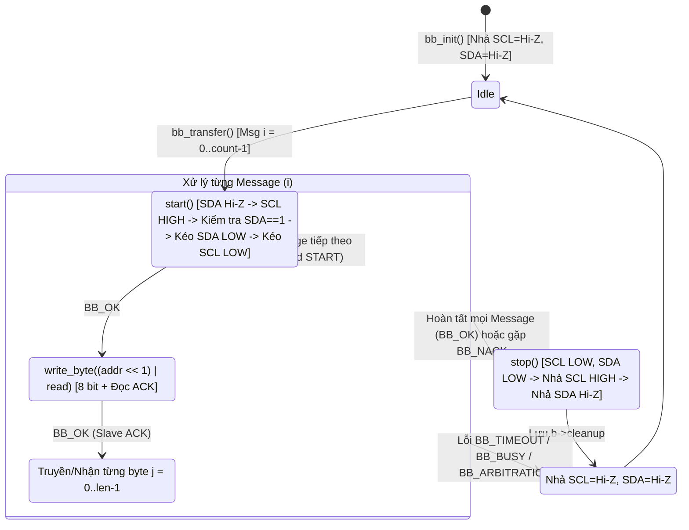

# Tài liệu Kiến trúc Chốt Tầng 1 (Bitbang Controller HAL) — I²C Software Master trên SOPHGO SG2002

Cập nhật chốt: **09-11-2026**  
Nền tảng phần cứng mục tiêu: **LicheeRV-Nano (SOPHGO SG2002 / CV181x — Giao thức I²C Master thuần phần mềm độc lập phần cứng)**.

---

## 1. Vai trò và Ranh giới của Tầng 1 (T1)

Trong kiến trúc I²C Bitbang 3 tầng (`T0` $\rightarrow$ `T1` $\rightarrow$ `T2`), **Tầng 1 (Bitbang Controller HAL Layer)** là bộ máy trạng thái thực thi giao thức đường dây I²C Master thuần phần mềm (`hal_i2c_bitbang.c` và `hal_i2c_bitbang.h`):

- **Trách nhiệm của T1:**
  1. Quản lý trực tiếp trình tự tín hiệu vật lý của giao thức I²C: phát điều kiện **START**, **Repeated START**, **STOP**, truyền/nhận từng bit theo thứ tự MSB-first, kiểm tra bit **ACK/NACK** sau mỗi byte ghi và phát **ACK** (hoặc **NACK** ở byte cuối cùng) khi đọc.
  2. Hỗ trợ xử lý **Clock Stretching**: khi nhả đường `SCL` lên mức cao, T1 đọc lại mức thực tế trên dây và chờ nếu Slave đang giữ `SCL` ở mức thấp trong phạm vi `stretch_us` và `deadline` tổng của phiên.
  3. Giám sát tính toàn vẹn của đường truyền tại từng bit: phát hiện **Bus Busy** (khi `SDA` bị kẹt thấp lúc tạo START/STOP) và **Arbitration Loss** (khi Master nhả `SDA` lên 1 nhưng đọc về 0 trong lúc truyền bit dữ liệu/địa chỉ).
  4. Cung cấp quy trình **Cứu hộ Bus (`bb_recover`)**: phát tối đa 9 xung nhịp `SCL` kèm điều kiện `STOP` để giải phóng Slave đang bị treo giữ đường `SDA` ở mức thấp.

- **Ranh giới phân định (Boundary):**
  - **T1 KHÔNG phụ thuộc:** FreeRTOS (`FreeRTOS.h`, `semphr.h`, `task.h`) hay địa chỉ thanh ghi MMIO của SoC SG2002. Nhờ đó, T1 có thể chạy kiểm thử đơn vị (Unit Test) trực tiếp trên máy trạm x86_64 thông qua bộ hook giả lập (`wire_t`).
  - **T1 KHÔNG sở hữu:** Khóa Mutex đa nhiệm hay quy ước đóng gói thanh ghi 16-bit của cảm biến (thuộc về **Tầng 2**).
  - **T1 KHÔNG tự động phát lại (No Auto-Retry):** Nếu gặp `BB_NACK` hoặc `BB_TIMEOUT` giữa chừng, T1 không tự động gửi lại gói tin vì lệnh phần cứng (như đóng màn trập FFC hoặc ghi Flash trên camera Tiny1C) có thể đã được Slave tiếp nhận trước khi lỗi xảy ra.

```mermaid
flowchart TB
    T2["Tầng 2: soft_i2c.c (FreeRTOS Bus Driver)\nStatic Mutex · Deadline ms -> us · read_reg16 / write_reg16"] -->|bb_init / bb_transfer / bb_recover| T1["Tầng 1: hal_i2c_bitbang.c (Software I2C Master)\nSTART · Repeated START · write_byte · read_byte · STOP"]
    T1 --> S["high(): Chờ Clock Stretching (stretch_us & deadline)"]
    T1 --> B["send_bit() / recv_bit(): Kiểm tra Arbitration Loss & ACK/NACK"]
    T1 --> R["bb_recover(): Tạo tối đa 9 xung SCL + STOP"]
    T1 -->|4 Platform Hooks (bb_io_t)| T0["Tầng 0: hal_i2c_gpio_platform.c\ndrive(A15/A27 DDR) · sample(GPIOA_EXT) · now_us/delay_us(rdtime)"]
```

---

## 2. Các Cấu trúc Dữ liệu và Mã Trạng thái của Tầng 1

Toàn bộ định nghĩa nằm trong [`freertos/cvitek/hal/cv181x/i2c/include/hal_i2c_bitbang.h`](../../../freertos/cvitek/hal/cv181x/i2c/include/hal_i2c_bitbang.h):

### 2.1. Bảng Mã Trạng thái (`bb_status_t`)

| Mã trả về | Giá trị | Ý nghĩa & Hành vi trên đường dây |
| :--- | :---: | :--- |
| **`BB_OK`** | `0` | Toàn bộ các thông điệp (`bb_msg_t`) và điều kiện `STOP` cuối phiên đã hoàn tất thành công. |
| **`BB_INVALID`** | `-1` | Tham số đầu vào không hợp lệ (con trỏ `NULL`, `hz` ngoài dải `1..100 kHz`, `addr > 0x7F`, đọc `len == 0`). Được kiểm tra trước khi chạm vào đường dây. |
| **`BB_TIMEOUT`** | `-2` | Quá hạn `deadline` toàn giao dịch hoặc Slave giữ `SCL` thấp vượt quá `stretch_us`. T1 lập tức nhả cả hai dây `SCL` và `SDA` về Hi-Z. |
| **`BB_NACK`** | `-3` | Slave không kéo `SDA` xuống thấp ở nhịp clock thứ 9 (NACK địa chỉ hoặc NACK dữ liệu). T1 dừng truyền và phát `STOP` để đóng phiên an toàn. |
| **`BB_BUSY`** | `-4` | Đường `SDA` đang bị giữ ở mức thấp khi bắt đầu tạo `START`, khi kết thúc `STOP`, hoặc sau khi đã chạy đủ 9 xung `bb_recover()`. |
| **`BB_ARBITRATION`** | `-5` | Mất quyền phân xử bus: Master nhả `SDA` lên mức 1 nhưng đọc về mức 0. T1 nhả ngay cả 2 dây và **không** phát `STOP` để tránh phá hỏng giao dịch của thiết bị khác. |
| **`BB_NOT_READY`** | `-6` | Tầng 0 hoặc Tầng 2 chưa được khởi tạo hợp lệ hoặc chưa xác nhận quyền sở hữu phần cứng. |

### 2.2. Cấu trúc Hook Phần cứng (`bb_io_t`), Thông điệp (`bb_msg_t`) và Master (`bb_master_t`)

```c
typedef struct {
    void *ctx;
    void (*drive)(void *, bool scl, bool low); /* scl=true: SCL, false: SDA; low=true: kéo 0V, false: nhả Hi-Z */
    bool (*sample)(void *, bool scl);          /* Đọc mức logic thực tế trên chân SCL hoặc SDA */
    uint64_t (*now_us)(void *);                /* Thời gian thực monotonic tính bằng micro-giây */
    void (*delay_us)(void *, uint32_t);        /* Trì hoãn micro-giây */
} bb_io_t;

typedef struct {
    uint8_t addr;  /* Địa chỉ Slave 7-bit (0x00..0x7F; ví dụ Tiny1C là 0x3C, KHÔNG truyền 0x78) */
    bool read;     /* false = Ghi (R/W=0), true = Đọc (R/W=1) */
    uint8_t *data; /* Bộ đệm dữ liệu (có thể NULL nếu len==0 và read==false để probe địa chỉ) */
    size_t len;    /* Số byte dữ liệu cần truyền/nhận */
} bb_msg_t;

typedef struct {
    bb_io_t io;          /* Bảng hàm hook nối xuống Tầng 0 */
    uint32_t half_us;    /* Thời gian nửa chu kỳ xung SCL: ceil(500000 / hz) */
    uint32_t stretch_us; /* Thời gian tối đa chờ Slave nhả SCL trong mỗi xung nhịp */
    uint64_t deadline;   /* Thời điểm hết hạn của toàn bộ phiên truyền (micro-giây) */
    bb_status_t cleanup; /* Lưu riêng kết quả phát STOP cuối phiên mà không che khuất lỗi gốc */
} bb_master_t;
```

---

## 3. Máy Trạng thái Giao thức và Chi tiết Từng Nguyên tử Đường dây



### 3.1. Tính toán Tốc độ Xung nhịp (`bb_init`)
- Chấp nhận tần số yêu cầu `hz` trong dải Standard-mode (`1000 Hz` .. `100000 Hz`).
- Nửa chu kỳ xung nhịp `half_us` được làm tròn lên để tần số thực tế trên dây không bao giờ vượt quá giới hạn tối đa mà caller yêu cầu:
  $$\text{half\_us} = \left\lfloor \frac{500000 + \text{hz} - 1}{\text{hz}} \right\rfloor$$
  Với `hz = 100000` ($100\ \text{kHz}$), `half_us = 5 us` (chu kỳ $T = 10\ \mu\text{s}$).

### 3.2. Nhả `SCL` và Chờ Clock Stretching (`high`)
1. Gọi `line(b, true, false)` để nhả chân `SCL` về trạng thái Hi-Z.
2. Vòng lặp kiểm tra `level(b, true)`:
   - Nếu Slave đang giữ `SCL` ở mức thấp (`level == false`), T1 kiểm tra đồng thời hai giới hạn thời gian:
     - `now(b) >= b->deadline` (quá hạn tổng thời gian của cả giao dịch), hoặc
     - `now(b) - start >= b->stretch_us` (Slave giữ clock quá lâu).
   - Nếu vượt một trong hai ngưỡng, trả về `BB_TIMEOUT` ngay lập tức. Ngược lại, chờ từng bước $1\ \mu\text{s}$.
3. Khi `SCL` đã thực sự lên mức cao (`level == true`), chờ đủ `pause_bit(b)` (`half_us`) rồi kiểm tra lại `deadline` lần cuối trước khi trả về `BB_OK`.

### 3.3. Điều kiện `START` / `Repeated START` (`start`) và `STOP` (`stop`)
- **Trong `start(b)`:**
  - Nhả `SDA` lên Hi-Z, chờ `half_us`, sau đó đưa `SCL` lên mức cao qua `high(b)`. (Trình tự này đảm bảo hoạt động đúng cho cả `START` đầu tiên lẫn `Repeated START` khi `SCL` đang ở mức thấp sau nhịp ACK trước đó).
  - Kiểm tra `level(b, false)`: nếu `SDA` đang bị kẹt ở mức `0`, trả về `BB_BUSY` mà không kéo `SCL` xuống.
  - Kéo `SDA` xuống `0` trong khi `SCL` đang `1`, chờ `half_us`, rồi kéo `SCL` xuống `0` để khóa bus.
- **Trong `stop(b)`:**
  - Đảm bảo cả `SCL` và `SDA` đang ở mức `0`, chờ `half_us`.
  - Đưa `SCL` lên mức `1` qua `high(b)`, sau đó nhả `SDA` lên mức `1` (tạo sườn lên trên `SDA` khi `SCL` đang cao) và chờ `half_us`.
  - Đọc kiểm chứng `level(b, false)`: nếu `SDA` đã lên mức `1` thì trả về `BB_OK`, ngược lại trả về `BB_BUSY`.

### 3.4. Truyền/Nhận Byte, Kiểm tra Arbitration và Quy tắc ACK/NACK
- **`send_bit(b, bit)`:** Đặt `SDA` theo `bit` khi `SCL` thấp, chờ `half_us`, nâng `SCL` lên cao qua `high(b)`. Nếu `bit == 1` nhưng đọc lại `level(b, false) == 0`, phát hiện mất quyền phân xử và trả về `BB_ARBITRATION`. Cuối cùng kéo `SCL` xuống thấp.
- **`write_byte(b, v)`:** Dịch 8 bit từ MSB đến LSB qua `send_bit()`, sau đó gọi `recv_bit(b, &nack)` ở xung thứ 9. Nếu `nack == true` (dây `SDA` ở mức 1), trả về `BB_NACK`.
- **`read_byte(b, *v, last)`:** Đọc 8 bit từ MSB đến LSB qua `recv_bit()`, sau đó phát bit thứ 9 qua `send_bit(b, last)`:
  - Các byte đầu (`last == false`): phát `0` (**ACK**) để yêu cầu Slave gửi byte tiếp theo.
  - Byte cuối cùng của thông điệp (`last == true`): phát `1` (**NACK**) để báo cho Slave ngừng phát dữ liệu, nhả đường `SDA` cho Master tạo `STOP` hoặc `Repeated START`.

### 3.5. Cơ chế Cứu hộ Bus (`bb_recover`)
Khi một giao dịch trước đó bị gián đoạn (ví dụ Master bị reset giữa chừng hoặc timeout khi đang đọc), Slave có thể vẫn đang giữ `SDA = 0`:
1. `bb_recover()` nhả `SDA` về Hi-Z (`line(b, false, false)`).
2. Chạy vòng lặp tối đa `9` lần trong khi `SDA` vẫn ở mức thấp (`!level(b, false)`):
   - Kéo `SCL` xuống `0`, chờ `half_us`, rồi nhả `SCL` lên `1` qua `high(b)`.
   - Ngay khi Slave nhả `SDA` lên mức `1`, vòng lặp dừng sớm.
3. Gọi `stop(b)` để phát điều kiện `STOP` chuẩn hóa trạng thái bus và kiểm tra `SDA` đã thực sự ở mức cao. Nếu sau 9 xung mà `SDA` vẫn kẹt ở mức `0`, `stop(b)` trả về `BB_BUSY`.

---

## 4. Trạng thái Xác minh Kỹ thuật

1. **Host Unit Tests ([`run.sh`](../../../freertos/cvitek/hal/cv181x/i2c/tests/run.sh)):**
   - Đạt **100% PASS** trên toàn bộ các kịch bản đường dây: Đọc kết hợp 16-bit register + Repeated START + ACK/NACK cuối, NACK địa chỉ, Clock Stretching hợp lệ & quá hạn, SCL bị kẹt thấp, mất quyền phân xử (`BB_ARBITRATION`), bus bận (`BB_BUSY`), cứu hộ 9 xung thành công/thất bại và kiểm tra tham số sai.
2. **Cross-Compilation RISC-V 64-bit ([`compile-riscv.sh`](../../../freertos/cvitek/hal/cv181x/i2c/tests/compile-riscv.sh)):**
   - Biên dịch thành công với `riscv64-unknown-elf-gcc` cùng các cờ nghiêm ngặt `-Wall -Wextra -Werror`, **0 error, 0 warning**.
