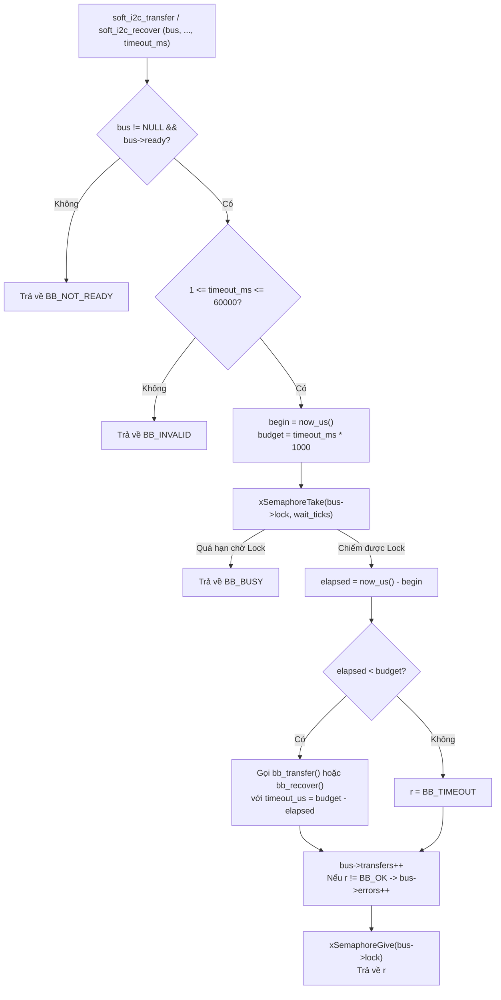

# Tài liệu Kiến trúc Chốt Tầng 2 (RTOS Soft-I²C Bus Driver Layer) — Điều phối Bus & Thanh ghi 16-bit trên SOPHGO SG2002

Cập nhật chốt: **09-11-2026**  
Nền tảng mục tiêu: **LicheeRV-Nano (SOPHGO SG2002 / CV181x — Nhân RISC-V 64-bit C906L chạy FreeRTOS)**.

---

## 1. Vai trò và Ranh giới của Tầng 2 (T2)

Trong kiến trúc I²C Bitbang 3 tầng (`T0` $\rightarrow$ `T1` $\rightarrow$ `T2` $\rightarrow$ `T3 Tiny1C VDCMD Driver`), **Tầng 2 (RTOS Soft-I²C Bus Driver Layer)** đóng gói bộ máy trạng thái bitbang của Tầng 1 (`hal_i2c_bitbang.c`) thành giao diện lập trình RTOS an toàn đa luồng (Thread-Safe Public API) phục vụ trực tiếp cho giao thức điều khiển lệnh Vendor Command (VDCMD) của cảm biến nhiệt Tiny1C ở Tầng 3:

```
+-----------------------------------------------------------------------------------+
| Tầng 3: Tiny1C Control Driver (VDCMD: short_cmd, standard_cmd, long_cmd)          |
|   -> Gọi các hàm Public API: soft_i2c_read_reg16, soft_i2c_write_reg16, recover   |
+-----------------------------------------------------------------------------------+
                                         │
                                         ▼
+-----------------------------------------------------------------------------------+
| Tầng 2: RTOS Soft-I2C Bus Layer (driver/i2c/src/soft_i2c.c & include/soft_i2c.h)  |
|   • Bảo vệ đa nhiệm bằng FreeRTOS Static Mutex (không cấp phát Heap).             |
|   • Quản lý ngân sách thời gian thực (timeout_ms = Chờ Mutex + Truyền trên dây).  |
|   • Đóng gói nguyên tử giao dịch Thanh ghi 16-bit MSB-first (Big-Endian).         |
|   • Hỗ trợ ghi payload tới 256 byte qua bộ đệm tĩnh trên Stack (258 byte).        |
|   • Thống kê số lượng giao dịch (transfers) và số lỗi phát sinh (errors).         |
+-----------------------------------------------------------------------------------+
                                         │
                                         ▼
+-----------------------------------------------------------------------------------+
| Tầng 1: Bitbang Controller HAL (hal_i2c_bitbang.c) — Software I2C Master Engine   |
+-----------------------------------------------------------------------------------+
                                         │
                                         ▼
+-----------------------------------------------------------------------------------+
| Tầng 0: GPIO Platform SoC (hal_i2c_gpio_platform.c) — GPIOA15/A27 & rdtime        |
+-----------------------------------------------------------------------------------+
```

- **Trách nhiệm của Tầng 2:**
  1. **An toàn đa luồng (Thread-Safety):** Sử dụng `StaticSemaphore_t` (`xSemaphoreCreateMutexStatic`) để bảo vệ độc quyền bus vật lý trong suốt một giao dịch (bao gồm cả các thông điệp ghép có `Repeated START`).
  2. **Quản lý Ngân sách Thời gian Thống nhất (`timeout_ms`):** Quy đổi `timeout_ms` (từ `1` đến `60000 ms`) thành số tick FreeRTOS để chờ Mutex, sau đó trừ đi phần thời gian thực đã tiêu tốn trong lúc chờ khóa rồi mới truyền phần ngân sách micro-giây còn lại (`budget - elapsed`) xuống Tầng 1.
  3. **Trợ năng Thanh ghi 16-bit (`reg16` Helpers):** Cung cấp hai hàm chuyên biệt [`soft_i2c_read_reg16()`](../../../freertos/cvitek/driver/i2c/src/soft_i2c.c#L33-L39) và [`soft_i2c_write_reg16()`](../../../freertos/cvitek/driver/i2c/src/soft_i2c.c#L40-L46) khớp trực tiếp với chuẩn CCI 16-bit Big-Endian của Tiny1C (`0x1D00`, `0x9D00`, `0x0200`).
  4. **Độc lập với ABI Legacy (`i2c.h`):** Đặt tên tiền tố `soft_i2c_*` và cấu trúc `soft_i2c_bus_t` tách biệt hoàn toàn với driver Synopsys DW I²C phần cứng cũ (`hal_dw_i2c.c` / `i2c.c`), không gây xung đột ký hiệu khi liên kết toàn bộ firmware `cvirtos.elf`.

---

## 2. Cấu trúc Dữ liệu Cốt lõi của Tầng 2 (`soft_i2c_bus_t`)

Được khai báo trong [`freertos/cvitek/driver/i2c/include/soft_i2c.h`](../../../freertos/cvitek/driver/i2c/include/soft_i2c.h):

```c
typedef struct {
    bb_master_t master;               /* Đối tượng điều khiển giao thức Tầng 1 */
    StaticSemaphore_t lock_storage;   /* Bộ nhớ tĩnh của FreeRTOS Mutex (không dùng Heap) */
    SemaphoreHandle_t lock;           /* Handle khóa Mutex bảo vệ bus */
    bool ready;                       /* Đánh dấu bus đã khởi tạo thành công */
    uint32_t transfers, errors;       /* Bộ đếm tổng số phiên và số phiên lỗi (cập nhật dưới lock) */
} soft_i2c_bus_t;
```

---

## 3. Các Cơ chế Vận hành Cốt lõi của Tầng 2

### 3.1. Cơ chế Quản lý Ngân sách Thời gian Thực (Unified Timeout Budget)

Trong hàm nội bộ [`run()`](../../../freertos/cvitek/driver/i2c/src/soft_i2c.c#L14-L28), một lời gọi với tham số `timeout_ms` (hợp lệ từ `1` đến `60000 ms`) được kiểm soát chặt chẽ qua 4 bước:
1. Ghi nhận mốc thời gian bắt đầu thực tế từ T0: `begin = now_us()`, và tính tổng ngân sách micro-giây: `budget = ms * 1000`.
2. Tính số tick chờ Mutex làm tròn lên:
   $$\text{wait\_ticks} = \left\lfloor \frac{\text{ms} \times \text{configTICK\_RATE\_HZ} + 999}{1000} \right\rfloor$$
3. Gọi `xSemaphoreTake(b->lock, wait_ticks)`:
   - Nếu không lấy được khóa trong thời gian chờ, trả về ngay **`BB_BUSY`**.
4. Sau khi chiếm được Mutex, đo lại thời gian thực đã trôi qua `elapsed = now_us() - begin`:
   - Nếu `elapsed >= budget` (thời gian chờ khóa đã ngốn hết ngân sách), T2 **không** phát bất kỳ xung nào ra dây mà trả về **`BB_TIMEOUT`** ngay.
   - Nếu `elapsed < budget`, T2 gọi xuống T1 (`bb_transfer` hoặc `bb_recover`) với đúng phần ngân sách còn lại `budget - elapsed`.



### 3.2. Các Hàm Helper Thanh ghi 16-bit (`soft_i2c_read_reg16` & `soft_i2c_write_reg16`)

1. **`soft_i2c_read_reg16(bus, addr, reg, data, len, timeout_ms)`**:
   - Tách địa chỉ thanh ghi 16-bit theo chuẩn Big-Endian: `index[0] = reg >> 8`, `index[1] = reg & 0xFF`.
   - Khởi tạo mảng 2 thông điệp `bb_msg_t m[2]`:
     - `m[0]`: `{addr, read = false, data = index, len = 2}` (Ghi địa chỉ thanh ghi 16-bit).
     - `m[1]`: `{addr, read = true,  data = data,  len = len}` (Phát `Repeated START` và đọc `len` byte dữ liệu).
   - Thực thi nguyên tử cả 2 thông điệp dưới một lần giữ khóa Mutex duy nhất qua `soft_i2c_transfer(b, m, 2, timeout_ms)`.
2. **`soft_i2c_write_reg16(bus, addr, reg, data, len, timeout_ms)`**:
   - Kiểm tra `data != NULL` và `1 <= len <= 256`.
   - Ghép 2 byte địa chỉ thanh ghi (`reg >> 8`, `reg & 0xFF`) và `len` byte payload vào mảng cục bộ trên Stack `uint8_t buffer[258]` để phát đi trong **1 thông điệp ghi duy nhất** (`START -> addr+W -> reg_hi -> reg_lo -> data[0..len-1] -> STOP`), tuyệt đối không chèn `STOP` hay `Repeated START` giữa địa chỉ thanh ghi và dữ liệu ghi.

---

## 4. Danh mục Public API Tầng 2

| Hàm | Tác dụng |
| :--- | :--- |
| [`soft_i2c_init`](../../../freertos/cvitek/driver/i2c/src/soft_i2c.c#L6-L13) | Khởi tạo đối tượng `soft_i2c_bus_t`, cấu hình `bb_master_t` ở T1 và tạo FreeRTOS Static Mutex. |
| [`soft_i2c_transfer`](../../../freertos/cvitek/driver/i2c/src/soft_i2c.c#L29-L30) | Thực thi nguyên tử một mảng thông điệp `bb_msg_t` dưới khóa Mutex với ngân sách `timeout_ms`. |
| [`soft_i2c_recover`](../../../freertos/cvitek/driver/i2c/src/soft_i2c.c#L31-L32) | Chiếm khóa Mutex và phát tối đa 9 xung `SCL` kèm `STOP` để giải cứu đường dây `SDA` bị kẹt. |
| [`soft_i2c_read_reg16`](../../../freertos/cvitek/driver/i2c/src/soft_i2c.c#L33-L39) | Ghi chỉ số thanh ghi 16-bit MSB-first, phát `Repeated START` và đọc khối dữ liệu phản hồi. |
| [`soft_i2c_write_reg16`](../../../freertos/cvitek/driver/i2c/src/soft_i2c.c#L40-L46) | Gộp chỉ số thanh ghi 16-bit MSB-first và tối đa 256 byte dữ liệu vào cùng một khung ghi I²C. |

---

## 5. Phối hợp Khóa Giữa Tầng 2 và Tầng 3 (Tiny1C VDCMD)

- **Mutex của Tầng 2 (`bus->lock`)** bảo vệ tính nguyên tử của **từng giao dịch I²C vật lý** (ví dụ: 1 lần đọc thanh ghi trạng thái `0x0200` hoặc 1 lần ghi gói lệnh vào `0x1D00`).
- Một lệnh Vendor Command (VDCMD) hoàn chỉnh ở **Tầng 3** bao gồm nhiều giao dịch I²C liên tiếp:
  1. Ghi payload vào `I2C_VD_BUFFER_HLD` (`0x9D00`) / `I2C_VD_BUFFER_RW` (`0x1D00`).
  2. Lặp lại việc đọc thanh ghi `I2C_VD_BUFFER_STATUS` (`0x0200`) để chờ bit `BUSY` hạ xuống `0` (giữa các lần poll dùng `vTaskDelay()`, nhả `bus->lock`).
  3. Đọc dữ liệu kết quả trả về từ `0x1D00`.
- Do đó, khi xây dựng **Tầng 3**, driver Tiny1C sẽ có thêm một `command_mutex` cấp thiết bị để hai Task không gửi đè hai lệnh VDCMD khác nhau xen vào giữa chu kỳ polling của nhau, trong khi `bus->lock` của Tầng 2 bảo vệ an toàn đường dây ở từng lượt đọc/ghi thanh ghi.
