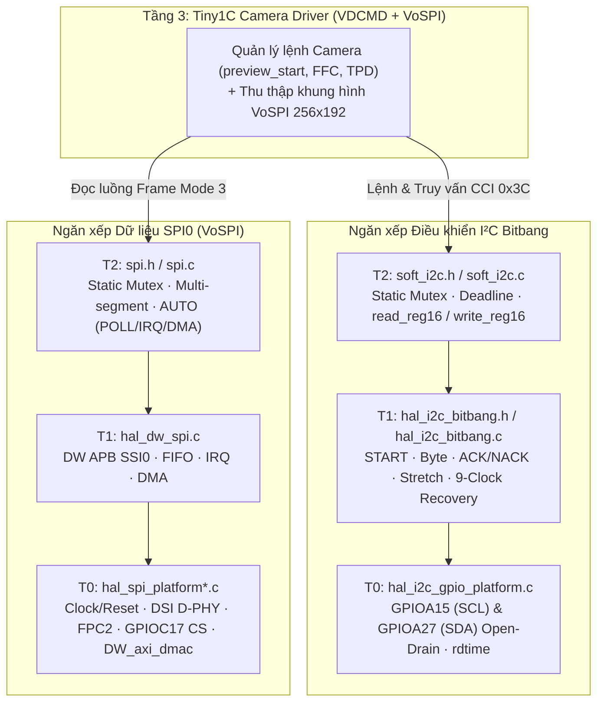

# Kiến trúc Driver I²C Bitbang SG2002 và Lộ trình Phát triển

**Phạm vi:** I²C Master thuần phần mềm (Bitbang) trên SOPHGO SG2002 / CV181x, chạy trên nhân FreeRTOS (C906L), sử dụng cặp chân **`GPIOA15 = SCL`** (`PAD_SPK_EN`) và **`GPIOA27 = SDA`** (`PAD_EMMC_DAT3`) của bo mạch LicheeRV-Nano. Tài liệu này mô tả kiến trúc 3 tầng (`T0`–`T2`) của nhánh điều khiển I²C song hành cùng kiến trúc 3 tầng của nhánh dữ liệu `SPI0` ([`Doc_md/SPI_Arch/`](../SPI_Arch/spi_driver_architecture_and_roadmap.md)).

**Trạng thái source:** Toàn bộ mã nguồn T0–T2 (`hal_i2c_gpio_platform.c`, `hal_i2c_bitbang.c`, `soft_i2c.c`) đã hoàn thiện, vượt qua 100% kịch bản Host Unit Test và biên dịch chéo RISC-V 64-bit (`-Wall -Wextra -Werror`). Node `i2c5` trong Device Tree của Linux đã được vô hiệu hóa để nhường chân `A15`/`A27` cho FreeRTOS.

---

## 1. Kiến trúc Phân tầng (T0 – T2) và Phối hợp với SPI0

Hệ thống giao tiếp với module camera nhiệt InfiRay **Tiny1C** hoạt động theo mô hình bus kép: **I²C Bitbang** đảm nhận kênh điều khiển lệnh (VDCMD / CCI) và **SPI0** đảm nhận kênh truyền luồng ảnh/nhiệt độ tốc độ cao (VoSPI). Việc tổ chức cả hai driver theo cùng mô hình 3 tầng giúp tách biệt triệt để thanh ghi phần cứng SoC, máy trạng thái giao thức và cơ chế đồng bộ đa nhiệm RTOS:

| Tầng | Trách nhiệm | Source | Tài liệu Chi tiết |
| :--- | :--- | :--- | :--- |
| **T0 — Platform SoC** | Clock gate `GPIOA`, giả lập Open-Drain qua `GPIOA_DDR` (`DR=0`), Pinmux `A15`/`A27` (func 3) + readback, timebase `rdtime` | [`hal_i2c_gpio_platform.c`](../../freertos/cvitek/hal/cv181x/i2c/src/hal_i2c_gpio_platform.c)<br>[`hal_i2c_gpio_platform.h`](../../freertos/cvitek/hal/cv181x/i2c/include/hal_i2c_gpio_platform.h) | • [Kiến trúc T0](T0_layer_arch/i2c_t0_platform_architecture.md)<br>• [Đánh giá Source T0](T0_layer_arch/i2c_t0_source_review.md) |
| **T1 — Bitbang HAL** | Phát START, Repeated START, STOP, truyền/nhận byte MSB-first, ACK/NACK, Clock Stretching, phát hiện Arbitration Loss, cứu hộ 9 xung SCL | [`hal_i2c_bitbang.c`](../../freertos/cvitek/hal/cv181x/i2c/src/hal_i2c_bitbang.c)<br>[`hal_i2c_bitbang.h`](../../freertos/cvitek/hal/cv181x/i2c/include/hal_i2c_bitbang.h) | • [Kiến trúc T1](T1_layer_arch/i2c_t1_controller_architecture.md)<br>• [Đánh giá Source T1](T1_layer_arch/i2c_t1_source_review.md) |
| **T2 — RTOS Bus API** | Quản lý `StaticSemaphore_t` Mutex, ngân sách thời gian thực `timeout_ms`, helpers `soft_i2c_read_reg16` / `soft_i2c_write_reg16`, thống kê lỗi | [`soft_i2c.c`](../../freertos/cvitek/driver/i2c/src/soft_i2c.c)<br>[`soft_i2c.h`](../../freertos/cvitek/driver/i2c/include/soft_i2c.h) | • [Kiến trúc T2](T2_layer_arch/i2c_t2_driver_architecture.md)<br>• [Đánh giá Source T2](T2_layer_arch/i2c_t2_source_review.md) |
| **Tầng 3 — Thiết bị** | Đóng gói lệnh VDCMD (Short/Standard/Long), polling trạng thái `0x0200` và đồng bộ luồng khung hình VoSPI | Chuẩn bị phát triển ở Tầng 3 | • [Hướng dẫn Tích hợp Tiny1C](tiny1c_integration.md) |



---

## 2. Phần cứng, Sơ đồ Chân và Quyền Sở hữu Tài nguyên

- **Chân vật lý trên LicheeRV-Nano:**
  - **`SCL`:** `GPIOA15` (Pad `PAD_SPK_EN`, thanh ghi Pinmux `0x0300103C` = Function `3`).
  - **`SDA`:** `GPIOA27` (Pad `PAD_EMMC_DAT3`, thanh ghi Pinmux `0x03001058` = Function `3`).
  - *Lưu ý:* Sử dụng đúng nhãn GPIO trên sơ đồ chân bo mạch (`A15`, `A27`), không nhầm với số thứ tự chân vật lý 15 và 27 trên header.
- **Giả lập Open-Drain An toàn:**
  - Thanh ghi dữ liệu `GPIOA_DR` (`0x03020000`) tại bit 15 và 27 luôn được cố định bằng `0`.
  - Việc kéo thấp hay nhả cao chỉ thực hiện bằng cách bật/tắt bit tương ứng trong thanh ghi hướng `GPIOA_DDR` (`0x03020004`). Mức cao được tạo hoàn toàn bởi điện trở kéo lên ngoài (External Pull-Up), đảm bảo an toàn tuyệt đối khi giao tiếp với Slave và khi Slave thực hiện Clock Stretching.
- **Phân tách với Camera MIPI và Linux:**
  - Bus `IIC4` (`CAM_SCL` / `CAM_SDA`) vẫn giữ nguyên cho Linux quản lý camera MIPI CSI truyền thống.
  - Node `i2c5` trong [`build/boards/sg200x/sg2002_licheervnano_sd/dts_riscv/sg2002_licheervnano_sd.dts`](../../build/boards/sg200x/sg2002_licheervnano_sd/dts_riscv/sg2002_licheervnano_sd.dts) đã được đặt `status = "disabled"` để Linux không gắn driver `i2c-gpio` lên `A15`/`A27`.
  - Do `GPIOA` là thanh ghi 32-bit dùng chung cho cả Port A, tầng tích hợp board phải đảm bảo Linux không thay đổi hướng chân (`GPIOA_DDR`) trên cùng bank trong lúc RTOS đang chạy giao dịch I²C, và xác nhận qua tham số `ownership_confirmed = true` khi gọi `bb_gpio_platform_init()`.

---

## 3. Luồng Khởi tạo và Luồng Giao dịch Thanh ghi 16-bit

```mermaid
sequenceDiagram
    participant A as Tầng 3 (Tiny1C Driver)
    participant B as T2 (soft_i2c)
    participant H as T1 (hal_i2c_bitbang)
    participant P as T0 (hal_i2c_gpio_platform)

    A->>P: bb_gpio_platform_init(&io, timer_hz, true)
    Note over P: Mở clk_apb_gpio, DDR=0, DR=0,<br/>Pinmux A15/A27=3, Readback
    P-->>A: BB_OK + bb_io_t hooks
    A->>B: soft_i2c_init(&bus, &io, 100000, 1000)
    B->>H: bb_init(&bus.master, &io, 100000, 1000)
    H->>P: Nhả SCL=Hi-Z, SDA=Hi-Z
    B-->>A: BB_OK (Static Mutex sẵn sàng)

    A->>B: soft_i2c_read_reg16(&bus, 0x3C, 0x0200, &status, 1, 20)
    B->>B: Lấy Static Mutex; tính ngân sách us còn lại
    B->>H: bb_transfer(m[0]: Write 0x0200, m[1]: Read 1B)
    H->>P: START -> 0x78 -> 0x02 -> 0x00 -> Repeated START -> 0x79 -> byte + NACK -> STOP
    H-->>B: BB_OK
    B->>B: Cập nhật transfers/errors; nhả Mutex
    B-->>A: BB_OK + giá trị thanh ghi 0x0200
```

---

## 4. Tích hợp Build và Trạng thái Xác minh Kỹ thuật

Các file mã nguồn của HAL I²C và Driver I²C được tự động thu thập qua `file(GLOB _SOURCES "src/*.c")` trong [`freertos/cvitek/hal/cv181x/i2c/CMakeLists.txt`](../../freertos/cvitek/hal/cv181x/i2c/CMakeLists.txt) và [`freertos/cvitek/driver/i2c/CMakeLists.txt`](../../freertos/cvitek/driver/i2c/CMakeLists.txt) để đóng gói vào `libhal.a` và `libdriver.a`.

Chạy kiểm thử tự động từ thư mục gốc của repository:

```bash
bash freertos/cvitek/hal/cv181x/i2c/tests/run.sh
bash freertos/cvitek/hal/cv181x/i2c/tests/compile-riscv.sh
```

| Mức xác minh | Nội dung kiểm tra | Kết quả |
| :--- | :--- | :---: |
| **Host Unit Tests (`run.sh`)** | Đọc kết hợp `reg16` + Repeated START + 2 byte, NACK byte cuối, NACK địa chỉ, Clock Stretching hợp lệ & quá hạn, kẹt SCL, mất quyền phân xử (`BB_ARBITRATION`), bus bận (`BB_BUSY`), khóa Mutex bận, cứu hộ 9 xung thành công/thất bại, kiểm tra tham số sai | **100% PASS** |
| **Cross-Compile RISC-V (`compile-riscv.sh`)** | Biên dịch cả 3 tầng T0 + T1 + T2 với `riscv64-unknown-elf-gcc`, header FreeRTOS thực tế và cờ `-Wall -Wextra -Werror` | **100% PASS (0 warning, 0 error)** |
| **Đo kiểm phần cứng (Board Bring-up)** | Đo mức điện áp nhả nghỉ (Idle HIGH), dạng sóng `0x78`/`0x79`, thời gian sườn lên (rise time) và phản hồi ACK từ module Tiny1C thật | Thực hiện khi nối phần cứng ở Tầng 3 |

---

## 5. Lộ trình Phát triển Tiếp theo (Hướng tới Tầng 3 — Tiny1C)

1. **Xây dựng Tầng 3 (`Tiny1C Driver`) trên nền `soft_i2c.h` và `spi.h`:**
   - Viết lớp adapter kết nối `i2c_data_read()` / `i2c_data_write()` của bộ lệnh VDCMD vào [`soft_i2c_read_reg16()`](../../freertos/cvitek/driver/i2c/include/soft_i2c.h#L25) và [`soft_i2c_write_reg16()`](../../freertos/cvitek/driver/i2c/include/soft_i2c.h#L26) với địa chỉ 7-bit chuẩn `0x3C`.
   - Bổ sung `device_mutex` ở Tầng 3 để bảo vệ toàn bộ chu trình lệnh VDCMD (`submit -> poll 0x0200 -> read response`), nhả `soft_i2c` bus mutex giữa các lượt chờ `vTaskDelay()`.
   - Kết nối luồng thu khung hình VoSPI (`256×192`, SPI Mode 3) vào [`spi_transfer()`](../../freertos/cvitek/driver/spi/include/spi.h#L157).
2. **Nghiệm thu trên phần cứng thực tế (Hardware Bring-up):**
   - Xác nhận điện áp kéo lên (Pull-Up / Level Shifter) trên hai chân `A15`/`A27`, kiểm tra lệnh đọc trạng thái `0x0200` và `get_device_info` trên camera Tiny1C thật, sau đó kích hoạt `preview_start` và thu luồng ảnh/nhiệt độ qua `SPI0`.
