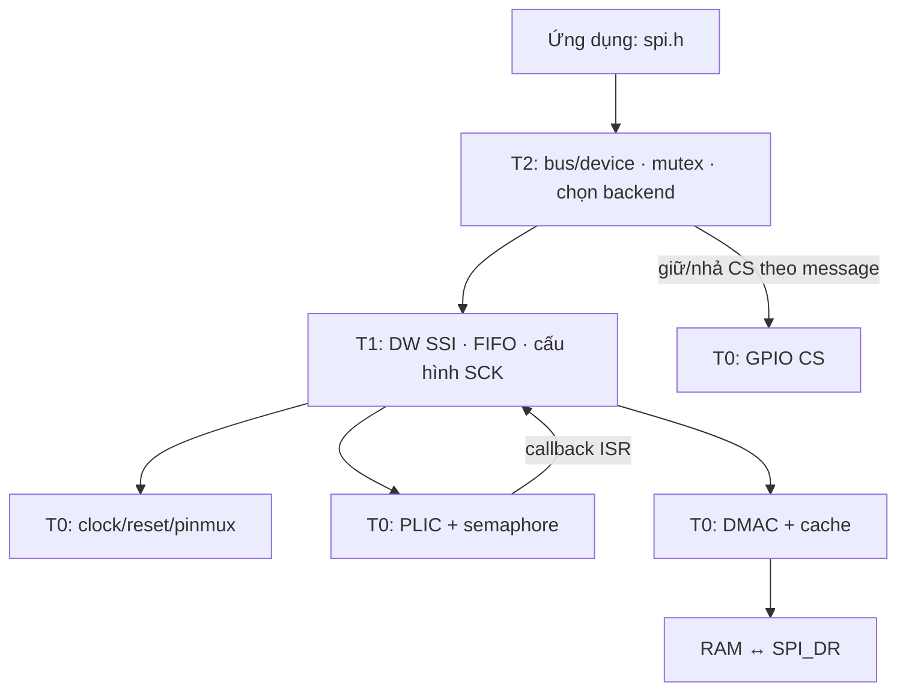
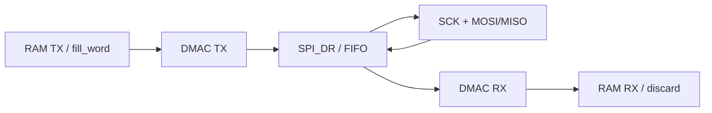

# Kiến trúc thiết kế và cách sử dụng tầng 0 SPI

Tài liệu này giải thích T0 từ source hiện có trên SG2002/CV181x: vì sao các khối được tạo ra, chúng lưu trạng thái gì, được gọi khi nào và phối hợp với T1/T2 ra sao. T0 hiện có phần triển khai IRQ và DMA; ví dụ API bên dưới dùng giao diện source hiện tại.

Các hằng phần cứng trong source còn một số sai lệch đã đối chiếu với SDK. Trong tài liệu, “code hiện thực hiện” mô tả luồng chương trình, không mặc nhiên xác nhận mapping điện đúng. Bảng kiểm tra chi tiết được lưu riêng ở [đánh giá source T0](spi_t0_source_review.md).

## 1. T0 giải quyết việc gì?

Để SPI0 trao đổi dữ liệu, việc ghi register FIFO của SPI chưa đủ. SoC phải cấp clock, nhả reset, nối tín hiệu tới pad ngoài, điều khiển CS và chuyển ngắt tới CPU. Khi dùng DMA, còn cần nối request SPI với DMAC và đồng bộ cache trước/sau truy cập RAM. T0 tập hợp những công việc này vào các platform hook để T1 gọi.

Nếu đặt toàn bộ thao tác này trong driver thiết bị, mỗi thiết bị sẽ phải biết địa chỉ clock, GPIO và DMAC; nhiều caller có thể cấu hình phần cứng theo các cách xung đột. T0 tạo một đầu mối cho tài nguyên SoC. Tuy nhiên, việc tách file tự nó không tạo khóa liên lõi hay cơ chế sở hữu tài nguyên: source hiện dựa vào caller để tuần tự hóa.

## 2. Các file và quan hệ phụ thuộc

| File | Nội dung cần đọc |
| --- | --- |
| [`hal_spi_platform.c`](../../freertos/cvitek/hal/cv181x/spi/src/hal_spi_platform.c) | Register SoC, state tĩnh, cache helpers, 12 platform hook, DMAC programming |
| [`hal_spi_platform_limits.h`](../../freertos/cvitek/hal/cv181x/spi/src/hal_spi_platform_limits.h) | Clock mặc định, FIFO depth, threshold, divider và kích thước block DMA |
| [`hal_dw_spi.h`](../../freertos/cvitek/hal/cv181x/spi/include/hal_dw_spi.h) | Prototype T0, kiểu callback IRQ, mã lỗi và state T1 |
| [`hal_dw_spi.c`](../../freertos/cvitek/hal/cv181x/spi/src/hal_dw_spi.c) | Caller T1: init, IRQ transfer, DMA transfer, abort |
| [`spi.c`](../../freertos/cvitek/driver/spi/src/spi.c) | Caller T2: mutex, backend và thời điểm assert/deassert CS |

T0 hiện phụ thuộc FreeRTOS cho semaphore, `request_irq()` cho PLIC, `mmio_*` để truy cập register và `arch_helpers.h` cho cache. Phần này có một instance tĩnh dành cho SPI0, chưa phải lớp platform đa bus.



T1 quyết định mode, BAUDR, FIFO threshold và DMACR của SPI. T0 quyết định cách truy cập clock/pad/PLIC/DMAC của SoC. T2 trực tiếp gọi hook CS để giữ CS qua các segment; do đó không phải mọi lời gọi T0 đều đi qua T1.

## 3. Trạng thái và bộ nhớ nội bộ

`g_spi0_plat` có kiểu `spi0_platform_state_t` và được cấp phát tĩnh:

| Trường | Ý nghĩa trong luồng chạy |
| --- | --- |
| `irq_sem_buf`, `irq_sem` | Vùng lưu static binary semaphore và handle dùng để block/wake task |
| `irq_handler`, `irq_ctx` | Callback T1 và con trỏ `hal_spi_t` chuyển qua PLIC trampoline |
| `irq_signaled` | Cờ completion dùng trong nhánh spin khi scheduler chưa chạy |
| `irq_registered` | Tránh gọi lại đăng ký PLIC sau lần đầu thành công |
| `dma_initialized` | Cho biết DMA đã đi qua routine init; không tự chứng minh phần cứng đã sẵn sàng |

Hai mảng tĩnh `g_dma_tx_dummy_line` và `g_dma_rx_dummy_line`, mỗi mảng 64 byte và căn 64 byte, phục vụ các giao dịch thiếu buffer TX hoặc RX. Tách hai dòng tránh để DMA ghi dữ liệu bỏ đi lên dòng chứa từ fill mà DMA TX đang đọc.

T0 không giữ toàn bộ payload, không cấp phát buffer ảnh hay packet của thiết bị. Buffer thật thuộc caller. Biến tĩnh giúp tránh cấp phát heap cho completion/dummy, nhưng cũng giới hạn một phiên sử dụng các tài nguyên này tại một thời điểm.

## 4. Clock và reset

### 4.1. `hal_spi_platform_clock_enable(reg_base)`

Hàm nhận base của controller, chỉ thực hiện khi base bằng `0x04180000`. Nó đọc register clock rồi OR mask để mở gate. Ý nghĩa của gate là cho phép xung đi vào khối; gate không xác định tần số nguồn.

Source hiện dùng `CLK_EN_1_REG=0x03002004`, bit 16. Khi đọc code cần biết mask này đang sai so với TRM: APB SPI0 ở bit 9 của bank này, functional clock SPI ở `0x0300200C` bit 6. Vì vậy không dùng dòng define hiện tại làm căn cứ nối/cấu hình board.

### 4.2. `hal_spi_platform_reset(reg_base)`

Hàm đọc reset register, clear bit để giữ reset, chờ `platform_short_delay(64)`, set lại bit rồi chờ tiếp. Mục đích là đưa state phần cứng về mặc định để T1 nạp lại cấu hình. Helper delay thực hiện vòng `nop`; số vòng không tương đương một thời gian microsecond cố định.

Source hiện dùng bank 0 bit 16; TRM xác định reset SPI0 ở `0x03003004` bit 8. Hàm được gọi trong init và từ `hal_spi_abort()`, nên mapping reset ảnh hưởng cả lúc khởi động lẫn phục hồi lỗi.

### 4.3. `hal_spi_platform_get_ref_clock_hz()`

Hàm trả `HAL_SPI_REF_CLOCK_HZ=187500000`, không đọc clock tree. Trong `hal_spi_init()`, nếu caller truyền `ref_clock_hz=0`, T1 lấy giá trị này; nếu caller truyền khác 0, T1 dùng giá trị caller cung cấp.

T1 tính SCK từ `ref_clock_hz / BAUDR`. Do đó trường này phải mô tả clock thực sự đang cấp, không phải tốc độ muốn đặt. Muốn đặt SCK của slave dùng `sck_hz` ở cấu hình device. Giá trị mặc định 187.5 MHz hiện là giả định cấu hình của source.

## 5. D-PHY, pad, pinmux và GPIO CS

`hal_spi_platform_pinmux_init()` thực hiện ba nhóm thao tác: ghi recipe D-PHY, read-modify-write pad control, rồi ghi mux function. Ba nhóm này có mục đích khác nhau:

| Nhóm | Mục đích |
| --- | --- |
| D-PHY | Cho tín hiệu digital đi qua khối pad dùng chung với MIPI |
| Pad control | Đặt pull-up/pull-down và drive strength |
| Pinmux | Chọn IP nào nối tới từng pad vật lý |

Trong source hiện tại, hàm ghi CSI RX base `0x0A0D0000` với `0x1F01`, sau đó đặt các pad mang tên SD1 và function 1. Đây là luồng ghi hiện có, nhưng bảng SDK cho SD1 function 1 là SPI2. Đường SPI0 FPC2 đã đối chiếu dùng các pad sau:

| Tín hiệu | FPC2 | Pad và mux | Function |
| --- | --- | --- | --- |
| SCK | 15 | MIPI_TXM2, `0x030011A4` | 6 |
| CS GPIO | 14 | MIPI_TXP2, `0x030011A8` | 3 = GPIOC17 |
| MOSI | 18 | MIPI_TXM1, `0x030011AC` | 6 |
| MISO | 17 | MIPI_TXP1, `0x030011B0` | 6 |

Vì vậy source cần sửa mapping trước khi ví dụ phần mềm có thể sử dụng đúng FPC2. Không đồng nhất CSI RX với DSI TX chỉ vì cùng có tên D-PHY.

`hal_spi_platform_cs_init()` đọc DR/DDR GPIOC, set bit 17 của DR lên HIGH rồi set DDR thành output. `hal_spi_platform_cs_set(true)` clear DR bit 17 để assert; `false` set bit để deassert. Việc dùng GPIO cho CS cho phép T2 giữ lựa chọn slave qua nhiều segment, độc lập với việc CPU có nạp FIFO liên tục hay không.

CS set/init không điều khiển SCK và không truyền dữ liệu. Chúng cũng không lấy mutex; T2 phải giữ bus lock trước khi dùng. Hiện pinmux được gọi trước cs_init, các hook trả void và không readback, nên đây chưa phải bảo đảm không có xung CS ngoài ý muốn.

## 6. IRQ: từ PLIC tới task đang chờ

### 6.1. Đăng ký

`hal_spi_platform_irq_init(reg_base, handler, ctx)` kiểm base/handler, tạo semaphore tĩnh nếu chưa có, lưu callback/context, clear cờ `irq_signaled`, rồi đăng ký `spi0_plic_irq_trampoline` bằng `request_irq(SPI_0_SSI_INTR, ...)` nếu chưa đăng ký.

Trampoline nhận ngắt PLIC và gọi `irq_handler(irq_ctx)`. Trong luồng hiện tại callback là ISR của T1. T0 không drain FIFO trong trampoline; T1 biết register và tiến độ truyền nên đảm nhiệm việc đó.

### 6.2. Chờ và đánh thức

```mermaid
sequenceDiagram
    participant Task as Task / T1
    participant T0 as T0 IRQ hooks
    participant P as PLIC
    participant ISR as T1 ISR
    Task->>T0: irq_init(handler, ctx)
    T0->>P: request_irq(trampoline)
    Task->>Task: nạp TX ban đầu và bật IMR
    Task->>T0: irq_wait(timeout_ms)
    Note over Task,T0: Task block trên semaphore khi scheduler chạy
    P->>T0: trampoline()
    T0->>ISR: handler(ctx)
    ISR->>ISR: phục vụ FIFO; ghi irq_status
    ISR->>T0: irq_notify() khi xong hoặc lỗi
    T0-->>Task: semaphore đánh thức task
    Task->>Task: kiểm irq_status và trạng thái controller
```

`irq_wait()` quy đổi timeout thành tick, tối thiểu một tick, rồi `xSemaphoreTake`. Nếu scheduler chưa chạy, code spin theo cờ `irq_signaled`. `timeout_ms=0` hiện dùng 1000 ms. `irq_notify()` set cờ, give semaphore bằng API FromISR và yêu cầu yield nếu cần.

Return OK từ wait chỉ biểu thị đã nhận thông báo; kết quả truyền nằm trong `hal->irq_status` và register T1. Notify phải được gọi từ ISR theo thiết kế hiện tại. Khi phát triển tiếp cần xử lý token cũ/ISR đến muộn; source chưa drain semaphore ở mỗi đầu giao dịch.

## 7. DMA: tổ chức truyền và các helper

### 7.1. `hal_spi_platform_dma_init(reg_base)`

Code bật clock SDMA, nhả reset nếu đang giữ, remap request SPI0 RX=16/TX=17 tới channel 0/1, ghi interrupt routing, bật DMAC rồi gọi disable hai channel. Sau đó đặt `dma_initialized=true`.

Request ID xác định nguồn handshake ngoại vi; channel là tài nguyên thực hiện transfer. `SRC_PER`/`DST_PER` trong cấu hình channel dùng slot đã remap. Hai khái niệm này không thể thay thế nhau. Source chọn cứng channel 0/1; DTS SoC đang dùng chúng cho I2S, nên hệ thống phải giải quyết ownership trước khi gọi init thật.

### 7.2. `hal_spi_platform_dma_transfer(...)`

| Đối số | Cách T0 sử dụng |
| --- | --- |
| `reg_base` | Tính địa chỉ `SPI_DR = base + DW_SPI_DR` |
| `tx_buf`, `rx_buf` | Con trỏ buffer hoặc NULL để dùng dummy |
| `frames` | Số frame SPI cần trao đổi |
| `frame_bytes` | 1 hoặc 2 byte trong RAM cho mỗi frame |
| `fill_word` | Từ phát lặp lại khi TX NULL |
| `timeout_ms` | Tham số giới hạn vòng chờ hiện tại; chưa phải deadline toàn transfer |

Hàm kiểm base/frame size, init DMA nếu chưa init, đồng bộ cache, chia transfer thành block ≤4096 frame, chạy từng block, rồi invalidate RX khi tất cả thành công. T0 không tự assert/deassert CS trong vòng chia block.

Với 10.000 frame, T0 tạo ba block 4096 + 4096 + 1808. Khi buffer có thật, địa chỉ block sau tăng `done_frames * frame_bytes`; khi dùng dummy, địa chỉ giữ nguyên. Block limit là lựa chọn source, không tự chứng minh giới hạn DMAC của mọi cấu hình SoC.

### 7.3. `dmac_run_single_block()`

Helper xóa interrupt status cũ, đặt địa chỉ/width/burst/count cho RX/TX, bật RX trước TX rồi chờ hoàn tất:

| Channel | Source | Destination | Tăng địa chỉ |
| --- | --- | --- | --- |
| RX | SPI_DR | RX buffer hoặc dummy RX | Chỉ tăng destination khi RX buffer có thật |
| TX | TX buffer hoặc dummy TX | SPI_DR | Chỉ tăng source khi TX buffer có thật |

Độ rộng transfer là 8 hoặc 16 bit theo `frame_bytes`; count register nhận `block_frames-1`; burst chọn một phần tử. T1 phải bật request trong SPI DMACR và đặt DMATDLR/DMARDLR trước khi gọi T0.



Source chờ DMA bằng polling MMIO: kiểm lỗi SPI/DMA, completion flags và channel enable. DMA chuyển dữ liệu thay CPU, nhưng task vẫn chạy vòng chờ; source chưa dùng semaphore cho completion DMA. Timeout cũng được cấp lại mỗi block.

### 7.4. Abort

`hal_spi_platform_dma_abort()` disable TX rồi RX, xóa status cả hai. `dmac_channel_disable()` ghi disable, thử abort nếu vẫn enabled và kiểm tối đa 4096 vòng. Các hàm hiện trả void, nên caller chưa nhận được xác nhận lỗi khi channel không dừng. Khi đọc luồng cleanup cần phân biệt “đã gửi yêu cầu dừng” với “đã xác nhận DMA không truy cập RAM nữa”.

## 8. Cache: vì sao cần ba thao tác

CPU có thể nhìn thấy dữ liệu mới trong cache trong khi RAM còn cũ; DMAC truy cập RAM. Các helper căn đầu/cuối vùng nhớ theo cache line 64 byte:

| Helper | Thời điểm | Mục đích |
| --- | --- | --- |
| `platform_dcache_clean` | Trước TX DMA | Đẩy dữ liệu CPU mới sửa xuống RAM |
| `platform_dcache_prepare_rx` | Trước RX DMA | Flush vùng RX trước khi phần cứng ghi |
| `platform_dcache_invalidate_rx` | Sau DMA thành công | Buộc CPU lấy dữ liệu RX mới từ RAM |

TX NULL dùng một từ fill ở dummy TX và tắt tăng địa chỉ nguồn. RX NULL dùng dummy RX với địa chỉ đích cố định để tiếp tục drain dữ liệu full-duplex dù caller không cần nhận.

Buffer thật phải tồn tại suốt transfer; CPU không được đồng thời sử dụng vùng mà DMA đang sở hữu. Các byte ngoài buffer nhưng chung cache line cũng cần được quản lý, vì invalidate thao tác theo cả dòng. Source hiện chỉ invalidate RX trên đường thành công; dữ liệu nhận một phần khi lỗi chưa có chính sách đầy đủ. Đây là giới hạn cần hiểu khi sử dụng API hiện tại.

## 9. Luồng khởi tạo T0 qua T1/T2

```text
spi_bus_init(bus, cfg)                 [T2]
  └─ hal_spi_init(hal, base, ref_hz)   [T1]
       ├─ lấy ref clock nếu ref_hz=0  [T0]
       ├─ clock_enable               [T0]
       ├─ reset                      [T0]
       ├─ pinmux_init                [T0]
       ├─ cs_init + cs_set(false)    [T0]
       ├─ irq_init(callback T1)      [T0]
       ├─ dma_init                   [T0]
       └─ quiesce_controller         [T1]
```

Đây là thứ tự source hiện thực hiện. IRQ và DMA init được gọi ngay trong init T1, kể cả khi device sau đó chọn polling; T1 hiện bỏ qua mã lỗi của hai hook này. T0 không có API deinit/unregister hoàn chỉnh để trả ownership lại cho Linux hoặc tác nhân khác.

## 10. Cách sử dụng trong chương trình

Ứng dụng tạo bus/device ở T2; `spi_bus_init()` tự đi qua các hook T0. Không cần gọi lại clock/reset/pinmux giữa mỗi message. Reset giữa một transfer sẽ phá trạng thái controller.

Ví dụ dưới đây minh họa đúng struct/prototype hiện có. Tham số slave chỉ là ví dụ; mapping phần cứng và ownership nêu trên cần được sửa/chốt trước khi chạy trên board. Chọn polling cũng không tránh được DMA init vô điều kiện đang có trong T1.

```c
#include "spi.h"

static spi_bus_t bus;
static spi_device_t dev;

spi_status_t example_init(void)
{
    const spi_bus_config_t bus_cfg = {
        .reg_base = 0x04180000UL,
        .ref_clock_hz = 0, /* T1 lấy mặc định từ T0; không đo clock */
        .irq_threshold_frames = 32,
        .dma_threshold_frames = 64,
    };
    const spi_device_config_t dev_cfg = {
        .sck_hz = 500000,
        .mode = 0,
        .bits_per_word = 8,
        .cs_id = SPI_CS0_GPIO,
        .backend = SPI_BACKEND_POLL,
        .rx_sample_dly = 0,
        .lsb_first = false,
    };
    spi_status_t rc = spi_bus_init(&bus, &bus_cfg);
    if (rc != SPI_OK)
        return rc;
    return spi_device_init(&dev, &bus, &dev_cfg);
}

spi_status_t example_exchange(const void *tx, void *rx, size_t bytes)
{
    /* 8 bit/frame: số frame bằng số byte. Gọi từ task sau init. */
    return spi_transfer_one(&dev, tx, rx, bytes, 0xFF, 100);
}
```

Khi phát triển T1, gọi `hal_spi_platform_irq_wait()` sau khi đã chuẩn bị tiến độ và bật interrupt SPI; ISR gọi `irq_notify()` khi hoàn tất/lỗi. Với DMA, T1 bật request SPI trước khi gọi `dma_transfer()`, tắt request sau khi hook trả về, rồi kiểm tra bus idle. Một lời gọi T0 DMA trực tiếp không tự configure mode/BAUDR, enable SPI, giữ CS hoặc khóa mutex.

## 11. Thứ tự đọc source T0 để hiểu hết một lượt

1. Đọc `hal_spi_platform_limits.h` và nhóm prototype trong `hal_dw_spi.h` để biết dữ liệu vào/ra.
2. Đọc nhóm define register; đối chiếu tên trong source với bảng phần cứng khi có ghi chú sai lệch.
3. Đọc `spi0_platform_state_t`, hai dummy buffer và ba cache helper.
4. Đọc clock/reset, pinmux, CS và hàm lấy ref clock; đối chiếu với thứ tự `hal_spi_init()`.
5. Đọc IRQ theo vòng callback: init → trampoline → ISR T1 → notify → wait trả về.
6. Đọc DMA theo vòng dữ liệu: init → transfer → single block → completion/abort → invalidate RX.
7. Quay lại `spi_transfer()` ở T2 để thấy mutex, CS và lựa chọn backend bao quanh T0/T1.

Nguồn phần cứng: [TRM](../HW/TRM/TRM_v102.md), [schematic](../HW/Schematic/LicheeRV_Nano_70415_Schematic_AI.md), [register pinmux SDK](../../freertos/cvitek/hal/cv181x/config/cv181x_reg_fmux_gpio.h), [function select SDK](../../freertos/cvitek/hal/cv181x/config/cv181x_pinlist_swconfig.h). Các chi tiết review/kiểm chứng được giữ riêng trong [đánh giá source T0](spi_t0_source_review.md).
