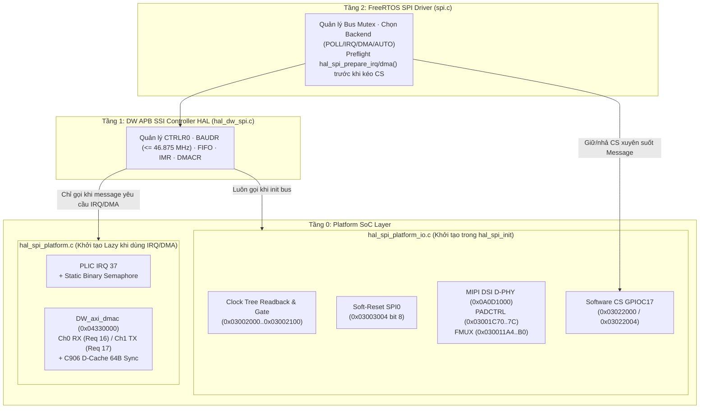

# Tài liệu Kiến trúc Chốt Tầng 0 (Platform SoC Layer) — SPI0 trên SOPHGO SG2002 (CV181x)

Cập nhật chốt: **30-10-2026**
Nền tảng phần cứng mục tiêu: **LicheeRV-Nano (SOPHGO SG2002 / CV181x — Nhân RISC-V C906L chạy FreeRTOS, SPI0 qua cổng FPC2)**.

---

## 1. Tổng quan Vai trò và Phạm vi của Tầng 0 (T0)

Trong kiến trúc ngăn xếp SPI 3 tầng (`T0` $\rightarrow$ `T1` $\rightarrow$ `T2`), **Tầng 0 (Platform SoC Layer)** đóng vai trò là lớp trừu tượng phần cứng cấp hệ thống (SoC Integration Layer) bao quanh khối IP bộ điều khiển Synopsys DesignWare APB SSI (`SPI0` tại `0x04180000`).

Tầng 0 **không** can thiệp vào giao thức của thiết bị ngoại vi (Sensor, Flash, Màn hình) và **không** quản lý máy trạng thái khung truyền của thanh ghi SPI0 (`CTRLR0`, `BAUDR`, `DR`, `IMR`, `DMACR` thuộc về Tầng 1). Thay vào đó, Tầng 0 chịu trách nhiệm độc quyền với **5 nhóm tài nguyên phần cứng cấp SoC SG2002**:

1. **Clock Tree & Soft-Reset (`CLKGEN` & `RSTGEN`)**:
   - Đọc cây xung nhịp phần cứng (`clk_byp_0` tại `0x03002030` và `div_clk_spi` tại `0x03002100`) để xác định tần số `clk_spi` thực tế (`25 MHz` XTAL hoặc `1500 MHz / div`, mặc định `187.5 MHz`).
   - Mở cổng xung nhịp APB GPIO (`clk_en_0` bit 29), APB SPI0 (`clk_en_1` bit 9) và xung nhịp chức năng `clk_spi` (`clk_en_3` bit 6) kèm đọc kiểm chứng (readback).
   - Phát xung Reset cứng tích cực mức thấp (`SOFT_RSTN_1` tại `0x03003004` bit 8) cho khối `SPI0` kèm đọc kiểm chứng.
2. **Mở khóa MIPI DSI D-PHY, PADCTRL & Pinmux (`FPC2`)**:
   - Chuyển 5 lane của khối **MIPI DSI D-PHY (`0x0A0D1000`)** sang chế độ Digital GPO/GPI (`0x00001F1F`) để tín hiệu số 1.8V đi qua cụm chân `MIPI_TX` ra cổng **FPC2**.
   - Thiết lập điện học Pad (`PADCTRL` tại `0x03001C70..0x03001C7C` với giá trị `0x44`: bật Pull-Up và Drive Strength).
   - Ánh xạ `FMUX` (`0x030011A4..0x030011B0`) cho `SPI0_SCK`, `XGPIOC_17` (CS), `SPI0_SDO` (MOSI), `SPI0_SDI` (MISO) và kiểm chứng lại bằng readback.
3. **Điều khiển Chip-Select bằng GPIO (`GPIOC17`)**:
   - Nạp trước mức logic CAO (`DR = 1`) và hướng Output (`DDR = 1`) cho `GPIOC17` (`0x03022000`) **trước khi** chuyển mux chân `PAD_MIPI_TXP2` sang `XGPIOC_17`, ngăn chặn xung chọn giả (spurious CS glitch) lúc khởi tạo.
   - Giữ và nhả chân `CS` xuyên suốt toàn bộ gói tin đa phân đoạn (multi-segment message) theo lệnh của Tầng 1/Tầng 2.
4. **Quản lý Ngắt phần cứng (`PLIC` + FreeRTOS Semaphore) — Khởi tạo theo nhu cầu (Lazy Init)**:
   - Chỉ đăng ký ngắt `SPI_0_SSI_INTR` (IRQ 37) và khởi tạo `StaticSemaphore_t` khi Tầng 1 gọi `hal_spi_prepare_irq()`.
   - Xóa sạch token cũ còn sót trong Semaphore khi khởi tạo/tái khởi tạo, đưa Task vào trạng thái ngủ (`Blocked`) chờ ISR của Tầng 1 báo hoàn tất.
5. **Tích hợp System DMA (`DW_axi_dmac`) & Đồng bộ D-Cache RISC-V C906L — Khởi tạo theo nhu cầu (Lazy Init)**:
   - Chỉ chạm vào thanh ghi Clock/Reset SDMA, bảng ánh xạ kênh `sdma_dma_ch_remap0` (`0x03000154`), `sdma_dma_int_mux` (`0x03000298`) và `DW_axi_dmac` (`0x04330000`) khi `hal_spi_prepare_dma()` được gọi cùng cam kết `resources_reserved = true` và tất cả các kênh DMAC đang rảnh (`CHEN_L & 0xFF == 0`).
   - Đảm bảo tính nhất quán bộ nhớ đệm D-Cache (Clean TX, Flush RX đầu phiên, Invalidate RX cuối phiên và khi lỗi giữa chừng) theo kích thước dòng cache `64-byte` của nhân T-Head C906L.

---

## 2. Cấu trúc Phân tách File của Tầng 0

Tầng 0 được tách thành **2 file mã nguồn thực thi** và **2 file header** để tách bạch phần I/O cơ bản (luôn chạy khi khởi tạo bus) với phần tài nguyên nâng cao (IRQ/DMA chỉ khởi tạo khi được yêu cầu):

| File | Đường dẫn | Vai trò trong Tầng 0 |
| :--- | :--- | :--- |
| **`hal_spi_platform_limits.h`** | [`freertos/cvitek/hal/cv181x/spi/src/hal_spi_platform_limits.h`](../../../freertos/cvitek/hal/cv181x/spi/src/hal_spi_platform_limits.h) | Định nghĩa các hằng số giới hạn phần cứng: `HAL_SPI_REF_CLOCK_HZ` (`187.5 MHz`), trần `HAL_SPI_MAX_SCK_HZ` (`46.875 MHz` theo TRM §21.3.2), `HAL_SPI_FIFO_DEPTH` (`8`), giới hạn `BAUDR` (`2..65534`), độ trễ lấy mẫu tối đa (`8`) và kích thước khối DMA tối đa (`4096` khung). |
| **`hal_dw_spi.h`** | [`freertos/cvitek/hal/cv181x/spi/include/hal_dw_spi.h`](../../../freertos/cvitek/hal/cv181x/spi/include/hal_dw_spi.h) | Khai báo hợp đồng 12 hàm Platform Hooks của Tầng 0 cho Tầng 1/Tầng 2 gọi. |
| **`hal_spi_platform_io.c`** | [`freertos/cvitek/hal/cv181x/spi/src/hal_spi_platform_io.c`](../../../freertos/cvitek/hal/cv181x/spi/src/hal_spi_platform_io.c) | Thực thi 6 hàm I/O nền tảng: đọc cây clock `clk_spi`, bật clock gate, phát xung reset `SPI0`, mở khóa MIPI DSI D-PHY, cấu hình `PADCTRL` + `FMUX` cho FPC2 và điều khiển `GPIOC17` CS. |
| **`hal_spi_platform.c`** | [`freertos/cvitek/hal/cv181x/spi/src/hal_spi_platform.c`](../../../freertos/cvitek/hal/cv181x/spi/src/hal_spi_platform.c) | Thực thi 6 hàm truyền dẫn nâng cao: đăng ký/chờ/đánh thức ngắt PLIC (`SPI_0_SSI_INTR`) và khởi tạo/truyền/hủy kênh System DMA (`DW_axi_dmac`) kèm đồng bộ D-Cache 64-byte. |

---

## 3. Bản đồ Thanh ghi Phần cứng Tầng 0 (Đã đối chiếu TRM & SDK)

### 3.1. Nhóm Clock, Reset, D-PHY, Pinmux và GPIO CS (trong `hal_spi_platform_io.c`)

| Khối chức năng | Tên thanh ghi / Hằng số | Địa chỉ vật lý | Bit / Giá trị cấu hình | Căn cứ xác minh |
| :--- | :--- | :--- | :--- | :--- |
| **SPI0 Controller** | `SPI0_BASE_ADDR` | `0x04180000` | Base MMIO của DW APB SSI0 | TRM §21.3 |
| **Clock Gate GPIO** | `CLK_EN_0_REG` | `0x03002000` | Bit `29` (`1U << 29`): Mở `clk_apb_gpio` | TRM Bảng 8-52 |
| **Clock Gate APB SPI0** | `CLK_EN_1_REG` | `0x03002004` | Bit `9` (`1U << 9`): Mở `clk_apb_spi0` | TRM Bảng 8-53 |
| **Clock Gate `clk_spi`** | `CLK_EN_3_REG` | `0x0300200C` | Bit `6` (`1U << 6`): Mở functional clock `clk_spi` | TRM Bảng 8-55 |
| **Clock Bypass `clk_spi`** | `CLK_BYP_0_REG` | `0x03002030` | Bit `30` (`1U << 30`): `1` = XTAL 25 MHz, `0` = chia từ FPLL | TRM Bảng 8-58 |
| **Clock Divider `clk_spi`** | `DIV_CLK_SPI_REG` | `0x03002100` | Bit `0`: Reset dis (`1` = chạy) Bit `3`: `0` = chia 8 mặc định (`187.5 MHz`), `1` = chia theo bits `[20:16]` | TRM Bảng 8-89 |
| **Soft-Reset SPI0** | `RESET_BANK1_REG` | `0x03003004` | Bit `8` (`1U << 8`): `reg_soft_reset_x_spi0` (tích cực mức thấp) | TRM Bảng 7-3 |
| **MIPI DSI D-PHY** | `DSI_DPHY_BASE_ADDR` | `0x0A0D1000` | `+0x00` (`EN`=0), `+0x9C` (`LANE_SEL`=`0xFFFFF`), `+0x64` (`PD`=`0x1F1F`), `+0x4C` (`LPTX_OV`=`0x1F001F`), `+0x54` (`PD_EN_TX`=`0x1F1F`), `+0x50` (`PD_TXDRV`=`0x1F1F1F1F`), `+0xC4` (`GPO`=`0x1F1F`), `+0xC8` (`GPI`=`0x1F1F`) | `top_reg.h` + Board Loopback |
| **PADCTRL FPC2** | `PADCTRL_PAD_MIPI_TXM2` `PADCTRL_PAD_MIPI_TXP2` `PADCTRL_PAD_MIPI_TXM1` `PADCTRL_PAD_MIPI_TXP1` | `0x03001C70` `0x03001C74` `0x03001C78` `0x03001C7C` | Giá trị `0x44`: Bật Pull-Up và cấu hình Drive Strength cho 4 chân SPI0 trên cổng FPC2 | Board Loopback |
| **FMUX Pinmux FPC2** | `PINMUX_PAD_MIPI_TXM2` (FPC2.15) `PINMUX_PAD_MIPI_TXP2` (FPC2.14) `PINMUX_PAD_MIPI_TXM1` (FPC2.18) `PINMUX_PAD_MIPI_TXP1` (FPC2.17) | `0x030011A4` `0x030011A8` `0x030011AC` `0x030011B0` | `6` (`SPI0_SCK`) `3` (`XGPIOC_17` — Software CS) `6` (`SPI0_SDO` / MOSI) `6` (`SPI0_SDI` / MISO) | `cv181x_reg_fmux_gpio.h` & `cv181x_pinlist_swconfig.h` |
| **GPIO Port C (CS)** | `GPIOC_SWPORTA_DR` `GPIOC_SWPORTA_DDR` | `0x03022000` `0x03022004` | Bit `17` (`1U << 17`): - `DDR[17] = 1` (Output) - `DR[17] = 0` (Assert CS), `1` (Deassert CS) | TRM GPIO & Schematic |

### 3.2. Nhóm PLIC IRQ và System DMA (trong `hal_spi_platform.c`)

| Khối chức năng | Tên thanh ghi / Hằng số | Địa chỉ / Giá trị | Ý nghĩa cấu hình | Căn cứ xác minh |
| :--- | :--- | :--- | :--- | :--- |
| **Ngắt PLIC SPI0** | `SPI_0_SSI_INTR` | IRQ `37` | Ngắt phần cứng của `SPI0` đưa vào bộ điều khiển PLIC trên C906L | `intr_conf.h` |
| **Clock Gate SDMA** | `CLK_EN_1_REG` | `0x03002004` | Bit `1` (`1U << 1`): Mở `clk_sdma_axi` | TRM Bảng 8-53 |
| **Soft-Reset SDMA** | `RESET_BANK0_REG` | `0x03003000` | Bit `18` (`1U << 18`): `reg_soft_reset_x_sdma` (tích cực mức thấp) | TRM Bảng 7-2 |
| **DMA Channel Remap** | `TOP_SDMA_CH_REMAP0_REG` | `0x03000154` | - Bits `[5:0] = 16` (`dma_rx_req_spi0` $\rightarrow$ Kênh 0) - Bits `[13:8] = 17` (`dma_tx_req_spi0` $\rightarrow$ Kênh 1) - Bit `31 = 1` (`update_dma_remap_0_3`) | TRM Bảng 9-1 & §9.3.2.4 |
| **DMA Interrupt Mux** | `TOP_SDMA_INT_MUX_REG` | `0x03000298` | Dịch trái `20` bit (`SDMA_INT_MUX_C906L_SHIFT`) để định tuyến ngắt Kênh 0, Kênh 1 về C906L | TRM §9.3.2.15 |
| **DW AXI DMAC Global** | `DW_DMAC_CFG` `DW_DMAC_CHEN_L` `DW_DMAC_CHEN_H` | `0x04330010` `0x04330018` `0x0433001C` | - `CFG = 0x3` (`DMAC_EN | INT_EN`) - `CHEN_L`: Bật/tắt kênh (bits `[7:0]` enable, `[15:8]` write-enable) - `CHEN_H`: Hủy kênh khẩn cấp (abort) | TRM Chương System DMA |
| **Kênh DMA 0 (RX)** | `DW_DMAC_CH_BASE(0)` | `0x04330100` | Đọc từ `SPI0_DR` (`0x04180060`) ghi vào RAM (`PER2MEM`, `SRC_PER = 0`, `PRIO = 1`) | TRM Chương System DMA |
| **Kênh DMA 1 (TX)** | `DW_DMAC_CH_BASE(1)` | `0x04330200` | Đọc từ RAM ghi vào `SPI0_DR` (`0x04180060`) (`MEM2PER`, `DST_PER = 1`, `PRIO = 0`) | TRM Chương System DMA |

---

## 4. Chi tiết Thiết kế và Hoạt động của 12 Hàm API Tầng 0

### 4.1. Nhóm Clock & Reset (`hal_spi_platform_io.c`)

1. **`uint32_t hal_spi_platform_get_ref_clock_hz(void)`**:
   - Đọc thanh ghi `CLK_BYP_0_REG` (`0x03002030`):
     - Nếu bit 30 (`CLK_BYP_0_SPI_BIT`) bằng `1`: nguồn xung nhịp `clk_spi` đang được nối tắt (bypass) trực tiếp vào thạch anh ngoại `XTAL`, hàm trả về **`25000000U` (25 MHz)**.
     - Nếu bit 30 bằng `0`: nguồn xung nhịp đi qua bộ chia `DIV_CLK_SPI_REG` (`0x03002100`) lấy từ `FPLL` (`1.5 GHz`).
   - Kiểm tra bit 0 (`DIV_CLK_SPI_RESET_DIS_BIT`) của `DIV_CLK_SPI_REG`: nếu bằng `0` (bộ chia đang bị giữ Reset), trả về `0U` để báo lỗi cấu hình clock.
   - Kiểm tra bit 3 (`DIV_CLK_SPI_REG_SEL_BIT`):
     - Nếu bằng `1`: lấy hệ số chia từ trường `[20:16]`. Nếu hệ số chia bằng `0`, trả về `0U`.
     - Nếu bằng `0`: phần cứng dùng hệ số chia khởi định là `8`.
   - Trả về `1500000000UL / div_factor` (mặc định là **`187500000U` — 187.5 MHz**).
   - Ở Tầng 1, `hal_spi_configure()` áp trần `HAL_SPI_MAX_SCK_HZ = 46875000U` (46.875 MHz, tương ứng `BAUDR >= 4` khi `clk_spi = 187.5 MHz`) theo đúng giới hạn vật lý của TRM §21.3.2.

2. **`hal_spi_status_t hal_spi_platform_clock_enable(uintptr_t reg_base)`**:
   - Kiểm tra `reg_base == 0x04180000UL`, nếu sai trả về `HAL_SPI_ERR_INVALID`.
   - Mở cổng clock APB cho GPIO (`0x03002000` bit 29), clock APB cho SPI0 (`0x03002004` bit 9) và functional clock `clk_spi` (`0x0300200C` bit 6).
   - Đọc kiểm chứng (readback) cả 2 bit clock của SPI0 và kiểm tra `hal_spi_platform_get_ref_clock_hz() != 0U`. Nếu hợp lệ trả về `HAL_SPI_OK`, ngược lại trả về `HAL_SPI_ERR_INVALID`.

3. **`hal_spi_status_t hal_spi_platform_reset(uintptr_t reg_base)`**:
   - Kiểm tra `reg_base == 0x04180000UL`.
   - Kéo bit 8 của `RESET_BANK1_REG` (`0x03003004`) xuống `0` để kích hoạt Reset cứng khối `SPI0`, chờ `64` chu kỳ `nop`, sau đó kéo bit 8 lên `1` để nhả Reset và chờ thêm `64` chu kỳ `nop`.
   - Đọc kiểm chứng lại bit 8 của `0x03003004`; nếu đã lên `1` thì trả về `HAL_SPI_OK`.

### 4.2. Nhóm GPIO CS & Pinmux FPC2 (`hal_spi_platform_io.c`)

Để triệt tiêu nguy cơ xuất hiện xung chọn giả (glitch xuống mức thấp) trên đường `CS` khi khởi tạo:
- Trong `hal_spi_init()`, **`hal_spi_platform_cs_init()` được gọi TRƯỚC `hal_spi_platform_pinmux_init()`**:
  1. `hal_spi_platform_cs_init()` ghi bit 17 của `GPIOC_SWPORTA_DR` (`0x03022000`) lên mức `1` (Inactive HIGH) trước, rồi mới đặt bit 17 của `GPIOC_SWPORTA_DDR` (`0x03022004`) lên `1` (Output).
  2. `hal_spi_platform_pinmux_init()` mở khóa chế độ Digital GPO/GPI (`0x00001F1F`) trên khối **MIPI DSI D-PHY (`0x0A0D1000`)**, cấu hình `PADCTRL` (`0x03001C70..0x03001C7C = 0x44`) và chuyển `FMUX` của 4 chân `PAD_MIPI_TXM2` (`SCK`), `PAD_MIPI_TXP2` (`XGPIOC_17`), `PAD_MIPI_TXM1` (`SDO`), `PAD_MIPI_TXP1` (`SDI`).
  3. Cuối `hal_spi_platform_pinmux_init()`, hàm đọc kiểm chứng lại thanh ghi `GPO`/`GPI` của DSI D-PHY, `DDR` của `GPIOC17` và cả 4 thanh ghi `FMUX`. Nếu bất kỳ thanh ghi nào không khớp, hàm trả về lỗi ngay lập tức.
- Trong quá trình truyền nhận, `hal_spi_platform_cs_set(true)` kéo `GPIOC17` xuống `0` và `hal_spi_platform_cs_set(false)` kéo `GPIOC17` lên `1`.

### 4.3. Nhóm Ngắt PLIC (`hal_spi_platform.c`)

1. **`hal_spi_platform_irq_init(uintptr_t reg_base, hal_spi_irq_handler_t handler, void *ctx)`**:
   - Chỉ được gọi khi Tầng 1 thực thi `hal_spi_prepare_irq()` (do Tầng 2 yêu cầu trước khi bắt đầu một gói tin cần `SPI_BACKEND_IRQ`).
   - Khởi tạo `StaticSemaphore_t` (`xSemaphoreCreateBinaryStatic`) nếu chưa tạo.
   - **Dọn sạch token cũ**: chạy vòng lặp `while (xSemaphoreTake(g_spi0_plat.irq_sem, 0U) == pdTRUE) {}` để bảo đảm không còn token completion tồn đọng từ phiên truyền trước.
   - Lưu `handler` và `ctx`, xóa cờ `irq_signaled = false`, và gọi `request_irq(SPI_0_SSI_INTR, spi0_plic_irq_trampoline, 0UL, "spi0_dw_ssi", &g_spi0_plat)` ở lần đầu tiên.
2. **`hal_spi_platform_irq_wait(uintptr_t reg_base, uint32_t timeout_ms)`**:
   - Khi FreeRTOS Scheduler đang chạy (`taskSCHEDULER_RUNNING`), chuyển đổi `timeout_ms` sang số tick (tối thiểu 1 tick) và gọi `xSemaphoreTake(g_spi0_plat.irq_sem, ticks)` để đưa Task vào trạng thái ngủ (`Blocked`), giải phóng 100% CPU cho các tác vụ khác.
   - Khi Scheduler chưa chạy, spin chờ cờ `g_spi0_plat.irq_signaled`.
3. **`hal_spi_platform_irq_notify(uintptr_t reg_base)`**:
   - Được gọi từ bên trong `hal_spi_isr()` khi toàn bộ khung dữ liệu đã truyền/nhận xong hoặc khi xảy ra lỗi FIFO.
   - Đặt `irq_signaled = true`, gọi `xSemaphoreGiveFromISR()` kèm `portYIELD_FROM_ISR()` để đánh thức Task ngay khi thoát ngắt.

### 4.4. Nhóm System DMA & Đồng bộ D-Cache (`hal_spi_platform.c`)

1. **Cơ chế Bảo vệ Quyền Sở hữu Tài nguyên trong `hal_spi_platform_dma_init(reg_base, resources_reserved)`**:
   - Trên SoC SG2002, bộ điều khiển `DW_axi_dmac` (`0x04330000`) và bảng `sdma_dma_ch_remap0` là tài nguyên dùng chung toàn hệ thống (mặc định DTS có thể gán Kênh 0/1 cho I2S).
   - Do đó:
     - Nếu `resources_reserved == false`, hàm từ chối ngay với `HAL_SPI_ERR_UNSUPPORTED` **trước khi thực hiện bất kỳ lệnh ghi MMIO nào**.
     - Sau khi bật clock `clk_sdma_axi` (`0x03002004` bit 1) và nhả reset `SDMA` (`0x03003000` bit 18), hàm đọc `DW_DMAC_CHEN_L` (`0x04330018`). Nếu bất kỳ kênh nào trong 8 kênh đang chạy (`(chen & 0xFFU) != 0U`), hàm từ chối với `HAL_SPI_ERR_BUSY` thay vì cưỡng bức tắt kênh hay ghi đè bảng remap.
     - Khi xác nhận toàn bộ kênh đang rảnh, hàm ánh xạ `CVI_DMA_REQ_SPI0_RX (16)` vào Kênh 0, `CVI_DMA_REQ_SPI0_TX (17)` vào Kênh 1 (kèm bit 31 `SDMA_REMAP_UPDATE_BIT`), định tuyến ngắt về C906L và bật `DW_DMAC_CFG`.

2. **Đồng bộ D-Cache 64-byte và Chia khối trong `hal_spi_platform_dma_transfer(...)`**:
   - Kiểm tra tràn số nguyên (`frames > SIZE_MAX / frame_bytes`) và kiểm tra căn lề chẵn 2-byte đối với khung 9..16 bit (`frame_bytes == 2`).
   - Sử dụng 2 dòng cache tĩnh căn lề 64-byte tách biệt (`g_dma_tx_dummy_line` và `g_dma_rx_dummy_line`) cho các giao dịch khuyết bộ đệm (`tx_buf == NULL` hoặc `rx_buf == NULL`), ngăn chặn triệt để lỗi False-Sharing giữa kênh đọc và kênh ghi.
   - **Trước khi chạy DMA**:
     - Gọi `platform_dcache_clean()` trên vùng `tx_buf` (hoặc `g_dma_tx_dummy_line`).
     - Gọi `platform_dcache_prepare_rx()` (`flush_dcache_range`) trên vùng `rx_buf` (hoặc `g_dma_rx_dummy_line`).
   - **Chia khối tuần tự**:
     - Chia tổng số khung `frames` thành các khối tối đa `HAL_SPI_DMA_MAX_BLOCK_FRAMES` (`4096` khung/khối).
     - Trong mỗi khối (`dmac_run_single_block`), cấu hình Kênh 0 (RX) và Kênh 1 (TX) với `MSIZE = 0` (1 phần tử mỗi lần bắt tay), bật Kênh RX trước rồi bật Kênh TX sau.
   - **Sau khi chạy DMA (kể cả khi thành công hay lỗi giữa chừng)**:
     - Luôn gọi `platform_dcache_invalidate_rx()` trên `rx_buf` trước khi trả về để đảm bảo CPU luôn đọc dữ liệu mới nhất từ RAM vật lý.

3. **Hủy khẩn cấp `hal_spi_platform_dma_abort(uintptr_t reg_base)`**:
   - Chỉ chạm vào thanh ghi DMAC nếu `g_spi0_plat.dma_initialized == true`.
   - Tắt Kênh TX (Kênh 1) trước, Kênh RX (Kênh 0) sau qua `DW_DMAC_CHEN_L` (và `DW_DMAC_CHEN_H` nếu kênh chưa dừng ngay), chờ kênh hạ cờ enable rồi xóa sạch cờ ngắt trong `CH_INTCLEAR_L`.

---

## 5. Trạng thái Xác minhHiện tại

1. **Kiểm thử Đơn vị và Tích hợp trên Host (`test_spi.c`)**:
   - Đã chạy `bash freertos/cvitek/hal/cv181x/spi/tests/run.sh`: **PASS 100%** toàn bộ kịch bản (`POLL`, `IRQ`, `DMA`, `AUTO`, `LSB-first`, `Helpers`, `Fault Recovery`, chính sách mặc định chỉ `POLL`, khởi tạo trễ `prepare_irq`/`prepare_dma`, từ chối DMA khi chưa đặt `dma_resources_reserved`, truyền lỗi prepare về caller trước khi kéo CS).
2. **Biên dịch Chéo (Cross-Compilation) cho Nhân RISC-V C906L (`riscv64-unknown-elf-gcc`)**:
   - Đã biên dịch thành công cả 3 object của HAL SPI (`hal_dw_spi.c.obj`, `hal_spi_platform.c.obj`, `hal_spi_platform_io.c.obj`) đóng gói vào `libhal.a` và driver Tầng 2 (`spi.c.obj`) đóng gói vào `libdriver.a` với cờ `-Wall -Wextra`, **0 error, 0 warning**.
