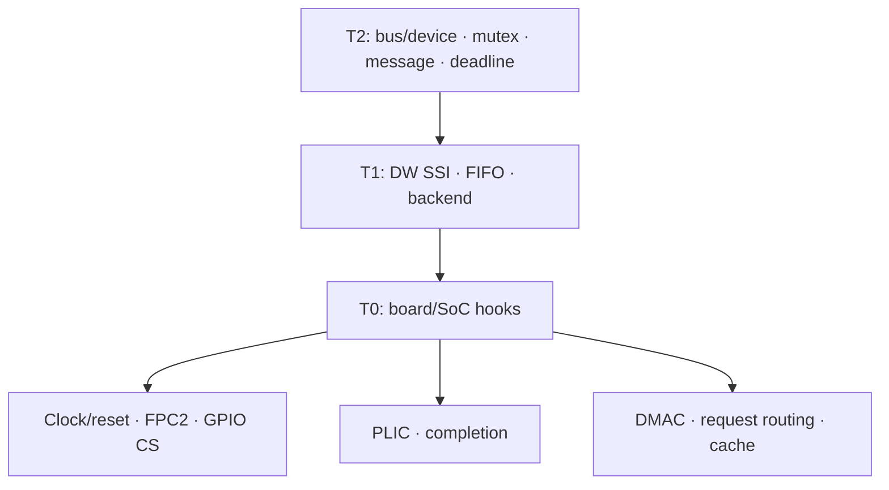

# Đánh giá source và các vấn đề còn lại của tầng 0 SPI0

Cập nhật: 30-10-2026. Board mục tiêu: LicheeRV-Nano, SPI0 qua FPC2.

**Kết luận kiểm tra source:** T0 hiện có code clock/reset, pinmux, CS, IRQ và DMA nhưng chưa hoàn thiện. Có sai lệch register/chân so với SDK và TRM, cùng các thiếu sót về ownership, timeout và cleanup DMA. Tài liệu này phân biệt hành vi source hiện tại với hợp đồng cần đạt; không chứng nhận hoạt động phần cứng.

## 1. Phạm vi và nguồn đối chiếu

- [Source T0](../../freertos/cvitek/hal/cv181x/spi/src/hal_spi_platform.c), [limits](../../freertos/cvitek/hal/cv181x/spi/src/hal_spi_platform_limits.h), [HAL API](../../freertos/cvitek/hal/cv181x/spi/include/hal_dw_spi.h).
- [TRM](../HW/TRM/TRM_v102.md): clock/reset, DMA remap, DW SSI.
- [SDK register pinmux](../../freertos/cvitek/hal/cv181x/config/cv181x_reg_fmux_gpio.h) và [function select](../../freertos/cvitek/hal/cv181x/config/cv181x_pinlist_swconfig.h).
- [Schematic](../HW/Schematic/LicheeRV_Nano_70415_Schematic_AI.md): §9.1 FPC2, bảng chân U1.
- [DTS SoC](../../build/boards/default/dts/sg200x/soph_base.dtsi): DMAC và phân bổ request hiện có; phải kiểm tra thêm DTS cuối cùng của board khi triển khai.

T0 quản lý các tài nguyên SoC bao quanh SPI0: clock/reset, pad/pinmux/D-PHY, GPIO CS, PLIC và tích hợp DMAC/cache. T1 sở hữu CTRLR0, BAUDR, FIFO, IMR, DMACR và trạng thái DW SSI. T2 quản lý bus/device, mutex, message và deadline. Nội dung lệnh slave thuộc tầng trên.

## 2. Bản đồ phần cứng mục tiêu đã đối chiếu

| Tài nguyên | Địa chỉ / bit / chức năng | Căn cứ |
| --- | --- | --- |
| SPI0 | `0x04180000` | TRM SPI0 |
| Clock APB SPI0 | `0x03002004`, bit 9 | TRM clk_en_1 |
| Clock SPI | `0x0300200C`, bit 6 | TRM clk_en_3 |
| SPI clock bypass/divider | `0x03002030` bit 30; divider tại `0x03002100` | TRM clock generator |
| Reset SPI0 | `0x03003004`, bit 8, active-low | TRM reset bank 1 |
| SCK FPC2.15 | MIPI_TXM2, mux `0x030011A4`, function 6 | SDK + schematic |
| CS FPC2.14 | MIPI_TXP2, mux `0x030011A8`, function 3 = GPIOC17 | SDK + schematic |
| MOSI FPC2.18 | MIPI_TXM1, mux `0x030011AC`, function 6 | SDK + schematic |
| MISO FPC2.17 | MIPI_TXP1, mux `0x030011B0`, function 6 | SDK + schematic |
| GPIOC DR/DDR | `0x03022000` / `0x03022004`, bit 17 | Platform GPIO mapping |
| System DMAC | `0x04330000`; SPI0 RX request 16, TX request 17 | TRM DMA |

FPC2 là đầu nối DSI có chân 1–31 và hai chân GND 32/33 theo schematic. Không gọi nó là FPC 26 chân/J4. SD1 function 1 là SPI2 trong SDK; không dùng mapping đó để điều khiển SPI0 trên FPC2. MIPI_TXM2 function 3 là GPIOC16, còn GPIOC17 nằm trên MIPI_TXP2.

Recipe D-PHY/pad phải dành cho đường MIPI TX của FPC2. Không lấy recipe CSI RX `0x0A0D0000` áp dụng chỉ vì cùng mang tên MIPI. Các giá trị recipe cũ cần đối chiếu bitfield và đo board trước khi ghi là đã nghiệm thu.

## 3. Clock và reset: hợp đồng cần đạt

T0 phải biết nguồn clock thực tế trước khi trả `ref_clock_hz`. Có thể cấu hình nguồn/divider hoặc xác nhận cấu hình do bootloader cung cấp. Hằng 187.5 MHz chỉ đúng khi clock tree thực sự tạo tần số đó; nó không phải thuộc tính bất biến của mọi lần boot. T1 dùng giá trị này tính BAUDR nên sai clock nguồn sẽ làm sai SCK.

Init phải cấp gate APB và functional clock, xác nhận reset đã nhả, rồi mới truy cập SPI0. Nếu cần reset pulse, thời gian giữ/ổn định phải dựa trên yêu cầu phần cứng và timebase. Vòng 64 lệnh NOP không tự chứng minh đủ thời gian trên mọi cấu hình CPU/compiler.

**Source hiện tại:** bật `clk_en_1` bit 16 (TRM ghi UART1), reset bank 0 bit 16, trả hằng 187.5 MHz; không kiểm clock tree/readback. Những hàm `void` hiện không báo được lỗi chuẩn bị clock/reset.

## 4. Pinmux, pad và CS

Thứ tự mục tiêu: kiểm ownership → giữ controller không phát xung → nạp GPIO CS inactive → cấu hình direction → nối đúng mux CS → cấu hình D-PHY/pad và SCK/MOSI/MISO → readback → công bố ready.

CS active-low phải được giữ qua toàn message theo quyết định của T2. Readback DR chỉ xác nhận register; cần đo chân vật lý để xác nhận không có xung chọn giả. Không khẳng định tuyệt đối “glitch-free” chỉ từ thứ tự ghi DR/DDR.

**Source hiện tại:** `pinmux_init()` chạy trước `cs_init()`, dùng sai nhóm SD1/CSI và sai offset mux so với SDK. Ví dụ source gán MIPI_TXM2 offset `0xEC`, SDK ghi `0x1A4`. Điều khiển GPIOC17 chưa chứng minh nối ra CS FPC2. Pinmux/pad/CS thiếu readback và đường báo lỗi.

## 5. IRQ và completion

Source có `irq_init`, `irq_wait`, `irq_notify`, static binary semaphore và callback PLIC. `irq_wait` block task khi scheduler chạy; trước scheduler dùng vòng spin. `timeout_ms=0` hiện được đổi thành 1000 ms.

Hợp đồng cần ghi rõ ngữ cảnh gọi: init/wait từ task hoặc boot được quy định; notify từ ISR; ưu tiên IRQ phải tương thích FreeRTOS. Cần xử lý token completion còn lại sau timeout, ISR đến muộn, tái khởi tạo và giao dịch kế tiếp; chỉ đặt `irq_signaled=false` không tự drain semaphore.

Đường spin phải dùng deadline từ timer, không quy đổi số vòng lặp thành mili giây. Phải truyền lỗi đăng ký IRQ lên caller. Hiện `hal_spi_init()` bỏ qua kết quả `irq_init()` nên có thể công bố thành công dù backend chưa sẵn sàng.

## 6. DMA: dữ liệu, ownership và completion

Source hiện lập trình RX/TX hai channel 0/1, remap request 16/17, chia block tối đa 4096 frame và bật RX trước TX. Completion vẫn được CPU kiểm tra bằng vòng đọc MMIO; đây là DMA có polling completion, chưa phải thiết kế task ngủ chờ DMA.

Channel số 0/1 không phải tài nguyên mặc định dành riêng cho SPI. DTS SoC đang remap chúng cho I2S0 RX/I2S2 TX. Phải xác nhận DTS hiệu lực và cấp quyền sở hữu trước khi đổi remap, tắt channel hoặc ghi cấu hình DMAC toàn cục. Mutex T2 không khóa Linux hoặc các bus khác.

Hợp đồng cần đạt:

1. Kiểm tra buffer, căn chỉnh, vùng RAM DMA truy cập được, phép nhân `frames * frame_bytes` và phép cộng địa chỉ không tràn.
2. Phân biệt request ID ngoại vi với slot handshake nội bộ của DMAC; xác minh width, burst, block limit và cách truy cập register của đúng IP.
3. Dùng một deadline cho toàn transfer, truyền ngân sách còn lại vào từng block. Chunking có thể tạo gap SCK và không được âm thầm nhả CS.
4. Chỉ báo success khi đã xác nhận hoàn tất hợp lệ cả RX/TX; channel disabled đơn thuần chưa đủ chứng minh dữ liệu đã truyền hết.
5. Abort phải xác nhận channel đã dừng và không còn truy cập RAM trước khi cho caller tái sử dụng buffer. Nếu không dừng được phải báo lỗi/fault và giữ quyền sở hữu buffer theo hợp đồng rõ ràng.
6. Nếu mục tiêu là giảm CPU, bổ sung completion IRQ và task wait; đo CPU load thay vì suy ra từ tên backend DMA.

**Thiếu sót hiện tại:** `dmac_channel_disable()` chờ tối đa 4096 vòng rồi trả `void` dù channel có thể còn chạy; `dma_abort()` không báo thất bại. Transfer dùng `timeout_ms * 50000` vòng và cấp lại timeout cho mỗi block. T0 chưa kiểm tràn kích thước/địa chỉ; lỗi trả về không cho biết số frame đã nhận. Init DMA bị T1 bỏ qua mã lỗi và còn được gọi ngay cả khi caller chỉ cần polling.

## 7. Cache và vòng đời buffer

Source clean TX, flush RX trước DMA, invalidate RX sau khi tất cả block thành công; có hai dummy cache line riêng cho TX/RX. Đây là các thành phần cần thiết nhưng chưa đủ bảo đảm coherency.

Buffer RX nên căn và sở hữu trọn cache line theo contract, hoặc dùng bounce buffer. Clean/flush đầu giao dịch không bảo vệ các biến lân cận nếu task khác sửa cùng cache line trong khi DMA chạy: invalidate cuối có thể làm mất dữ liệu CPU vừa ghi. Caller phải không truy cập vùng buffer/dòng cache do DMA sở hữu cho tới completion hoặc abort đã xác nhận dừng.

Phải xử lý cả đường timeout/lỗi có dữ liệu RX một phần. Source hiện return sớm khi block lỗi và bỏ qua bước invalidate RX cuối. Chính sách dữ liệu một phần, cache synchronization sau abort và quyền sở hữu buffer cần được định nghĩa trước khi sửa code. Cache operation cũng không thay thế memory barrier cần thiết cho thứ tự lập trình DMA.

## 8. API hiện có và những thay đổi contract cần thiết

Header hiện khai báo **12 hàm** T0 (tài liệu cũ gộp transfer/abort thành một dòng và đếm 11):

| Nhóm | API hiện có | Yêu cầu hoàn thiện |
| --- | --- | --- |
| Clock/reset | `clock_enable`, `reset`, `get_ref_clock_hz` | Xác nhận nguồn/gate/reset; báo lỗi thay vì chỉ void/hằng |
| Pad/CS | `pinmux_init`, `cs_init`, `cs_set` | Mapping đúng, thứ tự init, readback và lỗi |
| IRQ | `irq_init`, `irq_wait`, `irq_notify` | Context, ưu tiên, token cũ, deadline và lifecycle |
| DMA | `dma_init`, `dma_transfer`, `dma_abort` | Ownership, cache, kích thước, deadline, completion và xác nhận abort |

Đổi các prototype hoặc semantics phải sửa đồng bộ T1, T2 và mock test. Không coi mock thay thế kiểm chứng T0 thật.

## 9. Phân loại limits

Trong `hal_spi_platform_limits.h`, các hằng hiện không cùng một loại: `REF_CLOCK_HZ` là giả định cấu hình; FIFO depth cần căn cứ IP; TX threshold là lựa chọn thuật toán; RX sample delay cần căn cứ register; BAUDR min/max là giới hạn encoding; DMA block size cần xác minh cấu hình DMAC. Không gọi tất cả là “thông số vật lý bất biến”. SCK lý thuyết từ phép chia không phải tốc độ board/slave đã được chứng nhận.

## 10. Thứ tự sửa và tiêu chí hoàn tất source

| Ưu tiên | Việc cần làm | Bằng chứng hoàn tất |
| --- | --- | --- |
| P0 | Sửa clock/reset và mapping SPI0 FPC2/CS | Đối chiếu TRM/SDK, readback, đo waveform |
| P0 | Chốt ownership DMAC, tránh init DMA vô điều kiện | Cấu hình board/OS rõ, backend bị từ chối khi chưa có quyền |
| P0 | Bảo đảm abort dừng DMA; báo fault nếu thất bại | Kiểm tra timeout/error và buffer không còn bị truy cập |
| P1 | Deadline thực, không reset mỗi block | Đo thời gian chờ và cleanup riêng |
| P1 | Cache/buffer contract, overflow và partial RX | Kiểm tra các biên kích thước/căn chỉnh/lỗi |
| P1 | IRQ lifecycle, lỗi init truyền lên T2 | Kiểm tra timeout rồi giao dịch tiếp, ISR đến muộn |
| P2 | DMA IRQ completion và tối ưu throughput | Đo CPU load, throughput và gap SCK |

## 11. Phạm vi xác minh

Đánh giá này dựa trên đọc source T0, điểm gọi T1, SDK pinmux, TRM, schematic và DTS. Test host hiện có trong `hal/cv181x/spi/tests/run.sh` build T1/T2 với mock T0; script không biên dịch `hal_spi_platform.c`. Do đó test pass không chứng minh register T0, mapping chân, clock, cache hoặc DMAC thật đúng.

Ngày 30-10-2026 đã chạy `bash freertos/cvitek/hal/cv181x/spi/tests/run.sh`: pass toàn bộ các nhóm mà script báo (POLL, IRQ, DMA, AUTO, LSB-first, Helpers, Recovery). T0 thật vẫn bị thay bằng mock trong lần chạy này. Chưa chạy xác minh trên board hoặc build target trong lượt đánh giá này.

Chỉ công bố T0 sẵn sàng sau khi các mục P0/P1 được giải quyết, build target thành công và có kết quả board theo cấu hình/commit cụ thể. Tài liệu này là đặc tả cùng danh sách sai lệch đã kiểm tra; source hiện tại chưa đạt các điều kiện đó.
