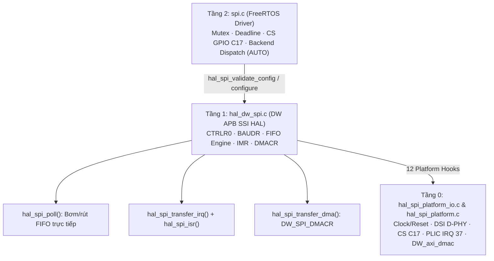
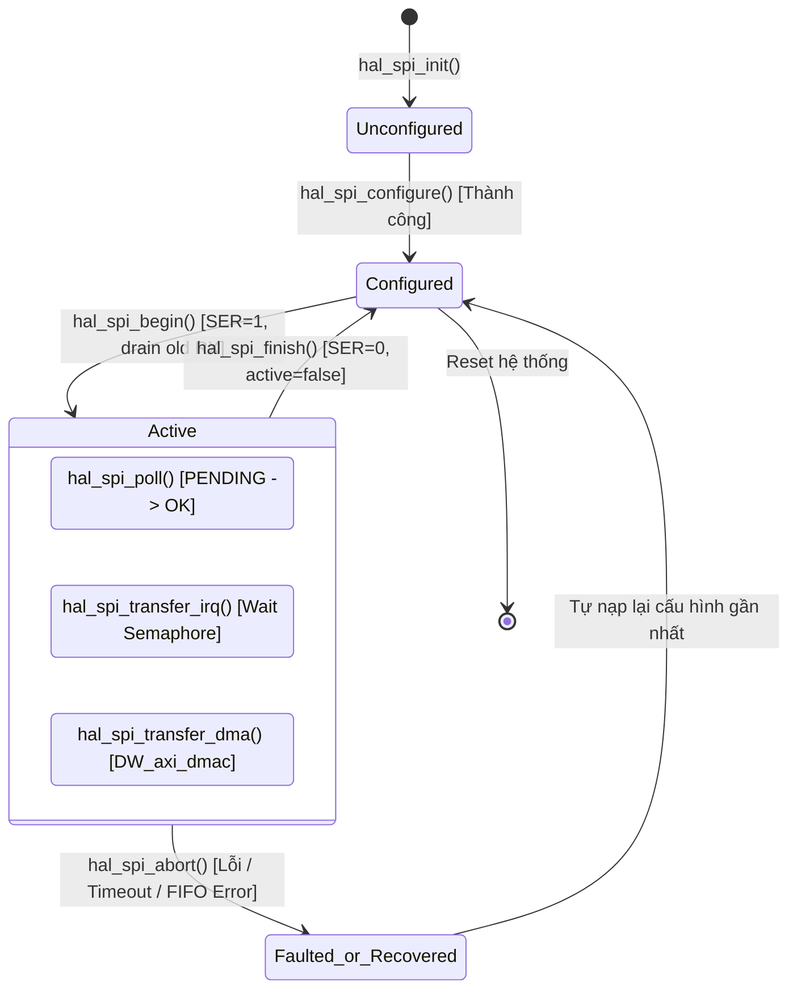

# Tài liệu Kiến trúc Chốt Tầng 1 (Controller HAL) — Bộ điều khiển Synopsys DW APB SSI trên SOPHGO SG2002

Cập nhật chốt: **09-11-2026**
Nền tảng phần cứng mục tiêu: **LicheeRV-Nano (SOPHGO SG2002 / CV181x — Bộ điều khiển SPI0 tại MMIO `0x04180000`)**.

---

## 1. Vai trò và Ranh giới của Tầng 1 (T1)

Trong kiến trúc SPI 3 tầng (`T0` $\rightarrow$ `T1` $\rightarrow$ `T2`), **Tầng 1 (Controller HAL Layer)** là lớp phần mềm quản lý trực tiếp máy trạng thái phần cứng và hệ thống thanh ghi của lõi IP **Synopsys DesignWare APB Synchronous Serial Interface (DW APB SSI)**:

- **Trách nhiệm của T1:**
  1. Quản lý trực tiếp cấu hình truyền dẫn vật lý: Chế độ Motorola SPI (Mode 0..3), độ rộng khung truyền DFS (`4..16 bit`), trần tần số xung nhịp `SCK` (`HAL_SPI_MAX_SCK_HZ = 46.875 MHz`), độ trễ lấy mẫu MISO (`RX_SAMPLE_DLY` từ 0..8 chu kỳ), và thuật toán đảo bit phần mềm cho chuẩn LSB-first.
  2. Quản lý luồng dữ liệu của 3 cơ chế thực thi (Backend Engines):
     - **Engine 1 (`POLL`):** Bơm/rút FIFO trực tiếp bằng CPU thông qua bất biến an toàn chống tràn FIFO (`in_flight = tx_done - rx_done < 8`).
     - **Engine 2 (`IRQ`):** Truyền nhận qua ngắt phần cứng PLIC, điều chỉnh ngưỡng `RXFTLR` linh hoạt cho các khung lẻ cuối gói, phối hợp đồng bộ với Task qua Semaphore ở Tầng 0.
     - **Engine 3 (`DMA`):** Kích hoạt bắt tay phần cứng qua `DMACR`, kết hợp bộ đệm trung gian trên Stack (128B bounce buffer) khi chạy LSB-first.
  3. Cung cấp cơ chế khởi tạo trễ (`hal_spi_prepare_irq`, `hal_spi_prepare_dma`), chụp ảnh trạng thái chẩn đoán (`hal_spi_snapshot`) và thu hồi/khôi phục khẩn cấp (`hal_spi_abort`).

- **Ranh giới phân định (Boundary):**
  - **T1 KHÔNG sở hữu:** Mutex FreeRTOS, thời gian timeout toàn phiên (deadline), cấu hình thiết bị cấp cao, và thời điểm kéo/nhả chân Chip-Select (các phần này thuộc quyền quản lý của **Tầng 2**).
  - **T1 KHÔNG quản lý trực tiếp:** Cấp xung nhịp Clock Gate, xung Soft-Reset SoC, giải mã chân FPC2, D-PHY TTL, thanh ghi DMAC kênh 0/1 hay đồng bộ D-Cache C906L (các phần này do **Tầng 0** phụ trách qua 12 hàm Platform Hooks).

---

## 2. Bản đồ Thanh ghi Khối IP Synopsys DesignWare APB SSI

Toàn bộ các thanh ghi của khối IP `SPI0` được định nghĩa trong [`dw_spi_regs.h`](../../../freertos/cvitek/hal/cv181x/spi/src/dw_spi_regs.h) tại địa chỉ cơ sở `0x04180000`:

| Offset | Tên thanh ghi | Quyền | Ý nghĩa & Cấu hình trong T1 |
| :--- | :--- | :---: | :--- |
| `0x00` | **`DW_SPI_CTRLR0`** | R/W | **Thanh ghi Điều khiển 0:** • Bits `[3:0]`: `DFS_32` (Độ rộng khung = `bits_per_word - 1`). • Bits `[5:4]`: `FRF_SPI` (`0x00` chuẩn Motorola SPI). • Bit `6`: `SCPH` (Pha xung nhịp — Mode 1, 3). • Bit `7`: `SCPOL` (Cực tính xung nhịp — Mode 2, 3). • Bits `[9:8]`: `TMOD_TR` (`0x00` truyền & nhận đồng thời Full Duplex). |
| `0x08` | **`DW_SPI_SSIENR`** | R/W | **Bật/Tắt SSI Controller:** `1` = Cho phép hoạt động; `0` = Tắt controller (bắt buộc tắt khi nạp cấu hình mới vào `CTRLR0`, `BAUDR`, `RX_SAMPLE_DLY`). |
| `0x10` | **`DW_SPI_SER`** | R/W | **Slave Enable Register:** Ghi `1U` vào bit 0 để kích hoạt bộ dịch bit nội bộ của IP phát xung SCK và đẩy dữ liệu ra dây. |
| `0x14` | **`DW_SPI_BAUDR`** | R/W | **Hệ số chia tần số SCK (SCKDV):** Chỉ nhận số chẵn từ `2` đến `65534`. Tần số SCK thực tế = `ref_clock_hz / BAUDR`. |
| `0x18` | **`DW_SPI_TXFTLR`** | R/W | **Ngưỡng TX FIFO:** Mặc định bằng `4`. Khi số khung trong TX FIFO $\le$ `TXFTLR`, ngắt `TXEI` được kích hoạt. |
| `0x1C` | **`DW_SPI_RXFTLR`** | R/W | **Ngưỡng RX FIFO:** Khi số khung trong RX FIFO $\ge$ `RXFTLR + 1`, ngắt `RXFI` được kích hoạt. T1 điều chỉnh linh hoạt trường này khi truyền bằng ngắt. |
| `0x20` | **`DW_SPI_TXFLR`** | RO | **Mức đầy TX FIFO:** Số lượng khung hiện có trong TX FIFO (0..8). Dùng cho Snapshot. |
| `0x24` | **`DW_SPI_RXFLR`** | RO | **Mức đầy RX FIFO:** Số lượng khung hiện có trong RX FIFO (0..8). Dùng cho Snapshot. |
| `0x28` | **`DW_SPI_SR`** | RO | **Thanh ghi Trạng thái (Status Register):** • Bit `0` (`BUSY`): `1` = Controller đang truyền/nhận, `0` = Rảnh rỗi. • Bit `1` (`TFNF`): `1` = TX FIFO chưa đầy (có thể nạp tiếp). • Bit `2` (`TFE`): `1` = TX FIFO hoàn toàn rỗng. • Bit `3` (`RFNE`): `1` = RX FIFO có dữ liệu (có thể đọc). |
| `0x2C` | **`DW_SPI_IMR`** | R/W | **Mặt nạ Ngắt (Interrupt Mask):** `TXEI` (bit 0), `TXOI` (bit 1), `RXUI` (bit 2), `RXOI` (bit 3), `RXFI` (bit 4). |
| `0x30` | **`DW_SPI_ISR`** | RO | **Trạng thái ngắt đã áp mặt nạ (Masked Interrupt Status).** |
| `0x34` | **`DW_SPI_RISR`** | RO | **Trạng thái ngắt thô (Raw Interrupt Status):** Dùng để giám sát lỗi FIFO (`TXOI | RXUI | RXOI = 0x0E`). |
| `0x48` | **`DW_SPI_ICR`** | RO | **Xóa toàn bộ ngắt:** Đọc thanh ghi này sẽ tự động xóa sạch các cờ lỗi FIFO cũ. |
| `0x4C` | **`DW_SPI_DMACR`** | R/W | **Điều khiển DMA:** Bit `0` (`RDMAE` — Kích hoạt bắt tay DMA nhận), Bit `1` (`TDMAE` — Bắt tay DMA phát). |
| `0x50` | **`DW_SPI_DMATDLR`**| R/W | **Ngưỡng phát tín hiệu DMA TX:** Mặc định đặt bằng `4`. |
| `0x54` | **`DW_SPI_DMARDLR`**| R/W | **Ngưỡng phát tín hiệu DMA RX:** Mặc định đặt bằng `0` (phát yêu cầu ngay khi có $\ge 1$ khung trong RX FIFO). |
| `0x60` | **`DW_SPI_DR`** | R/W | **Cửa sổ Dữ liệu (Data Register):** Cửa ngõ đọc/ghi FIFO (16-bit). |
| `0xF0` | **`DW_SPI_RX_SAMPLE_DLY`** | R/W | **Độ trễ lấy mẫu MISO:** Dịch thời điểm lấy mẫu tín hiệu MISO từ 0 đến 8 chu kỳ xung nhịp `clk_spi` nội bộ. |

---

## 3. Cấu trúc Trạng thái Nội bộ `hal_spi_t`

Đối tượng [`hal_spi_t`]( /freertos/cvitek/hal/cv181x/spi/include/hal_dw_spi.h#L73-L107) được cấp phát tĩnh trong cấu trúc bus của Tầng 2, gồm 3 nhóm thông tin:

1. **Nhóm Cấu hình Phần cứng:**
   - `reg_base`: Địa chỉ thanh ghi cơ sở (`0x04180000`).
   - `ref_clock_hz`: Tần số xung nhịp thực tế đọc từ cây clock T0 (thường là `187.5 MHz` hoặc `25 MHz`).
   - `actual_sck_hz`: Tần số SCK thực tế tính được sau khi làm tròn lên số chia chẵn (luôn $\le$ `46.875 MHz`).
   - `mode`, `bits_per_word`, `frame_bytes` (1 byte nếu $\le 8$-bit, 2 byte nếu 9..16-bit), `rx_sample_dly`, `lsb_first`.
2. **Nhóm Tiến trình Phân đoạn (Segment Progress):**
   - `tx`, `rx`: Con trỏ bộ đệm phát và nhận do caller cung cấp (hỗ trợ `NULL`).
   - `frames`: Tổng số khung cần truyền nhận trong phân đoạn hiện tại.
   - `tx_done`: Số khung đã nạp thành công vào TX FIFO.
   - `rx_done`: Số khung đã đọc thành công từ RX FIFO ra bộ đệm (kể cả trường hợp `rx == NULL`).
   - `fill_word`: Từ phát lặp lại dùng để sinh xung SCK khi `tx == NULL`.
3. **Nhóm Vòng đời và Trạng thái Sẵn sàng (Lifecycle Flags):**
   - `configured`: Đánh dấu đã nạp thành công các thanh ghi `CTRLR0`, `BAUDR`, `RX_SAMPLE_DLY`.
   - `active`: Đánh dấu phân đoạn đang chiếm dụng phần cứng (đã qua `hal_spi_begin`).
   - `irq_ready`: Đánh dấu đã đăng ký thành công vector ngắt PLIC qua `hal_spi_prepare_irq()`.
   - `dma_ready`: Đánh dấu đã khởi tạo thành công DMAC qua `hal_spi_prepare_dma()`.
   - `irq_status`: Lưu trữ mã lỗi hoặc trạng thái hoàn tất từ ISR (`HAL_SPI_OK`, `HAL_SPI_ERR_FIFO`...).

---

## 4. Máy trạng thái (State Machine) và Vòng đời một Phân đoạn

1. **Khởi tạo (`hal_spi_init`):**
   - Xác nhận xung nhịp phần cứng từ T0 qua `hal_spi_platform_get_ref_clock_hz()`.
   - Cấp clock, reset, nạp `GPIOC17 = HIGH` trước khi mở Pinmux FPC2.
   - Đưa bộ điều khiển về trạng thái nghỉ (`quiesce_controller`).
2. **Chuẩn bị Lazy Backend (`hal_spi_prepare_irq` / `hal_spi_prepare_dma`):**
   - Được gọi theo nhu cầu trước khi gửi gói tin. Nếu thành công mới bật cờ `irq_ready` / `dma_ready`.
3. **Cấu hình (`hal_spi_configure`):**
   - Ép trần `requested_sck_hz <= HAL_SPI_MAX_SCK_HZ (46.875 MHz)`.
   - Tính toán `BAUDR = (div + 1) & ~1`.
   - Tắt `SSIENR = 0` $\rightarrow$ nạp `CTRLR0`, `BAUDR`, `RX_SAMPLE_DLY`, `TXFTLR`, `RXFTLR` $\rightarrow$ bật `SSIENR = 1`.
4. **Mở phiên (`hal_spi_begin`):**
   - Xóa sạch dữ liệu rác cũ trong RX FIFO, xóa cờ ngắt cũ qua `ICR`, bật `SER = 1`.
5. **Đóng phiên (`hal_spi_finish`):**
   - Tắt `IMR`, `DMACR`, `SER = 0`, xóa con trỏ và hạ cờ `active = false`.
6. **Thu hồi khẩn cấp (`hal_spi_abort`):**
   - Dừng DMA nếu `dma_ready == true`, phát xung Soft-Reset T0, kéo `CS = HIGH`, xóa cờ trạng thái và tự động nạp lại cấu hình đã lưu để sẵn sàng cho phiên tiếp theo.

---

## 5. Chi tiết 3 Cơ chế Thực thi (Backend Engines)

### 5.1. Engine 1: Polling (`hal_spi_poll`)
- **Nguyên lý:** Phù hợp cho các gói tin ngắn ($< 32$ khung), độ trễ thấp, không phụ thuộc bộ lập lịch RTOS.
- **Bất biến an toàn (In-flight Invariant):**
  $$\text{in\_flight} = \text{hal}\rightarrow\text{tx\_done} - \text{hal}\rightarrow\text{rx\_done} < \text{HAL\_SPI\_FIFO\_DEPTH (8)}$$
  Quy tắc này giới hạn số lượng khung đang bay (nằm trong TX FIFO, bộ dịch bit và RX FIFO) không bao giờ vượt quá dung lượng vật lý của RX FIFO (8 khung). Nhờ đó, nếu Task bị ngắt quãng hoặc CPU bị tranh chấp, RX FIFO không bao giờ bị tràn (`RXOI`).
- **Thứ tự thực thi:** Luôn rút RX FIFO (`drain_rx_fifo`) trước khi bơm thêm vào TX FIFO (`fill_tx_fifo`). Kiểm tra `DW_SPI_RISR` ở từng bước để phát hiện sớm lỗi FIFO. Khi đủ số khung nhận, chờ `SR.TFE == 1` và `SR.BUSY == 0` rồi mới trả `HAL_SPI_OK`.

### 5.2. Engine 2: Interrupt (`hal_spi_transfer_irq` & `hal_spi_isr`)
- **Nguyên lý:** Phù hợp cho gói tin trung bình ($32..63$ khung), đưa Task vào trạng thái ngủ (`Blocked`) để giải phóng CPU.
- **Điều chỉnh ngưỡng động (`update_irq_thresholds_and_mask`):**
  - Ngắt `RXFI` chỉ kích hoạt khi số khung trong RX FIFO $\ge \text{RXFTLR} + 1$.
  - Khi số khung còn lại $\text{rem\_rx} \le 4$, hàm tự động hạ $\text{RXFTLR} = \text{rem\_rx} - 1$. Nhờ đó, khung dữ liệu cuối cùng rơi vào RX FIFO luôn kích hoạt được ngắt `RXFI` để gọi `hal_spi_platform_irq_notify()` đánh thức Task, không bao giờ bị treo chờ ngắt.
- **Bảo vệ ngắt:** Khi phát hiện lỗi phần cứng (`TXOI | RXUI | RXOI`), ISR tắt ngay `IMR = 0`, xóa cờ qua `ICR`, ghi nhận `irq_status = HAL_SPI_ERR_FIFO` và đánh thức Task ngay lập tức để thực hiện quy trình khôi phục.

### 5.3. Engine 3: System DMA (`hal_spi_transfer_dma`)
- **Nguyên lý:** Phù hợp cho khối dữ liệu lớn ($\ge 64$ khung, truyền ảnh Camera, nạp Flash).
- **Cấu hình bắt tay ngoại vi:**
  - `DMATDLR = 4`: Khối SPI0 phát xung yêu cầu `dma_tx_req` khi TX FIFO còn $\le 4$ chỗ trống.
  - `DMARDLR = 0`: Khối SPI0 phát xung yêu cầu `dma_rx_req` ngay khi có $\ge 1$ khung trong RX FIFO.
  - Bật bắt tay đồng thời: `reg_write(hal, DW_SPI_DMACR, RDMAE | TDMAE)`.
- **Cơ chế LSB-First qua Bounce Buffer:**
  - Vì phần cứng DW APB SSI chỉ hỗ trợ dịch bit theo chiều MSB-first, khi thiết bị yêu cầu LSB-first:
    - Nếu `tx != NULL`: Dữ liệu được chia thành từng cụm tối đa 64 khung (`HAL_SPI_LSB_DMA_CHUNK_FRAMES`), đảo bit đưa vào mảng trung gian trên Stack `uint16_t tx_bounce[64]` (128 byte) rồi mới phát DMA. Cách này giữ nguyên vẹn bộ đệm gốc của caller.
    - Dữ liệu nhận về được đảo bit ngược lại sau khi DMA hoàn tất.

---

## 6. Trạng thái Xác minh Kỹ thuật

1. **Host Unit Tests ([`run.sh`]( /freertos/cvitek/hal/cv181x/spi/tests/run.sh)):**
   - Đạt **100% PASS** toàn bộ 8 nhóm kịch bản: `POLL`, `IRQ`, `DMA`, `AUTO`, `LSB-first`, `Helpers`, `Recovery`, `Lazy Backend Init`.
2. **Cross-Compilation RISC-V 64-bit (`riscv64-unknown-elf-gcc`):**
   - Biên dịch thành công target `halspi` ([`src/hal_dw_spi.c`]( /freertos/cvitek/hal/cv181x/spi/src/hal_dw_spi.c), [`src/hal_spi_platform.c`]( /freertos/cvitek/hal/cv181x/spi/src/hal_spi_platform.c), [`src/hal_spi_platform_io.c`]( /freertos/cvitek/hal/cv181x/spi/src/hal_spi_platform_io.c)) đóng gói vào `libhal.a` với cờ `-Wall -Wextra`, **0 error, 0 warning**.
3. **Kết luận:** Tầng 1 đã đạt trạng thái **Hoàn thiện Chốt** đồng bộ tuyệt đối giữa kiến trúc đặc tả và mã nguồn thực thi.
