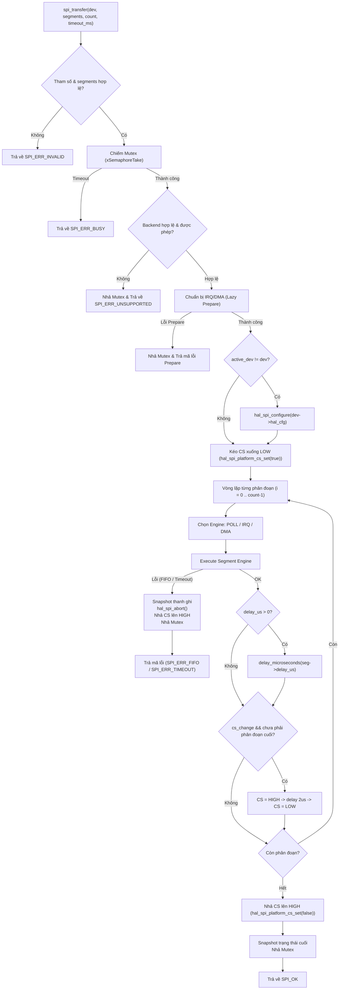

# Tài liệu Kiến trúc Chốt Tầng 2 (RTOS SPI Driver Layer) — Điều phối Bus & Thiết bị trên SOPHGO SG2002

Cập nhật chốt: **09-11-2026**  
Nền tảng mục tiêu: **LicheeRV-Nano (SOPHGO SG2002 / CV181x — Nhân RISC-V 64-bit C906L chạy FreeRTOS)**.

---

## 1. Vai trò và Ranh giới của Tầng 2 (T2)

Trong kiến trúc SPI 3 tầng (`T0` $\rightarrow$ `T1` $\rightarrow$ `T2` $\rightarrow$ `T3 Sensor Driver`), **Tầng 2 (RTOS SPI Bus & Device Layer)** là lớp điều phối cấp cao, đóng gói toàn bộ logic tương tác phần cứng của Tầng 1 (`hal_dw_spi.c`) thành giao diện lập trình RTOS an toàn đa luồng (Thread-Safe Public API) cho các Driver Cảm biến ngoại vi (Tầng 3 như Tiny-1C, Flash, IMU, Màn hình):

```
+-----------------------------------------------------------------------------------+
| Tầng 3: Sensor / Device Drivers (Tiny-1C Thermal Camera, IMU, SPI Flash, OLED)    |
|   -> Gọi các hàm Public API: spi_transfer, spi_write_then_read, spi_write, ...     |
+-----------------------------------------------------------------------------------+
                                         │
                                         ▼
+-----------------------------------------------------------------------------------+
| Tầng 2: RTOS SPI Bus & Device Layer (driver/spi/src/spi.c & include/spi.h)         |
|   • Bảo vệ đa nhiệm bằng FreeRTOS Static Mutex (không cấp phát Heap).             |
|   • Quản lý giao dịch nguyên tử đa phân đoạn (Multi-Segment Messages).            |
|   • Kiểm soát chính xác chân Chip-Select (GPIOC17) suốt phiên truyền.             |
|   • Tối ưu chuyển đổi thiết bị thông minh (Lazy Reconfiguration).                 |
|   • Tự động chọn Backend tối ưu (AUTO: POLL < 32B, IRQ 32..63B, DMA >= 64B).      |
|   • Quản lý Deadline & Ngân sách Polling không khóa cứng (Non-blocking loop).    |
|   • Tự động chụp Snapshot và thu hồi khẩn cấp khi lỗi (Fault Recovery).           |
+-----------------------------------------------------------------------------------+
                                         │
                                         ▼
+-----------------------------------------------------------------------------------+
| Tầng 1: Controller HAL (hal_dw_spi.c) — Synopsys DesignWare APB SSI               |
+-----------------------------------------------------------------------------------+
                                         │
                                         ▼
+-----------------------------------------------------------------------------------+
| Tầng 0: Platform SoC (hal_spi_platform.c & hal_spi_platform_io.c)                 |
+-----------------------------------------------------------------------------------+
```

- **Trách nhiệm của Tầng 2:**
  1. **An toàn đa luồng (Thread-Safety):** Sử dụng `StaticSemaphore_t` của FreeRTOS để bảo vệ bus vật lý, đảm bảo nhiều Task độc lập có thể gọi truyền nhận mà không làm xung đột bus hay lẫn lộn dữ liệu.
  2. **Quản lý phiên đa phân đoạn (Multi-segment Atomic Transfer):** Thực thi chuỗi các phân đoạn liên tiếp trong cùng một lần kéo chân CS xuống LOW (ví dụ: phát byte lệnh $\rightarrow$ chờ delay phần cứng $\rightarrow$ đọc khối dữ liệu kết quả).
  3. **Tối ưu hóa cấu hình thiết bị (Lazy Reconfiguration):** Ghi nhớ thiết bị đang hoạt động (`bus->active_dev`). Nếu giao dịch tiếp theo cùng thiết bị và tham số không đổi, T2 bỏ qua bước ghi thanh ghi phần cứng để giảm thiểu độ trễ giao tiếp.
  4. **Bộ điều phối Backend thông minh (`SPI_BACKEND_AUTO`):** Tự động phân tích kích thước từng phân đoạn (`frames`) để chọn cơ chế tối ưu (`POLL`, `IRQ`, hoặc `DMA`), đồng thời kiểm tra quyền sử dụng backend trước khi kéo chân CS.
  5. **Quản lý Deadline & Thu hồi lỗi (Fault Recovery):** Khống chế thời gian chờ `timeout_ms`, chuyển đổi sang Tick FreeRTOS, giới hạn số chu kỳ polling tránh treo CPU; tự động chụp ảnh thanh ghi lỗi (`hal_spi_snapshot`), hủy bỏ phiên truyền (`hal_spi_abort`), nhả CS và mở khóa Mutex để bảo vệ hệ thống.

- **Ranh giới phân định (Boundary):**
  - **T2 KHÔNG làm:** Không truy cập trực tiếp địa chỉ vật lý MMIO của các thanh ghi SPI (`0x04180000`) hay bảng thanh ghi DMAC (`0x04330000`). Toàn bộ việc ghi thanh ghi IP do **Tầng 1** đảm nhiệm; toàn bộ việc cấp xung Clock, Reset SoC và điều khiển chân vật lý do **Tầng 0** đảm nhiệm.

---

## 2. Các Cấu trúc Dữ liệu Cốt lõi của Tầng 2

Toàn bộ các cấu trúc dữ liệu được khai báo trong [`freertos/cvitek/driver/spi/include/spi.h`](freertos/cvitek/driver/spi/include/spi.h):

### 2.1. Cấu trúc Cấu hình Bus (`spi_bus_config_t`)
```c
typedef struct {
    uintptr_t reg_base;            /* Địa chỉ MMIO cơ sở của SPI (0x04180000 cho SPI0) */
    uint32_t ref_clock_hz;         /* Tần số ssi_clk gốc (truyền 0 để tự nhận 187.5 MHz) */
    uint16_t irq_threshold_frames; /* Ngưỡng khung kích hoạt IRQ trong AUTO (mặc định 32) */
    uint16_t dma_threshold_frames; /* Ngưỡng khung kích hoạt DMA trong AUTO (mặc định 64) */
    bool enable_irq;               /* Cho phép sử dụng ngắt PLIC */
    bool enable_dma;               /* Cho phép sử dụng System DMA */
    bool dma_resources_reserved;   /* Cam kết board đã dành riêng kênh DMA 0/1 */
} spi_bus_config_t;
```

### 2.2. Cấu trúc Cấu hình Thiết bị Ngoại vi (`spi_device_config_t`)
```c
typedef struct {
    uint32_t sck_hz;        /* Tần số xung nhịp SCK tối đa thiết bị chịu được (Hz) */
    uint8_t mode;           /* Chế độ Motorola SPI (0..3) */
    uint8_t bits_per_word;  /* Độ rộng khung truyền (4..16 bit) */
    uint8_t cs_id;          /* Chân Chip-Select (SPI_CS0_GPIO = 0 cho GPIOC17) */
    spi_backend_t backend;  /* Cơ chế thực thi: POLL, IRQ, DMA, hoặc AUTO */
    uint8_t rx_sample_dly;  /* Độ trễ lấy mẫu MISO (0..8 chu kỳ ssi_clk) */
    bool lsb_first;         /* false = MSB-first, true = LSB-first */
} spi_device_config_t;
```

### 2.3. Cấu trúc Mô tả Phân đoạn (`spi_segment_t`)
```c
typedef struct {
    const void *tx;     /* Buffer phát dữ liệu (NULL nếu chỉ đọc) */
    void *rx;           /* Buffer nhận dữ liệu (NULL nếu chỉ ghi) */
    size_t frames;      /* Số lượng khung trong phân đoạn (phải > 0) */
    uint16_t fill_word; /* Từ nhồi phát MOSI khi tx == NULL (thường 0xFFFF hoặc 0x0000) */
    uint16_t delay_us;  /* Thời gian trễ sau phân đoạn (micro-giây) */
    bool cs_change;     /* true = Nhả CS lên HIGH 2 us rồi kéo lại LOW */
} spi_segment_t;
```

### 2.4. Đối tượng Bus Quản lý Runtime (`spi_bus_t`)
```c
struct spi_bus {
    hal_spi_t hal;                    /* Trạng thái phần cứng Tầng 1 */
    StaticSemaphore_t mutex_storage;  /* Vùng nhớ tĩnh cho FreeRTOS Mutex */
    SemaphoreHandle_t mutex;          /* Mutex handle bảo vệ bus đa nhiệm */
    const spi_device_t *active_dev;   /* Thiết bị vừa cấu hình gần nhất (Lazy Reconfig) */
    hal_spi_snapshot_t last_snapshot; /* Ảnh chụp thanh ghi lúc hoàn tất hoặc xảy ra lỗi */
    spi_status_t last_error;          /* Mã lỗi gần nhất của bus */
    uint16_t irq_threshold_frames;    /* Ngưỡng chuyển IRQ (32 khung) */
    uint16_t dma_threshold_frames;    /* Ngưỡng chuyển DMA (64 khung) */
    uint32_t poll_segment_count;      /* Thống kê số phân đoạn đã chạy POLL */
    uint32_t irq_segment_count;       /* Thống kê số phân đoạn đã chạy IRQ */
    uint32_t dma_segment_count;       /* Thống kê số phân đoạn đã chạy DMA */
    uint32_t error_count;             /* Thống kê số lần kích hoạt cơ chế thu hồi */
    bool enable_irq;                  /* Quyền sử dụng IRQ của bus */
    bool enable_dma;                  /* Quyền sử dụng DMA của bus */
    bool dma_resources_reserved;      /* Trạng thái cấp phép DMA của board */
    bool initialized;                 /* Trạng thái bus sẵn sàng */
};
```

---

## 3. Các Cơ chế Vận hành Cốt lõi của Tầng 2

### 3.1. Cơ chế Bảo vệ Đa luồng (Thread-Safety & Static Mutex)
- Khởi tạo qua `xSemaphoreCreateMutexStatic(&bus->mutex_storage)` trong [`spi_bus_init`](/freertos/cvitek/driver/spi/src/spi.c).
- Toàn bộ vùng nhớ Mutex được cấp phát tĩnh nằm trọn trong `spi_bus_t`, không phụ thuộc vào FreeRTOS Heap (`pvPortMalloc`), loại trừ 100% rủi ro phân mảnh bộ nhớ (Heap Fragmentation) hoặc thiếu bộ nhớ (`Out-Of-Memory`) khi chạy dài ngày.
- Mọi API truy cập bus (`spi_transfer`, `spi_bus_deinit`, `spi_bus_recover`, `spi_device_set_backend`, `spi_device_set_freq`) đều bắt buộc chiếm giữ Mutex trước khi can thiệp vào cấu trúc bus và phần cứng.

### 3.2. Cơ chế Tối ưu hóa Chuyển đổi Thiết bị (Lazy Reconfiguration)
Khi có nhiều thiết bị (sensors) cùng chia sẻ Bus SPI0:
1. Trước khi kéo chân CS, hàm `spi_transfer` kiểm tra:
   ```c
   if (bus->active_dev != dev || !bus->hal.configured) {
       if (bus->active_dev == NULL || !bus->hal.configured ||
           !hal_configs_equal(&bus->active_dev->hal_cfg, &dev->hal_cfg)) {
           hal_spi_configure(&bus->hal, &dev->hal_cfg);
       }
       bus->active_dev = dev;
   }
   ```
2. Nếu Task gọi liên tiếp nhiều giao dịch tới cùng 1 sensor (ví dụ đọc streaming ảnh nhiệt từ Tiny-1C), bước ghi lại các thanh ghi `CTRLR0`, `BAUDR`, `RX_SAMPLE_DLY` sẽ được **bỏ qua hoàn toàn**, tiết kiệm chu kỳ bus APB và tăng thông lượng hệ thống.

### 3.3. Điều khiển Chân Chip-Select (CS Management)
- Tầng 2 quản lý chân CS thông qua hook của T0: `hal_spi_platform_cs_set(bool asserted)`.
- **Nguyên lý giữ mức tích cực (Active-LOW Holding):**
  - Kéo `CS = LOW` (`asserted = true`) **trước phân đoạn đầu tiên**.
  - Giữ nguyên mức `LOW` qua toàn bộ các phân đoạn trong mảng `segments`.
  - Chỉ kéo `CS = HIGH` (`asserted = false`) **sau khi phân đoạn cuối cùng đã hoàn tất và bus đã hoàn toàn về trạng thái nghỉ (`wait_for_bus_quiescent`)**.
- **Hỗ trợ cờ `cs_change`:** Nếu thiết bị ngoại vi yêu cầu chu kỳ kích xung giữa các phân đoạn (ví dụ đọc ADC hoặc lệnh Flash đặc biệt), cờ `seg->cs_change == true` sẽ kích hoạt nhịp nhả `CS = HIGH` trong $2\ \mu\text{s}$ rồi kéo lại `LOW` trước khi sang phân đoạn kế tiếp.

### 3.4. Bộ Điều phối Backend Thông minh (AUTO Backend Dispatching)
Khi thiết bị được cấu hình `backend = SPI_BACKEND_AUTO`:
- Tầng 2 chọn engine động cho từng phân đoạn theo độ dài dữ liệu:
  $$\text{Engine} = \begin{cases} 
  \text{DMA} & \text{khi } \text{enable\_dma} == \text{true} \text{ và } \text{frames} \ge 64 \\
  \text{IRQ} & \text{khi } \text{enable\_irq} == \text{true} \text{ và } \text{frames} \ge 32 \\
  \text{POLL} & \text{các trường hợp còn lại}
  \end{cases}$$
- **Kiểm tra quyền trước CS (Pre-CS Validation):**
  Trước khi kéo chân CS xuống `LOW`, Tầng 2 duyệt toàn bộ các phân đoạn và gọi hàm chuẩn bị (`hal_spi_prepare_irq` hoặc `hal_spi_prepare_dma`). Nếu board không cấp phép hoặc khởi tạo kênh thất bại, giao dịch sẽ **từ chối ngay lập tức**, trả mã lỗi và không làm nháy chân CS ra ngoài phần cứng.



### 3.5. Cơ chế Tự Phục Hồi Lỗi (Self-Healing & Fault Recovery)
Khi một phân đoạn gặp sự cố (quá hạn `timeout_ms` hoặc lỗi phần cứng `FIFO Overrun / Underrun`):
1. **Chụp ảnh chẩn đoán:** Gọi `hal_spi_snapshot(&bus->hal, &bus->last_snapshot)` ghi nhận nguyên vẹn các thanh ghi `CTRLR0`, `BAUDR`, `SR`, `RISR`, `TXFLR`, `RXFLR`, `IMR`, `DMACR` để phục vụ hậu kiểm.
2. **Thu hồi khẩn cấp phần cứng:** Gọi `hal_spi_abort(&bus->hal)` để ngắt ngay tín hiệu DMAC, ngắt mặt nạ IMR, phát xung Reset mềm phần cứng cho SPI0 IP và khôi phục lại cấu hình ban đầu.
3. **Bảo vệ đường truyền vật lý:** Kéo chân `CS = HIGH` ngay lập tức để slave ngắt trạng thái lắng nghe.
4. **Giải phóng tài nguyên:** Xóa con trỏ `bus->active_dev = NULL`, tăng biến đếm `bus->error_count`, nhả Mutex và trả về mã lỗi (`SPI_ERR_FIFO` hoặc `SPI_ERR_TIMEOUT`).

---

## 4. Danh mục Public API Tầng 2

### 4.1. Nhóm Quản trị Bus & Thiết bị
| Hàm | Tác dụng |
| :--- | :--- |
| [`spi_bus_init`](/freertos/cvitek/driver/spi/src/spi.c#L173) | Khởi tạo Bus SPI, tạo static mutex bảo vệ và liên kết tài nguyên phần cứng T0/T1. |
| [`spi_bus_deinit`]( /freertos/cvitek/driver/spi/src/spi.c#L215) | Đưa Bus SPI về trạng thái nghỉ an toàn, giải phóng thiết bị và thu hồi tài nguyên. |
| [`spi_bus_recover`]( /freertos/cvitek/driver/spi/src/spi.c#L232) | Cưỡng bức thu hồi và làm mới Bus SPI an toàn đa luồng khi ngoại vi bị treo. |
| [`spi_device_init`]( /freertos/cvitek/driver/spi/src/spi.c#L249) | Gắn và kiểm tra tính hợp lệ của một thiết bị ngoại vi trên Bus SPI. |
| [`spi_device_set_backend`]( /freertos/cvitek/driver/spi/src/spi.c#L285) | Thay đổi động cơ chế truyền nhận (`POLL`, `IRQ`, `DMA`, `AUTO`) cho thiết bị. |
| [`spi_device_set_freq`]( /freertos/cvitek/driver/spi/src/spi.c#L301) | Đổi nóng tần số xung SCK và độ trễ lấy mẫu MISO của thiết bị lúc đang chạy. |

### 4.2. Nhóm Truyền nhận Dữ liệu cho Sensor Driver
| Hàm | Tác dụng |
| :--- | :--- |
| [`spi_transfer`]( /freertos/cvitek/driver/spi/src/spi.c#L341) | Thực thi giao dịch SPI nguyên tử đa phân đoạn, quản lý giữ/nhả CS và phục hồi lỗi. |
| [`spi_transfer_one`]( /freertos/cvitek/driver/spi/src/spi.c#L459) | Truyền nhận 1 phân đoạn đơn lẻ (Full-Duplex, TX-only hoặc RX-only). |
| [`spi_write_then_read`]( /freertos/cvitek/driver/spi/src/spi.c#L477) | Gửi gói lệnh (TX), đợi delay phần cứng, rồi đọc dữ liệu (RX) trong cùng 1 lần giữ CS. |
| [`spi_write`]( /freertos/cvitek/driver/spi/include/spi.h#L232) | Gửi gói dữ liệu (TX-only), tự động bỏ qua dữ liệu thu về trên đường MISO. |
| [`spi_read`]( /freertos/cvitek/driver/spi/include/spi.h#L244) | Đọc khối dữ liệu (RX-only), tự động phát từ nhồi `fill_word` trên đường MOSI. |

---

## 5. Ma trận Kiểm thử & Trạng thái Xác nhận Kỹ thuật

Tầng 2 được kiểm chứng toàn diện qua bộ kiểm thử tự động [`freertos/cvitek/hal/cv181x/spi/tests/test_spi.c`]( /freertos/cvitek/hal/cv181x/spi/tests/test_spi.c):

| Test Case | Mục tiêu kiểm chứng | Kết quả |
| :--- | :--- | :---: |
| `test_backend_policy_and_lazy_init` | Kiểm tra chính sách cấp quyền backend của bus và cơ chế khởi tạo trễ (Lazy Init). Không khởi tạo DMA/IRQ khi chưa có gói tin yêu cầu. | **PASS** |
| `test_prepare_failure_before_message` | Khi prepare backend thất bại, từ chối ngay trước khi kéo chân CS và không làm nháy xung ra ngoại vi. | **PASS** |
| `test_hal_requires_prepare` | Kiểm tra điều kiện tiên quyết: T1 từ chối chạy IRQ/DMA nếu chưa qua bước prepare. | **PASS** |
| `test_init_and_config_validation` | Xác thực tham số cấu hình khởi tạo (tần số, mode 0..3, bits 4..16, delay). | **PASS** |
| `test_poll_and_fifo_in_flight_bound` | Kiểm tra cơ chế Polling và bất biến khống chế số khung in-flight $\le 8$. | **PASS** |
| `test_irq_backend_and_dynamic_thresholds` | Kiểm tra ngắt PLIC, đánh thức qua Semaphore và hạ ngưỡng `RXFTLR` linh hoạt cho tail frame. | **PASS** |
| `test_dma_backend_and_auto_backend_selection` | Kiểm tra chuyển mạch tự động POLL (< 32), IRQ (32..63), DMA ($\ge 64$) của chế độ `AUTO`. | **PASS** |
| `test_lsb_first_across_backends` | Kiểm tra chuẩn LSB-first hoạt động chính xác trên cả 3 engine (POLL, IRQ, DMA bounce buffer). | **PASS** |
| `test_sensor_helper_apis_and_fault_recovery` | Kiểm tra `spi_write_then_read`, `spi_write`, `spi_read` và cơ chế tự phục hồi sau lỗi FIFO/Timeout. | **PASS** |

### Kết quả Biên dịch RISC-V 64-bit
```bash
export PATH=.../riscv64-elf-x86_64/bin:$PATH
export DDR_64MB_SIZE=n
cmake --build freertos/cvitek/build/driver --target install
```
- **Kết quả:** Thư viện `libdriver.a` (chứa `spi.c.obj`) biên dịch thành công, cài đặt vào `install/lib/libdriver.a` và `install/include/driver/spi/spi.h` với **0 error, 0 warning**.
