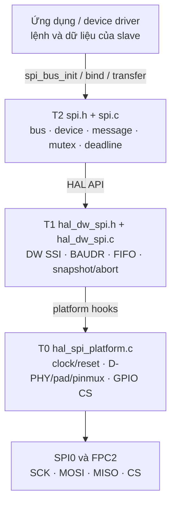

# Kiến trúc driver SPI0 SG2002 và lộ trình phát triển

**Phạm vi:** SPI0 master trên SG2002/CV181x, FreeRTOS Core 1, chân FPC2 của LicheeRV-Nano. Tài liệu mô tả driver SPI dùng chung. Giao thức của từng slave thuộc driver thiết bị phía trên.

**Trạng thái source:** T0–T2 có backend polling và đã được biên dịch, liên kết trong image FreeRTOS ở lần build trước. Chưa có kết quả đo xác nhận clock PLL, timing chân, throughput hay giao dịch trên board đối với source hiện tại. `SPI_BACKEND_IRQ` và `SPI_BACKEND_DMA` được khai báo nhưng trả `SPI_ERR_UNSUPPORTED`.

## 1. Vì sao chia tầng

Một giao dịch SPI cần ba nhóm quyết định khác nhau: board cấp clock và nối chân; bộ điều khiển DW SSI phát/thu frame; task FreeRTOS chia sẻ bus và quản lý timeout. Tách T0–T2 giúp thay đổi board, backend hoặc thiết bị ngoại vi mà không đưa register SoC và protocol slave vào API ứng dụng.

| Tầng | Trách nhiệm | Source | Không sở hữu |
| --- | --- | --- | --- |
| T0 — platform | Clock, reset, pad, pinmux, D-PHY, GPIO CS, timebase | [`hal_spi_platform.c`](../../freertos/cvitek/hal/cv181x/spi/src/hal_spi_platform.c) | FIFO, message, mutex |
| T1 — controller HAL | Register DW SSI, mode, BAUDR, FIFO polling, trạng thái và abort | [`hal_dw_spi.c`](../../freertos/cvitek/hal/cv181x/spi/src/hal_dw_spi.c) | Task, cấu hình slave, protocol |
| T2 — bus/device | Public API, cấu hình thiết bị, kiểm tra buffer, mutex, deadline, kết quả | [`spi.c`](../../freertos/cvitek/driver/spi/src/spi.c) | Register SoC, nội dung lệnh slave |
| Tầng trên | Quy trình/lệnh và kiểm tra dữ liệu của từng ngoại vi | Ứng dụng hoặc device driver riêng | Clock/pinmux/FIFO trực tiếp |



## 2. Phần cứng và quyền sở hữu

- **SPI0:** base `0x04180000`. T0 chọn nguồn clock, bật gate APB/SPI và deassert reset trước khi T1 truy cập register.
- **Chân ngoài:** FPC2.15 là SCK, FPC2.18 là SDO/MOSI, FPC2.17 là SDI/MISO. FPC2.14 được mux thành GPIOC17 làm CS active-low. `external_pins=0` dành cho loopback nội và không nối các chân này.
- **D-PHY/pad:** FPC2 đi qua khối DSI D-PHY; recipe trong T0 chuyển sang đường digital, cấu hình pad và pinmux. FPC2/D-PHY không thể được ứng dụng khác tự ý đổi khi SPI đang dùng.
- **Linux và FreeRTOS:** mutex T2 chỉ đồng bộ các task đi qua cùng API. Hệ thống phải cấp quyền sở hữu SPI0, clock, GPIOC và D-PHY cho một phía; tránh Linux driver hoặc code khác ghi cùng register.
- **DMAC:** backend DMA tương lai còn cần quyền sở hữu controller DMA, request remap và channel giữa các lõi. Chưa gán channel cho driver hiện tại.

Các địa chỉ và bit cụ thể nằm trong source T0 và [TRM](../TRM/TRM_v102.md). Nối chân và mức điện áp thực tế cần đối chiếu [pinmux](../Pinmux/Pinmux.md), [schematic](../Schematic/LicheeRV_Nano_70415_Schematic_AI.md) và board đang dùng.

## 3. Clock và tốc độ

`spi_bus_config_t.force_xtal=1` chọn XTAL 25 MHz. `force_xtal=0` cấu hình divider FPLL/8 và đặt `clock_hz=187.5 MHz` theo giả định FPLL 1.5 GHz trong source. T1 chọn BAUDR chẵn, tối thiểu 2, sao cho `actual_hz = clock_hz / BAUDR` không vượt `max_hz` và giới hạn source `46.875 MHz`.

| Nguồn T0 | Clock khai báo | Ví dụ trần SCK tính toán | Mức xác minh |
| --- | ---: | ---: | --- |
| XTAL | 25 MHz | 12.5 MHz (BAUDR=2) | Cần đo cho cấu hình đang chạy |
| FPLL/8 | 187.5 MHz | 46.875 MHz (BAUDR=4 theo trần source) | Giả định thiết kế; chưa đo trên board |

`actual_hz` là kết quả tính từ clock khai báo và BAUDR, không phải phép đo SCK. DMA giảm CPU phục vụ FIFO; nó không tự tăng SCK. Giới hạn `max_hz` của từng slave phải do caller đặt theo datasheet và chất lượng tín hiệu đã đo.

## 4. Luồng khởi tạo

```mermaid
sequenceDiagram
    participant A as Ứng dụng
    participant B as T2 bus
    participant P as T0 platform
    participant H as T1 HAL
    A->>B: spi_bus_init(0, config)
    B->>P: prepare(clock, gate, reset, base)
    P-->>B: base + clock_hz
    B->>H: hal_spi_init()
    Note over H: SSI off; probe FIFO khi chân ngoài chưa nối
    B->>P: connect(D-PHY, pad, pinmux, CS inactive)
    B-->>A: SPI_OK / lỗi; bus ready chỉ khi đủ ba bước
    A->>B: spi_device_bind(bus, device_config)
```

T0 có thể để lại clock/pad đã cấu hình một phần nếu init lỗi; source hiện không rollback mọi register dùng chung. Khởi tạo lại phải được ứng dụng tuần tự hóa và giải quyết nguyên nhân lỗi trước.

## 5. Luồng truyền, kết thúc và lỗi

```mermaid
sequenceDiagram
    participant A as Caller
    participant B as T2 spi_transfer
    participant H as T1 HAL
    participant P as T0 GPIO CS
    A->>B: message + result
    B->>B: validate toàn message; deadline; lấy mutex
    B->>H: configure(mode, bits, max_hz)
    B->>H: begin()
    H->>P: CS active
    B->>B: cs_setup_us
    loop Mỗi segment, CS vẫn active
        B->>H: poll(tx, rx, fill, frames, deadline)
    end
    B->>H: finish(): TX empty và !BUSY
    B->>B: cs_hold_us nếu thành công
    B->>H: snapshot(SR, RISR)
    B->>H: abort(): tắt SSI/request, CS inactive
    H->>P: CS inactive
    B->>B: lưu result; nhả mutex
    B-->>A: status + diagnostics
```

Một `spi_message_t` có 1–32 segment, giữ CS qua toàn message. SCK có thể tạm dừng giữa segment hoặc khi task bị preempt. TX NULL phát `fill_word`; RX NULL vẫn drain FIFO. Timeout áp dụng cho cả chờ mutex và truyền. Trên lỗi/timeout, T2 vẫn snapshot rồi abort. Nếu cleanup không xác nhận SSI/CS inactive, bus chuyển NOT_READY; `transfer_status` giữ lỗi gốc, `cleanup_status` báo lỗi dọn dẹp.

## 6. Hợp đồng hiện tại và giới hạn

- Chỉ bus 0, một CS GPIO active-low, tối đa bốn device handle tĩnh.
- Mode 0–3, MSB-first, 4–16 bit/frame. Buffer là `uint8_t[]` cho ≤8 bit, `uint16_t[]` cho 9–16 bit.
- Backend hoạt động là full-duplex polling. IRQ/DMA, LSB-first, nhiều CS, native hardware CS và các mode TMOD chuyên biệt chưa hỗ trợ.
- `spi_device_bind()` và `spi_device_unbind()` cần được ứng dụng tuần tự hóa; không unbind handle đang được task khác dùng.
- Buffer, message và result phải hợp lệ suốt lời gọi. TX/RX không chồng lấn giữa các segment. T2 không biết số byte thực sự được cấp phát phía sau con trỏ C.
- `SPI_OK` chỉ xác nhận giao dịch bus hoàn thành; việc slave có nhận lệnh, CRC hoặc nội dung dữ liệu đúng thuộc tầng trên.

Chi tiết từng hàm và thứ tự đọc source ở [hướng dẫn T0–T2](spi_layers_0_2_completion_report.md). Public contract chuẩn nằm trong [`spi.h`](../../freertos/cvitek/driver/spi/include/spi.h).

## 7. Tích hợp build và xác minh

HAL SPI được đăng ký trong `freertos/cvitek/hal/cv181x/CMakeLists.txt`, driver SPI trong `freertos/cvitek/driver/CMakeLists.txt`. Hai thư viện object được đưa vào `libhal.a` và `libdriver.a`, sau đó ứng dụng FreeRTOS liên kết vào `cvirtos.elf`.

| Mức | Cần xác minh | Trạng thái |
| --- | --- | --- |
| Compile/link | HAL, driver, image FreeRTOS | Đã hoàn thành ở lần build trước; không phải nghiệm thu board |
| Điện và clock | SCK, CS, MOSI/MISO, nguồn PLL, timing setup/hold | Chưa có kết quả đo cho source hiện tại |
| Giao dịch slave | Mode, dữ liệu, timeout, phục hồi lỗi | Cần kiểm chứng trên board mục tiêu |
| Hiệu năng | Throughput, gap SCK, tải CPU | Chưa đo |

## 8. Lộ trình phát triển driver chung

1. Xác nhận ownership SPI0/FPC2/clock với Linux và đo XTAL/PLL, CS, SCK trên board. Chọn giới hạn SCK từ phép đo và khả năng từng slave.
2. Hoàn thiện backend DMA dùng chung: chốt request/remap/channel, phối hợp ownership DMAC, TX/RX full-duplex, descriptor cho transfer dài, IRQ/completion, timeout/abort và cache coherency. Không trả buffer khi channel còn hoạt động.
3. Kiểm tra tính tương đương hợp đồng `spi_transfer()` giữa polling và DMA, kể cả message nhiều segment và lỗi giữa giao dịch. Đo tải CPU/throughput trên board.
4. Viết driver thiết bị ở tầng trên `spi.h`: lệnh, framing, kiểm tra nội dung, retry và buffer theo datasheet riêng. Mọi yêu cầu timing đặc biệt phải được biểu diễn hoặc bổ sung rõ trong hợp đồng SPI chung.

Các bài test slave và tài liệu thiết bị cụ thể là tài liệu riêng; chúng không định nghĩa kiến trúc của T0–T2.
