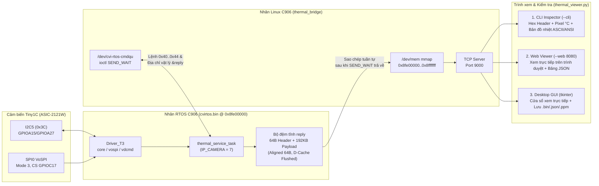

# Ứng Dụng Thu Nhận, Truyền Dẫn & Xem Dữ Liệu Camera Nhiệt Tiny1C (`App`)

Thư mục này chứa toàn bộ tuyến ứng dụng hoàn chỉnh từ nhân **RTOS C906** sang **Linux C906** và hiển thị/kiểm tra trực quan dữ liệu truyền sang trên **PC / Terminal / Web Browser**.

Đọc [lộ trình T3 → App](../LO_TRINH_DOC_T3_APP.md) để theo từng hàm từ camera tới viewer.

## Chạy nhanh cho stream và thu dữ liệu thô

Build bridge cho board và bản giả lập trên PC:

```bash
make -C Doc_md/Tiny-1C/App all linux test
```

Bản cho board: `Doc_md/Tiny-1C/App/build/thermal_bridge` (RISC-V, static).
Chép bản này thay bridge cũ trên board, dừng tiến trình bridge cũ rồi chạy:

```bash
/root/thermal_bridge --resources-owned --bind 0.0.0.0 --port 9000
```

Chọn **một** trong hai lệnh dưới trên PC (bridge phục vụ một client tại một thời điểm).
IP `10.250.50.1` là USB Ethernet đã dùng trong bring-up; thay nếu board dùng IP khác.

**1. Stream đầy đủ để quan sát và hiểu dữ liệu:**

```bash
python3 Doc_md/Tiny-1C/App/pc/thermal_viewer.py 10.250.50.1 --run stream --mode temp --fps 25
```

Mở `http://127.0.0.1:8080`. Có nút Nhiệt / Ảnh / Kép, FFC, header hex,
metadata, cờ chất lượng, min/max/tâm, mẫu byte và phép đổi °C. `render_ms` là thời gian
xử lý ảnh và metadata trên PC, không phải độ trễ từ cảm biến. Đổi cổng bằng `--web 8081`.
Các chế độ Desktop, `--cli`, xuất ảnh và `--scan` cũ vẫn dùng được.

**2. Chỉ nhận dữ liệu để xử lý tiếp, không dựng ảnh:**

```bash
python3 Doc_md/Tiny-1C/App/pc/thermal_viewer.py 10.250.50.1 --run data --mode temp --fps 25
```

Mặc định chạy liên tục đến Ctrl+C, kiểm tra ABI của từng gói, chỉ in thống kê mỗi giây.
Không lưu nếu thiếu `--output`. Để thu 500 khung và lưu dữ liệu nguyên gốc:

```bash
python3 Doc_md/Tiny-1C/App/pc/thermal_viewer.py 10.250.50.1 --run data --mode temp --fps 25 --count 500 --output capture.thm
```

`capture.thm` gồm các bản ghi liên tiếp `[64-byte THM1 header][payload_bytes byte payload]`,
không phải ảnh hay CSV. File đích được ghi đè nếu đã tồn tại. Payload Y16/YUYV không đổi.
Có thể tích hợp thuật toán tại biến `h, data` trong `run_data()`; Y16 ở offset 0 (temp)
hoặc 98304 (dual), `raw/64 - 273.15` ra °C. Nếu ghi file hoặc xử lý chậm,
chế độ data chờ hoàn tất rồi mới yêu cầu khung tiếp theo; không tự bỏ khung đã nhận.
`--mode image` hoặc `--mode dual` chọn dữ liệu khác; `all` chỉ có nghĩa quét cả ba ở CLI,
còn stream/data bắt đầu bằng temp. Dừng client trước khi chuyển sang chế độ khác.

Các tối ưu đã áp dụng:

- Bridge gửi header + payload cùng một lần gọi; bật TCP_NODELAY hai đầu đường nhận liên tục.
- Stream chỉ giữ một khung mới nhất đang chờ hiển thị để tránh tích lũy trễ.
- Thống kê nhiệt không dựng RGB dư thừa; Web tái sử dụng thống kê từ lần dựng ảnh.
- Màu nhiệt được tính theo giá trị Y16 phân biệt; YUYV xám dùng bảng tra chính xác.
- BMP đổi kênh bằng thao tác mảng; HTTP không giữ khóa trong lúc dựng ảnh.
- Web cập nhật theo `--fps`, chờ ảnh tải xong trước lần tiếp theo, không tải lại cùng seq.
- Tốc độ yêu cầu mặc định là 25 FPS, thay vì 8; đây là giới hạn yêu cầu,
  không đảm bảo tốc độ cảm biến. Dual có lượng dữ liệu gấp đôi temp/image.

Không thay firmware RTOS, xung SPI hay trình tự thu camera trong đợt tối ưu này.
11 kiểm thử giả lập đạt; benchmark trên PC: thermal RGB khoảng 11 → 3,4 ms,
YUYV xám 38 → 0,09 ms/khung; ảnh màu YUYV giữ đường chuyển đổi tổng quát.
Đã đối chiếu pixel với bản trước trên mẫu ngẫu nhiên, biên và dải nhiệt cố định/tự động.
Chưa đo FPS trên board thật; dùng thống kê chế độ data để phân biệt giới hạn thu/mạng
với chi phí hiển thị. Có thể chạy thử bằng `build/thermal_bridge_host --simulate`
và đổi host thành `127.0.0.1`.


---

## 1. Sơ đồ luồng dữ liệu toàn tuyến (End-to-End Pipeline)



---

## 2. Cấu trúc các thành phần trong `App/`

| Thành phần | Đường dẫn tệp | Chức năng chi tiết |
| :--- | :--- | :--- |
| **Giao thức ABI 64-byte** | [`include/thermal_protocol.h`](include/thermal_protocol.h) | Định nghĩa `thermal_header_t` (64 byte, magic `THM1` = `0x314D4854`), mã lệnh Mailbox `0x40..0x44`, cờ tài nguyên (`THERMAL_GPIO_OWNED`, `THERMAL_DMA_OWNED`) và cờ chất lượng khung (`THERMAL_FLAG_*`). |
| **Dịch vụ RTOS C906** | [`rtos/thermal_service.c`](rtos/thermal_service.c) | Tác vụ FreeRTOS gắn vào `E_QUEUE_CAMERA` (`IP_CAMERA = 7`). Điều khiển `Driver_T3`, thu khung vào vùng đệm tĩnh `reply`, thực hiện `flush_dcache_range` + `fence rw, rw` và gửi trả địa chỉ vật lý qua `E_QUEUE_CMDQU`. |
| **Cầu nối Linux / Simulator** | [`linux/thermal_bridge.c`](linux/thermal_bridge.c) | Quản lý khóa độc quyền `/run/thermal-camera.lock`, gọi `ioctl(SEND_WAIT)` tới `/dev/cvi-rtos-cmdqu`, ánh xạ `/dev/mem` để đọc `reply` và phát qua TCP (`127.0.0.1:9000`). Hỗ trợ `--simulate` để chạy độc lập trên PC. |
| **Trình xem & Kiểm tra dữ liệu** | [`pc/thermal_viewer.py`](pc/thermal_viewer.py) | Giải mã gói tin `THM1` + Payload ở cả 3 chế độ (`MODE_TEMP`, `MODE_IMAGE`, `MODE_DUAL`). Hỗ trợ **3 chế độ xem**: `--cli` (Terminal Inspector + Bản đồ nhiệt), `--web <port>` (Trình duyệt Web) và cửa sổ Tkinter GUI. |
| **Kiểm thử tự động** | [`tests/test_pipeline.py`](tests/test_pipeline.py) | Bộ 11 bài test `unittest` kiểm tra toàn bộ giao thức TCP, giải mã nhiệt độ `Y16 -> °C`, ảnh `YUYV -> RGB`, kiểm tra gói lỗi và xuất ảnh BMP/PPM. |
| **Kịch bản Build Firmware & FIP** | [`scripts/build_firmware.sh`](scripts/build_firmware.sh), [`scripts/build_mailbox.sh`](scripts/build_mailbox.sh), [`scripts/package_fip.py`](scripts/package_fip.py) | Biên dịch `cvirtos.bin` (tích hợp `THERMAL_TINY1C=ON`), biên dịch module kernel `soph_rtos_cmdqu.ko` và đóng gói `fip-thermal.bin` bảo toàn nguyên vẹn `BL2/DDR_PARAM/MONITOR/LOADER_2ND`. |

---

## 3. Cấu trúc dữ liệu Camera nhiệt truyền sang như thế nào?

Mỗi khung hình gửi từ `thermal_bridge` sang `thermal_viewer.py` là một gói nhị phân gồm **2 phần nối tiếp nhau**:

### Phần 1: Gói Header `thermal_header_t` (Cố định 64 byte, Little-Endian)

| Offset (Byte) | Tên trường | Kiểu | Giá trị mẫu (`MODE_TEMP`) | Ý nghĩa |
| :---: | :--- | :---: | :--- | :--- |
| `00..03` | `magic` | `uint32` | `0x314D4854` (`54 48 4d 31`) | Chuỗi định danh `'THM1'` |
| `04..07` | `version` | `uint32` | `1` | Phiên bản giao thức ABI |
| `08..11` | `header_bytes` | `uint32` | `64` | Độ dài Header cố định 64 byte |
| `12..15` | `status` | `int32` | `0` (`IR_SUCCESS`) | Mã trạng thái thực thi từ RTOS (`0` = thành công, `< 0` = lỗi) |
| `16..19` | `seq` | `uint32` | `1, 2, 3...` | Số thứ tự khung hình tăng dần tại RTOS |
| `20..23` | `mode` | `uint32` | `0` / `1` / `2` | `0`: `MODE_IMAGE` (YUYV), `1`: `MODE_TEMP` (Y16), `2`: `MODE_DUAL` |
| `24..27` | `width` | `uint32` | `256` | Chiều rộng khung hình (256 cột) |
| `28..31` | `height` | `uint32` | `192` hoặc `384` | Chiều cao (`192` cho đơn, `384` cho `MODE_DUAL`) |
| `32..35` | `payload_bytes` | `uint32` | `98304` hoặc `196608` | Số byte dữ liệu đi kèm ngay sau Header (`0` nếu là lệnh điều khiển/lỗi) |
| `36..39` | `timestamp_ms` | `uint32` | `ms` | Thời gian theo bộ đếm `rdtime` 25 MHz trên RTOS |
| `40..43` | `index_image` | `uint32` | `0..65535` | Số thứ tự `frame_index` từ gói VoSPI Header `0xAA` |
| `44..47` | `index_temp` | `uint32` | `0..65535` | Số thứ tự `frame_index` từ gói VoSPI Header `0xCC` (trong `MODE_DUAL`) |
| `48..51` | `flags` | `uint32` | Bitmask | Bit 0: `SIMULATED`, Bit 1: `SHUTTER_CLOSED`, Bit 2: `FROZEN`, Bit 3: `HIGH_GAIN`, Bit 4: `DUAL_INDEX_MISMATCH` |
| `52..55` | `vtemp` | `uint32` | `2960` (`0x0B90`) | Metadata thô `vtemp` từ VoSPI header |
| `56..59` | `reserved[0]` | `uint32` | Mã `BB_*` có dấu | Lỗi I2C gốc dạng bù 2: `-2` timeout, `-3` NACK, `-4` busy, `-5` arbitration, `-6` not ready; `0` nếu giao dịch cuối thành công |
| `60..63` | `reserved[1]` | `uint32` | Bước probe hoặc start / vị trí NACK / thanh ghi | Bits `31:24`: bước probe (1 PROJECT, 2 FW date, 3 FW version, 4 PN, 5 SN, 6 preview, 7 Y16); bits `23:16`: byte bị NACK (`0` địa chỉ msg0, `1..` dữ liệu msg0, bit 7 chọn msg1, `255` nếu không NACK); bits `15:0`: thanh ghi I2C cuối |

Trong bảng trên, `index_image`, `index_temp`, `flags` và `vtemp` mang metadata của CAPTURE thành công. RTOS dùng lại các trường này cho INFO và chẩn đoán START/CAPTURE lỗi. Xem [giải thích RTOS](../Implementation/02_rtos_app.md) để giải mã theo lệnh và status.

### Phần 2: Vùng dữ liệu điểm ảnh `payload` (`98,304` hoặc `196,608` byte)

1. **Ở chế độ Nhiệt độ `MODE_TEMP` (`mode = 1`, `98,304` byte)**:
   - Gồm `256 × 192 = 49,152` điểm ảnh, mỗi điểm ảnh là 1 số nguyên 16-bit không dấu Little-Endian (`raw_u16 = byte_low | (byte_high << 8)`).
   - Công thức giải mã nhiệt độ tại mỗi điểm ảnh $(x, y)$:
     $$\text{Kelvin} = \frac{\text{raw\_u16}}{64.0}, \qquad ^\circ\text{C} = \frac{\text{raw\_u16}}{64.0} - 273.15$$
   - Ví dụ thực tế từ gói tin:
     - Hai byte Little-Endian `[c9 49]` $\rightarrow \text{raw\_u16} = \text{0x49C9} = 18889 \rightarrow 295.14\text{ K} \rightarrow \mathbf{21.99^\circ\text{C}}$.
     - Hai byte Little-Endian `[c9 4d]` $\rightarrow \text{raw\_u16} = \text{0x4DC9} = 19913 \rightarrow 311.14\text{ K} \rightarrow \mathbf{37.99^\circ\text{C}}$.
2. **Ở chế độ Ảnh `MODE_IMAGE` (`mode = 0`, `98,304` byte)**:
   - Định dạng `YUYV422` (`256 × 192 × 2` byte). Mỗi cụm 4 byte `[Y0, U, Y1, V]` biểu diễn 2 điểm ảnh liên tiếp trên cùng một hàng, được giải mã sang `RGB24` để hiển thị.
3. **Ở chế độ Kép `MODE_DUAL` (`mode = 2`, `196,608` byte)**:
   - `98,304` byte đầu (`offset 0..98303`): Mặt phẳng ảnh `YUYV422` (`256 × 192`) thu từ lệnh VoSPI `0xAA`.
   - `98,304` byte sau (`offset 98304..196607`): Mặt phẳng nhiệt độ `RAW Y16` (`256 × 192`) thu từ lệnh VoSPI `0xCC`.

---

## 4. Hướng dẫn 3 cách xem dữ liệu Camera nhiệt truyền sang

### Cách 1: Xem chi tiết cấu trúc gói tin, điểm ảnh °C & Bản đồ nhiệt ngay trên Terminal (`--cli`)

Không cần cài đặt `tkinter` hay bất kỳ thư viện ngoài nào:

```bash
# 1. Build bridge và chạy kiểm thử tự động
make -C Doc_md/Tiny-1C/App all linux test

# 2. Khởi chạy bridge ở chế độ giả lập (hoặc kết nối tới IP của board thật)
./Doc_md/Tiny-1C/App/build/thermal_bridge_host --simulate --port 9000 &

# 3. Chạy trình kiểm tra dữ liệu (--cli) cho cả 3 chế độ (temp, image, dual) và xuất file mẫu
python3 Doc_md/Tiny-1C/App/pc/thermal_viewer.py 127.0.0.1 --port 9000 --cli --mode all \
    --dump-dir Doc_md/Tiny-1C/App/build/sample_frames
```

### Cách 2: Xem trực tiếp luồng Video Nhiệt / YUYV / Kép trên Trình duyệt Web (`--web 8080`)

Dành cho máy tính không cài `python3-tk` hoặc khi muốn xem qua trình duyệt:

```bash
python3 Doc_md/Tiny-1C/App/pc/thermal_viewer.py 127.0.0.1 --port 9000 --web 8080
```
Sau đó mở trình duyệt tại **`http://127.0.0.1:8080`** để xem trực tiếp hình ảnh nhiệt, chuyển đổi qua lại giữa 3 chế độ (`Nhiệt Y16`, `Ảnh YUYV`, `Kép Ảnh + Nhiệt`), bấm hiệu chuẩn màn trập (`FFC`) và quan sát bảng JSON giải mã gói tin theo thời gian thực.

### Cách 3: Xem bằng cửa sổ ứng dụng Desktop Tkinter (khi máy có `python3-tk`)

```bash
python3 Doc_md/Tiny-1C/App/pc/thermal_viewer.py 127.0.0.1 --port 9000
```
*(Nếu máy chưa cài `python3-tk`, lệnh trên sẽ tự động thông báo và chuyển sang chế độ hiển thị trực tiếp trên Terminal `--cli`.)*
