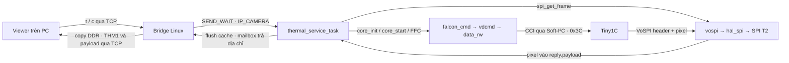

# Lộ trình đọc Tiny1C từ driver T3 đến ứng dụng

Đọc theo một lần START và một lần CAPTURE ở `MODE_TEMP`, sau đó mở rộng sang `MODE_DUAL`, xử lý lỗi và triển khai. Bạn cần nhận ra ba đơn vị dữ liệu khác nhau: một giao dịch thanh ghi I²C, một cặp giao dịch VoSPI cho mỗi mặt phẳng, và một bản ghi THM1 để chuyển từ RTOS đến PC.



## 1. Bắt đầu ở ranh giới ứng dụng

**Đọc** [ABI dùng chung](../../freertos/cvitek/driver/sensor/tiny1C/include/thermal_protocol.h) → [task RTOS](../../freertos/cvitek/driver/sensor/tiny1C/rtos/thermal_service.c) → [tổng quan App](App/README.md) (bản ABI/bridge phía Linux nằm tại [App/include/thermal_protocol.h](App/include/thermal_protocol.h)). Tìm các nhánh START và CAPTURE trong task. Ghi lại đầu vào, đầu ra và trạng thái mà mỗi nhánh thay đổi.

| Sự kiện | Byte TCP | Mã mailbox | Hiệu ứng ở RTOS |
| --- | --- | --- | --- |
| START | `i`, `t`, `d` | `0x40` | Mode 0/1/2 ở byte thấp của `param_ptr`, bit 16 xác nhận tài nguyên GPIO/SPI, bit 17 xác nhận DMA. Khởi tạo khi cần rồi bật preview. |
| CAPTURE | `c` | `0x41` | Nếu đang stream, gọi `spi_get_frame()` và điền metadata. `seq` tăng khi capture thành công. |
| STOP | `s` | `0x42` | Gọi `core_stop()`. |
| FFC | `f` | `0x43` | Gọi `trigger_shutter()` khi đang stream. |
| INFO | `?` | `0x44` | Trả thông tin thiết bị nếu đã init; nếu chưa, thử quét khi bus I²C đã sẵn sàng. |

Mọi lệnh dùng IP 7. Một task giữ quyền gọi T3 nên START, CAPTURE, STOP và FFC đi tuần tự. Boot tạo task và queue. Phần cứng camera chỉ được khởi tạo khi START đi qua kiểm tra mode và ownership. Task yêu cầu preview ở 25 fps và chờ 100 ms sau START thành công. Nhịp CAPTURE thực tế đi theo yêu cầu của client.

**Tự kiểm**. Theo dõi `initialized`, `streaming` và `sequence` nếu gửi `c → t → c → s → c`. Xác định hai lần CAPTURE nào trả payload rỗng và lúc nào bộ đếm tăng.

## 2. Theo START xuống đường điều khiển I²C

**Đọc** [core.c](../../freertos/cvitek/driver/sensor/tiny1C/src/core.c) theo `core_init → core_probe_device_info → core_start → core_stop`. Lần init đi qua `data_rw_i2c_hw_init`, đăng ký VDCMD, probe các mục CHIP_ID, PROJECT, FW_DATE, FW_VERSION, PN, SN. Xem trực tiếp nhánh xử lý từng mục. PROJECT, PN và SN trả lỗi probe khi lỗi transport nhưng cho phép tiếp tục khi gặp `IR_CHECK_DONE_FAIL`. Mask thành công đầy đủ là `0xF3` do các bit có vị trí rời nhau. `probed` và mask cung cấp hai thông tin khác nhau.

Sau init I²C, service gọi `spi_stream_init()`. `core_start()` kiểm tra mode, fps 1–25 và kết quả probe, dừng cấu hình trước, đặt SCK rồi gọi `preview_start`. TEMP thêm `y16_preview_start(..., Y16_MODE_TEMPERATURE)`. DUAL đặt chiều cao preview 384, trong khi từng mặt phẳng VoSPI vẫn cao 192. FFC gọi lệnh OOC B-update qua chuỗi điều khiển; xem `trigger_shutter` khi cần lần theo nút FFC.

**Đọc** [falcon_cmd.c](../../freertos/cvitek/driver/sensor/tiny1C/src/falcon_cmd.c) để tìm `preview_start`, `get_device_info` và `ooc_b_update`. Từ một caller, đi sang [vdcmd.c](../../freertos/cvitek/driver/sensor/tiny1C/src/vdcmd.c) và [vdcmd.h](../../freertos/cvitek/driver/sensor/tiny1C/include/vdcmd.h) để xem header short/standard/long tương ứng 4/8/16 byte, cách ghép tham số và khóa thiết bị. Đọc `standard_cmd_read` trước, rồi so với `standard_cmd_write` có đường nạp giữ và commit. Với lệnh long, theo dõi dữ liệu nạp ở vùng hold và phần kích hoạt tại vùng RW cộng offset.

**Đọc** [data_rw.c](../../freertos/cvitek/driver/sensor/tiny1C/src/data_rw.c) theo `i2c_data_write → t3_i2c_write_reg16 → i2c_check_access_done`. Driver chuẩn hóa `0x78` thành địa chỉ 7 bit `0x3C`. CCI gửi byte cao của địa chỉ thanh ghi trước. Vùng `0x1D00` là command/response, `0x9D00` là hold. Ghi thanh ghi có bit 15 bật bỏ qua bước poll. Đường commit chờ status tại `0x0200`; bit 0 báo busy, bit 1 báo result fail, các bit 7:2 mang lỗi lệnh. Driver chờ 5 ms giữa các lần poll khi busy. Mặc định poll có ngưỡng 20 s, chờ mutex VDCMD 25 s, còn từng transfer I²C có ngân sách 1 s. Đây là các cửa sổ chờ theo từng lớp. Một START gồm nhiều lệnh và có thể chịu timeout riêng ở mailbox 30 s.

**Tự kiểm**. Vẽ chuỗi đọc một byte ở `0x0200` từ T3 xuống T1. Giải thích vì sao cần giữ mutex VDCMD suốt submit → poll → response dù T2 đã khóa bus từng lần. So sánh lỗi T1 `BB_NACK`, lỗi ghi T3 `IR_I2C_SET_REGISTER_FAIL` và lỗi ASIC `IR_CHECK_DONE_FAIL`. Khi đọc chính sách retry, tách các lần thử lại đọc/nạp giữ khi recover khỏi gói commit mà driver không phát lại. [Ranh giới I²C T0–T2](../I2C_Arch/README.md)

## 3. Theo CAPTURE xuống đường dữ liệu VoSPI

**Đọc** [all_config.h](../../freertos/cvitek/driver/sensor/tiny1C/include/all_config.h), [hal_spi.h](../../freertos/cvitek/driver/sensor/tiny1C/include/hal_spi.h) và [hal_spi.c](../../freertos/cvitek/driver/sensor/tiny1C/src/hal_spi.c). Tiny1C bind SPI0 mode 3, word 8 bit, MSB-first, GPIO CS và `rx_sample_dly=1`. Mặc định dùng polling. Đường khởi tạo tương thích gọi cấu hình divider 8 nên có thể log 23,4375 MHz, còn `core_start()` đặt cả mode đơn và kép về 11,71875 MHz theo cấu hình hiện tại. `use_25m_osc` là tham số tương thích; adapter hiện tính tốc độ từ ref clock của bus. Cờ DMA được dùng lúc khởi tạo; điều kiện thực tế còn phụ thuộc tài nguyên board.

**Đọc** [vospi.h](../../freertos/cvitek/driver/sensor/tiny1C/include/vospi.h) → [vospi.c](../../freertos/cvitek/driver/sensor/tiny1C/src/vospi.c), từ `spi_get_frame` đến `vospi_read_single_frame`.

1. Gửi 512 byte, byte đầu là `0xAA` hoặc `0xCC`, phần còn lại bằng 0. Thu đồng thời vào `s_rx_dummy` trong một phiên CS.
2. Thử header 32 byte tại offset 64. Khi bit 0 ở byte đó bằng 0, quét từ 64 đến 480, chọn byte khác 0 đầu tiên rồi kiểm tra header. Đây là heuristic phù hợp với chuỗi dummy 0 quan sát trên module. Header toàn `0xFF` trả `-2`; bit 0 `frame_valid` bằng 0 trả `-4`. Xem [log tìm offset 480 trên board](Implementation/09_board_bringup_2026-11-18.md).
3. Nhả CS sau giao dịch header và chờ 1 ms bằng `delay_ms`. Giao dịch tiếp theo phát `0x55` để tạo clock và thu 98.304 byte thẳng vào buffer đích. Lỗi transfer payload hoặc payload toàn `0xFF` trả `-3`. Lỗi transport header cũng trả `-2`. Hai nhánh lỗi transport gọi phục hồi bus.
4. `MODE_IMAGE` dùng `0xAA` và xuất YUYV. `MODE_TEMP` cũng dùng `0xAA`, nhưng preview đã đổi sang Y16. Với buffer ít nhất 196.608 byte, `spi_get_frame()` thu `0xAA` vào nửa đầu và `0xCC` vào nửa sau, giữ metadata riêng. Nếu nửa sau lỗi, App công bố payload dài 0 cho cả capture.

**Tự kiểm**. Vẽ CS, SCK và MOSI trong mode DUAL. Đếm bốn phiên CS và hai khoảng chờ sau header. Với SCK cấu hình 11.718.750 Hz, chỉ riêng truyền 98.304 × 8 bit mất khoảng 67 ms. Dùng phép tính này để giải thích vì sao yêu cầu 25 fps ở PC có thể cao hơn tốc độ kéo dữ liệu trên board. [Ranh giới SPI T0–T2](../SPI_Arch/spi_driver_architecture_and_roadmap.md)

## 4. Theo khung từ RTOS qua DDR và mailbox

**Đọc** [thermal_service.c](../../freertos/cvitek/driver/sensor/tiny1C/rtos/thermal_service.c) từ nhánh CAPTURE đến cuối vòng lặp, rồi tìm `IP_CAMERA`, `E_QUEUE_CAMERA` và `prvCmdQuRunTask` trong [comm_main.c](../../freertos/cvitek/task/comm/src/riscv64/comm_main.c). Đọc tiếp [driver cmdqu Linux](../../osdrv/interdrv/rtos_cmdqu/rtos_cmdqu.c), tập trung vào `RTOS_CMDQU_SEND_WAIT`.

`reply` là buffer tĩnh căn 64 byte trong BSS của RTOS. Sau khi ghi header và payload, RTOS flush đúng vùng sẽ công bố rồi thực hiện `fence rw, rw`. Hàng đợi `E_QUEUE_CMDQU` gửi địa chỉ vật lý 32 bit qua mailbox. Linux dùng vùng DDR đã reserve (mặc định `0x8fe00000` đến `0x8fffffff`) để ánh xạ và copy. Tính ổn định của buffer dựa trên việc bridge copy xong mới phát lệnh sau. Khóa `flock` giúp các tiến trình bridge tuân thủ mô hình một chủ sở hữu.

Với frame thành công, `seq` là bộ đếm của task, còn `index_image/index_temp` đến từ camera. `vtemp` là metadata header VoSPI. Trong DUAL, cờ `0x10` cho biết hai index lệch nhau; frame vẫn hợp lệ. Header điều khiển và header lỗi có payload rỗng. Cách hiểu `index_*`, `flags` và `vtemp` trên ACK/lỗi phụ thuộc lệnh. Ví dụ CAPTURE `-4` dùng ba trường để mang mẫu RX và offset/giá trị byte khác 0 đầu tiên. START lỗi dùng `index_*` cho echo, `flags` cho mask probe và `vtemp` cho status VDCMD.

**Tự kiểm**. Giải thích dữ liệu nào đi qua mailbox, dữ liệu nào đi qua DDR, và vì sao flush phải xảy ra trước khi gửi địa chỉ. Phân biệt hai trường hợp cùng hiện mã `-4`: `reserved[0]` mang `BB_BUSY`, còn `status` từ CAPTURE có thể báo frame invalid.

## 5. Theo bridge và viewer đến một điểm ảnh

**Đọc** [thermal_bridge.c](App/linux/thermal_bridge.c) theo `main → transact → valid_header → send_all`. Bridge xử lý một client tại một thời điểm, kiểm tra IP/lệnh và địa chỉ/căn chỉnh trả về, kiểm tra ABI/biên vùng nhớ, copy rồi gửi TCP. Khi lỗi trao đổi, bridge kết thúc phiên client, thử STOP ở cleanup và tiếp tục listen. Một timeout có nghĩa bridge chưa nhận reply đúng hạn; tình trạng camera cần được kiểm tra tại RTOS.

**Đọc** [thermal_viewer.py](App/pc/thermal_viewer.py) theo `recv_exact → read_packet → decode_frame → thermal_rgb / yuyv_rgb`. TCP là luồng byte. Parser đọc đủ 64 byte theo `<IIIi12I`, rồi đọc đúng `payload_bytes`. YUYV gom `Y0 U Y1 V` cho hai pixel. Y16 lấy 2 byte little-endian tại `base + 2 * (y * 256 + x)`, với `base=0` ở TEMP và `base=98304` ở DUAL. Ví dụ `48 4c` thành `0x4c48 = 19528`, rồi `19528 / 64 - 273.15 = 31.975 °C`. DUAL hiển thị YUYV ở trên và bản đồ Y16 ở dưới.

Tiếp tục từ các hàm tiêu thụ frame. `run_cli()` in header, metadata, mẫu raw và xuất frame. `CameraWorker` kéo frame cho Web/GUI, hàng đợi một phần tử giữ kết quả gần nhất đang chờ hiển thị. `run_data()` có thể lưu từng bản ghi THM1 liên tiếp, xử lý/ghi xong rồi mới hỏi frame tiếp theo. `run_web()` phục vụ BMP và JSON từ trạng thái hiển thị. [Chế độ chạy và ví dụ lệnh](App/README.md)

**Tự kiểm**. Tính offset của điểm tâm `(128,96)` trong cả TEMP và DUAL. Đối chiếu nhiệt độ tính tay với báo cáo CLI. So sánh `seq`, index cảm biến và nhịp hiển thị khi Web bỏ qua frame đang chờ.

## 6. Chạy từ mô phỏng đến kiểm tra board

Từ gốc repo, chạy kiểm thử driver và pipeline giả lập.

```bash
make -C freertos/cvitek/driver/sensor/tiny1C test riscv-check
make -C Doc_md/Tiny-1C/App test
Doc_md/Tiny-1C/App/build/thermal_bridge_host --simulate
```

Ở terminal khác, xem lần lượt ba mode rồi lưu một bản ghi để tự giải mã.

```bash
python3 Doc_md/Tiny-1C/App/pc/thermal_viewer.py 127.0.0.1 --cli --mode all --frames 1
python3 Doc_md/Tiny-1C/App/pc/thermal_viewer.py 127.0.0.1 --run data --mode dual --count 1 --output /tmp/tiny1c-dual.thm
```

Bản ghi DUAL thành công dài `64 + 196608 = 196672` byte. So sánh các giả định với [test driver](../../freertos/cvitek/driver/sensor/tiny1C/tests/test_driver.c), [test lỗi I²C](../../freertos/cvitek/driver/sensor/tiny1C/tests/test_i2c_failure.c), [test VoSPI](../../freertos/cvitek/driver/sensor/tiny1C/tests/test_vospi.c) và [test pipeline](App/tests/test_pipeline.py). Mô phỏng đi qua định dạng và xử lý PC. Đường kernel mailbox, DDR, timing GPIO/FIFO vật lý và cảm biến cần board.

Trước khi đọc log board, đối chiếu [build và deploy](Implementation/05_build_deploy.md), [quy trình kiểm chứng](Implementation/06_validation.md) và [bring-up ngày 18/11](Implementation/09_board_bringup_2026-11-18.md). Firmware RTOS nằm trong FIP. Linux dùng DT đi cùng FIT `boot.sd`. Binary bridge và module kernel cũng có phiên bản riêng. Nhìn vào status của **DT đang chạy**, log init và mode thực tế để xác định đúng cấu hình đang thử.

| Triệu chứng | Điểm đọc trước | Tín hiệu dựa vào |
| --- | --- | --- |
| START `-22` hoặc BB not ready | GPIO platform, cờ START, pad và nguồn | Ownership, log idle LOW và trạng thái hai dây |
| START `-5`, I²C NACK hoặc VDCMD fail | `core_probe_device_info`, `data_rw.c`, `format_i2c_diag` | Stage, reg, pha NACK, status `0x0200`, probe mask và echo |
| START được, CAPTURE `-2/-4` | `vospi_read_single_frame`, ownership SPI0 | DT/SPI0 binding, mẫu RX, header toàn FF, offset và bit valid |
| CAPTURE `-3` | SPI payload, T2 snapshot và dây | Lỗi engine, dữ liệu toàn FF, CS/SCK và tín hiệu MISO |
| Bridge báo invalid ABI/address hoặc timeout | `transact`, driver mailbox, RTOS reply | Version firmware, reserved DDR, căn chỉnh, queue và phúc đáp |
| Hình hiển thị chậm hoặc màu khó đọc | `run_data` rồi Web/CLI | FPS thu, `render_ms`, giá trị raw và thang màu. Cờ mismatch chỉ nói về index hai mặt phẳng. |
