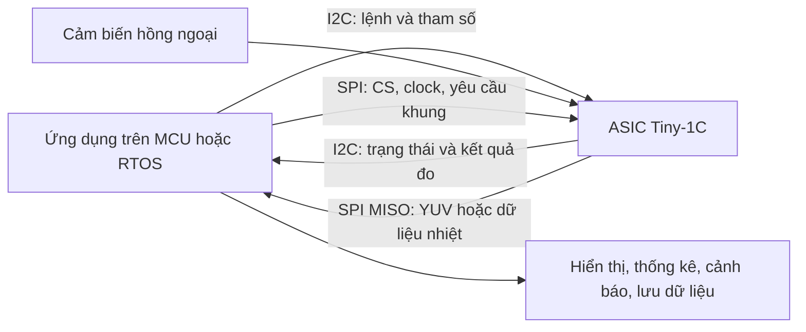

# Tiny-1C: chức năng camera nhiệt, giao tiếp SPI/I2C và khả năng chỉnh sửa

Tài liệu tiếng Việt được lập ngày 24/10/2026 bằng cách đọc tài liệu DOCX, bảng XLSX và mã C/H trong chính thư mục `ASIC_2121W_RTOS_SDK_V1.0.0_release`.

**Điểm cốt lõi:** I2C dùng để điều khiển và truy vấn camera; SPI dùng để lấy khung ảnh hoặc ma trận nhiệt độ. Bạn có thể chỉnh tham số camera qua API và sửa mã trên bộ xử lý chủ. Việc sửa thuật toán bên trong firmware camera hoặc thư viện nhị phân là phạm vi khác, không được cung cấp đầy đủ mã nguồn trong gói này.

## 1. Phạm vi và cách đọc tài liệu

Gói đang có ba phần cần phân biệt:

| Thư mục | Nội dung thực tế | Vai trò |
|---|---|---|
| `SPI/Tiny1C_STM32_SPI_SDK` | Ví dụ STM32F767, VOSPI, I2C, LCD, hiệu chỉnh nhiệt và cập nhật firmware | Mẫu tham khảo gốc cho đường truyền SPI + I2C |
| `DVP/Tiny1C_STM32_DVP_SDK` | Ví dụ STM32 dùng DVP/DCMI và I2C | Phương án lấy ảnh qua bus song song thay cho SPI |
| `RTOS_V1` | Mã triển khai cho SG2002/LicheeRV Nano, thu SPI, điều khiển I2C, lưới 8×8, IPC | Phần ứng dụng/tích hợp riêng có trong bản sao đang đọc |

Release note ở thư mục gốc ghi bản phát hành `1.0.0`; ví dụ SPI có `SDK_VERSION "0.3.0"`. Đây là phiên bản gói và phiên bản sample, không phải bằng chứng firmware đang chạy trên camera là phiên bản nào. [S1](release%20note.txt), [S4](SPI/Tiny1C_STM32_SPI_SDK/USER/main.c)

Trong tài liệu này:

- **Camera hỗ trợ:** được mô tả trong tài liệu hãng/bảng API Tiny1C, có thể phụ thuộc firmware.
- **Mã hiện có:** nhìn thấy cách triển khai trong nguồn, chưa đồng nghĩa đã được xác nhận trên phần cứng.
- **Có thể phát triển:** có thể xây dựng trên host từ dữ liệu camera; chưa khẳng định gói đã có sản phẩm hoàn chỉnh.

Chưa có phiên kiểm thử với camera thật. Không suy ra điện áp chân, NETD, tiêu cự, góc nhìn, sai số đo hoặc dải nhiệt danh định của thiết bị cụ thể từ tên SDK. Các thông số này cần datasheet đúng mã module/ống kính/firmware.

## 2. Tiny-1C cung cấp dữ liệu gì?

### 2.1. Khung ảnh nhiệt và khung nhiệt độ là hai loại dữ liệu

Camera quan sát bức xạ hồng ngoại của cảnh. Hệ thống cảm biến và ASIC xử lý dữ liệu để tạo ảnh hiển thị và dữ liệu phục vụ đo nhiệt. SDK cung cấp hai đầu ra cần phân biệt:

| Đầu ra | Định dạng được mô tả | Dùng để làm gì? |
|---|---|---|
| Ảnh hiển thị | YUV422, thứ tự YUYV | Xem cảnh nhiệt, áp bảng màu, chuyển sang RGB/LCD |
| Ma trận nhiệt độ | Mỗi pixel 2 byte, little-endian; thông tin nhiệt nằm ở 14 bit cao | Đổi sang °C, tìm điểm nóng/lạnh, tính thống kê và cảnh báo |

Ảnh YUV có thể thay đổi màu và độ tương phản theo xử lý hiển thị. Không dùng trực tiếp các byte YUV như giá trị nhiệt độ. Ngược lại, dữ liệu nhiệt độ 16 bit cần ánh xạ sang mức xám/bảng màu nếu muốn xem như ảnh. Tên `RAW16` trong `RTOS_V1` chỉ bộ đệm nhiệt độ 16 bit; không nên hiểu mặc định là tín hiệu ADC nguyên bản chưa hiệu chuẩn. [S2](SPI/RTOS%E2%95%9E%E2%95%9C%E2%95%A0%C2%BFSPI%E2%95%9C%E2%95%99%E2%94%90%E2%94%8C%E2%95%9A%CF%86%E2%95%9D%E2%96%A0%E2%94%90%C2%AC%E2%95%96%C3%B3%E2%95%AB%E2%95%A9%E2%94%B4%E2%95%A7%20Interface%20development%20instructionsV1.0.docx), [S4](SPI/Tiny1C_STM32_SPI_SDK/USER/main.c), [S12](RTOS_V1/src/stream_spi.c)

### 2.2. Độ phân giải và chế độ đầu ra

| Chế độ | Cấu hình preview trong sample | Dữ liệu nhận |
|---|---|---|
| Chỉ ảnh | `256×192`, `mode=8` | Một mặt phẳng YUV422 |
| Chỉ nhiệt độ | `256×192`, `mode=8`, thêm `y16_preview_start(..., Y16_MODE_TEMPERATURE)` | Một ma trận nhiệt độ |
| Ảnh + nhiệt độ | `256×384`, `mode=8` | Hai mặt phẳng 256×192: ảnh và nhiệt độ |
| Ảnh thường xuyên, nhiệt độ cách quãng | Cấu hình ảnh + nhiệt độ, điều chỉnh `interval` ở host | Sample đọc ảnh mỗi vòng, nhiệt độ theo chu kỳ |

`256×384` là kích thước đầu ra ghép hai loại dữ liệu, không có nghĩa cảm biến được nâng lên độ phân giải cảnh 256×384. Sample cấu hình `25 fps`; không coi tham số `fps` là bằng chứng camera chấp nhận mọi tốc độ khác. [S2](SPI/RTOS%E2%95%9E%E2%95%9C%E2%95%A0%C2%BFSPI%E2%95%9C%E2%95%99%E2%94%90%E2%94%8C%E2%95%9A%CF%86%E2%95%9D%E2%96%A0%E2%94%90%C2%AC%E2%95%96%C3%B3%E2%95%AB%E2%95%A9%E2%94%B4%E2%95%A7%20Interface%20development%20instructionsV1.0.docx), [S4](SPI/Tiny1C_STM32_SPI_SDK/USER/main.c)

Một mặt phẳng có `256 × 192 = 49.152 pixel`, chiếm `98.304 byte = 96 KiB`. Một cặp ảnh + nhiệt chiếm `196.608 byte = 192 KiB`, chưa kể phần giao thức và bộ đệm bổ sung.

## 3. SPI hoạt động thế nào, có chức năng gì?

### 3.1. Vai trò và bốn tín hiệu

VOSPI là giao thức xuất video qua SPI của ASIC camera. Host/MCU là **SPI master**; camera là **SPI slave**. Host phát clock và chọn thiết bị để lấy dữ liệu. [S2](SPI/RTOS%E2%95%9E%E2%95%9C%E2%95%A0%C2%BFSPI%E2%95%9C%E2%95%99%E2%94%90%E2%94%8C%E2%95%9A%CF%86%E2%95%9D%E2%96%A0%E2%94%90%C2%AC%E2%95%96%C3%B3%E2%95%AB%E2%95%A9%E2%94%B4%E2%95%A7%20Interface%20development%20instructionsV1.0.docx), [S5](SPI/Tiny1C_STM32_SPI_SDK/HARDWARE/SPI/spi.c)

| Tín hiệu | Chiều theo góc nhìn host | Chức năng |
|---|---|---|
| SCK | Host → camera | Clock để dịch từng bit |
| MOSI | Host → camera | Gửi lệnh VOSPI và byte tạo clock khi đọc |
| MISO | Camera → host | Trả dữ liệu khung và thông tin giao thức |
| CS/NSS | Host → camera | Chọn camera; sample dùng mức LOW để chọn |

SPI truyền và nhận đồng thời: muốn nhận một byte trên MISO, host vẫn phải phát clock, thường bằng cách truyền byte dummy trên MOSI. Vì vậy dữ liệu truyền trên MOSI trong lúc đọc pixel không phải là ảnh gửi ngược vào camera.

Các tín hiệu này cần mass chung và mức điện phù hợp với phần cứng. Pin nguồn và điện áp I/O phải lấy từ sơ đồ/datasheet đúng bo, không lấy từ tên tín hiệu SPI.

### 3.2. Cấu hình SPI được dùng trong Tiny1C sample

| Tham số | Cấu hình thực tế trong ví dụ |
|---|---|
| SPI mode | Mode 3: `CPOL=1`, `CPHA=1` |
| Trạng thái clock lúc rỗi | HIGH |
| Kích thước truyền | 8 bit |
| Thứ tự bit | MSB first |
| Kiểu truyền | Hai đường dữ liệu, full-duplex |
| STM32 | SPI4, prescaler `/4`, hàm truyền nhận blocking |
| CS trong mã STM32 | GPIO `PE4`, điều khiển bằng phần mềm |
| SG2002 trong `RTOS_V1` | SPI0, CS GPIO; driver đọc/ghi FIFO bằng polling |

Tài liệu DOCX có câu NSS do phần cứng điều khiển, nhưng mã `spi.c` cấu hình `SPI_NSS_SOFT` và `main.c` tự kéo GPIO CS. Khi mô tả sample chạy thế nào, cần theo mã này. [S2](SPI/RTOS%E2%95%9E%E2%95%9C%E2%95%A0%C2%BFSPI%E2%95%9C%E2%95%99%E2%94%90%E2%94%8C%E2%95%9A%CF%86%E2%95%9D%E2%96%A0%E2%94%90%C2%AC%E2%95%96%C3%B3%E2%95%AB%E2%95%A9%E2%94%B4%E2%95%A7%20Interface%20development%20instructionsV1.0.docx), [S4](SPI/Tiny1C_STM32_SPI_SDK/USER/main.c), [S5](SPI/Tiny1C_STM32_SPI_SDK/HARDWARE/SPI/spi.c), [S13](RTOS_V1/src/hal_spi0_dsi.c)

DOCX nêu giới hạn khối VOSPI của ASIC là 75 MHz, đồng thời nhắc clock quá cao có thể gây nhiễu ảnh. **75 MHz không phải tốc độ khuyến nghị mặc định cho mọi dây nối/bo mạch.** Tốc độ dùng được phụ thuộc cả master, đường tín hiệu, các khoảng nghỉ và cách triển khai driver. [S2](SPI/RTOS%E2%95%9E%E2%95%9C%E2%95%A0%C2%BFSPI%E2%95%9C%E2%95%99%E2%94%90%E2%94%8C%E2%95%9A%CF%86%E2%95%9D%E2%96%A0%E2%94%90%C2%AC%E2%95%96%C3%B3%E2%95%AB%E2%95%A9%E2%94%B4%E2%95%A7%20Interface%20development%20instructionsV1.0.docx)

### 3.3. Một lượt đọc khung trong mã mẫu

Hàm gốc cần đọc là `get_one_frame()` trong `SPI/.../USER/main.c`. `RTOS_V1/src/stream_spi.c` có hàm tương ứng `spi_get_frame()`.

Trình tự sample:

1. Kéo CS xuống LOW.
2. Truyền/nhận một khối 512 byte; byte MOSI đầu là mã yêu cầu khung.
3. Kéo CS lên HIGH, chờ 1 ms.
4. Kéo CS xuống LOW để lấy phần dữ liệu tiếp theo.
5. Đọc 192 hàng, mỗi hàng 512 byte; host truyền dữ liệu dummy trong lúc nhận.
6. Kéo CS lên HIGH khi xong.

Trong sample STM32, byte đầu của bộ đệm gửi hàng được đặt `0x55`. Trong `RTOS_V1`, bộ đệm gửi hàng được điền toàn bộ bằng `0x55`. Đây là cách tạo luồng truyền/clock trong ví dụ, không phải một lệnh I2C. [S4](SPI/Tiny1C_STM32_SPI_SDK/USER/main.c), [S12](RTOS_V1/src/stream_spi.c)

```text
Host                                   Camera
CS LOW, gửi yêu cầu + dummy   --------> Chuẩn bị dữ liệu
Nhận khối phản hồi đầu       <-------- Phản hồi VOSPI
CS HIGH, nghỉ 1 ms
CS LOW, phát clock/dummy      --------> Tiếp tục truyền
Nhận 192 × 512 byte          <-------- Dữ liệu một mặt phẳng
CS HIGH
```

### 3.4. Ý nghĩa `0xAA`, `0xCC` và cấu hình I2C

Không nên diễn giải đơn giản rằng cứ gửi `0xCC` là camera chắc chắn ở chế độ nhiệt độ.

| Trường hợp trong sample STM32 | Cách lấy dữ liệu |
|---|---|
| Chỉ ảnh | `get_one_frame(..., 0xAA)` |
| Chỉ nhiệt | Gọi `y16_preview_start(..., Y16_MODE_TEMPERATURE)` qua I2C, sau đó vẫn `get_one_frame(..., 0xAA)` |
| Ảnh + nhiệt | Đọc mặt phẳng ảnh bằng `0xAA`; đọc mặt phẳng nhiệt bằng `0xCC` |

Do đó ý nghĩa dữ liệu trả về phụ thuộc **cả cấu hình pipeline qua I2C và yêu cầu VOSPI trên SPI**. `RTOS_V1` đang chọn `0xCC` cho `MODE_TEMP`, khác sample gốc; cần kiểm chứng với firmware thực tế trước khi coi hai cách là tương đương. [S4](SPI/Tiny1C_STM32_SPI_SDK/USER/main.c), [S11](RTOS_V1/src/core.c), [S12](RTOS_V1/src/stream_spi.c)

### 3.5. Frame header và kiểm tra khung hợp lệ

Tài liệu hãng mô tả “Read a New Frame” và “Read a Continued Frame”. Đọc mới có dummy cycles để ASIC lấy dữ liệu từ DDR, sau đó có **frame header 32 byte**; đọc tiếp dùng để tiếp tục khung đang đọc. Dummy cycles trong đặc tả tính theo chu kỳ SCK; không đồng nhất với macro 512 **byte** của sample. [S2](SPI/RTOS%E2%95%9E%E2%95%9C%E2%95%A0%C2%BFSPI%E2%95%9C%E2%95%99%E2%94%90%E2%94%8C%E2%95%9A%CF%86%E2%95%9D%E2%96%A0%E2%94%90%C2%AC%E2%95%96%C3%B3%E2%95%AB%E2%95%A9%E2%94%B4%E2%95%A7%20Interface%20development%20instructionsV1.0.docx)

Một số trường header được mô tả:

| Byte | Ý nghĩa |
|---|---|
| 0, bit 0 | `FrameValid`: 1 hợp lệ, 0 không hợp lệ |
| 2–3 | `FrameIndex`, byte thấp trước |
| 4 | Trạng thái shutter: 0 đóng, 1 mở |
| 5–6 | Vtemp |
| 7–8 | Shutter temperature; tài liệu header ghi Tiny1C luôn bằng 0 |
| 9 | Gain: 1 high gain, 0 low gain |
| 12 | Trạng thái pixel freeze |

Mã sample nhận khối phản hồi đầu nhưng không phân tích các trường này; `RTOS_V1` cũng chưa kiểm tra `FrameValid`/`FrameIndex`. Muốn nhận ảnh ổn định cần đối chiếu vị trí header, dummy và thời điểm CS với đặc tả/hardware capture, rồi bổ sung kiểm tra khung mới và khung lỗi. Không tự thêm/bớt 32 byte vào luồng chỉ dựa trên một đoạn mô tả vì có thể làm lệch toàn bộ pixel. [S2](SPI/RTOS%E2%95%9E%E2%95%9C%E2%95%A0%C2%BFSPI%E2%95%9C%E2%95%99%E2%94%90%E2%94%8C%E2%95%9A%CF%86%E2%95%9D%E2%96%A0%E2%94%90%C2%AC%E2%95%96%C3%B3%E2%95%AB%E2%95%A9%E2%94%B4%E2%95%A7%20Interface%20development%20instructionsV1.0.docx), [S4](SPI/Tiny1C_STM32_SPI_SDK/USER/main.c), [S12](RTOS_V1/src/stream_spi.c)

### 3.6. Băng thông và FPS

Tính cho dữ liệu pixel ở 25 fps:

| Dữ liệu | Phép tính | Băng thông tối thiểu phần pixel |
|---|---|---|
| Một mặt phẳng 256×192 | `256×192×2×8×25` | 19,6608 Mbit/s |
| Cặp ảnh + nhiệt | `256×384×2×8×25` | 39,3216 Mbit/s |

Clock thực tế phải có dư cho lệnh, dummy, khoảng nghỉ, lập lịch và xử lý. `RTOS_V1` mặc định ghi nguồn 187,5 MHz chia 8, tương ứng khoảng 23,4375 MHz. Theo phép tính lý tưởng, riêng 96 KiB đã mất khoảng 33,55 ms; hai mặt phẳng mất khoảng 67,11 ms. Vì vậy mức clock này không đủ cho 25 cặp ảnh + nhiệt mỗi giây, ngay cả khi bỏ qua overhead. Đây là tính toán băng thông, chưa phải FPS đo được. [S2](SPI/RTOS%E2%95%9E%E2%95%9C%E2%95%A0%C2%BFSPI%E2%95%9C%E2%95%99%E2%94%90%E2%94%8C%E2%95%9A%CF%86%E2%95%9D%E2%96%A0%E2%94%90%C2%AC%E2%95%96%C3%B3%E2%95%AB%E2%95%A9%E2%94%B4%E2%95%A7%20Interface%20development%20instructionsV1.0.docx), [S12](RTOS_V1/src/stream_spi.c), [S13](RTOS_V1/src/hal_spi0_dsi.c)

Có thể giảm tần suất đọc nhiệt độ trong chế độ kép. Với ảnh 25 fps và nhiệt mỗi 5 vòng, phần pixel trung bình là khoảng `19,6608 × (1 + 1/5) = 23,593 Mbit/s`, vẫn cần thêm overhead. Đặt `interval=5` không tự bảo đảm đạt 25 fps trên mọi nền tảng. [S4](SPI/Tiny1C_STM32_SPI_SDK/USER/main.c)

## 4. I2C hoạt động thế nào, có chức năng gì?

### 4.1. Hai dây điều khiển

| Tín hiệu | Chức năng |
|---|---|
| SCL | Clock giao dịch I2C do host phát |
| SDA | Dữ liệu hai chiều: địa chỉ, thanh ghi, lệnh và phản hồi |

I2C sử dụng địa chỉ slave, START/STOP và ACK/NACK. SDA/SCL cần được kéo lên mức điện phù hợp; mã STM32 cấu hình chân ở chế độ open-drain. Camera đóng vai slave, host đọc/ghi các thanh ghi điều khiển và bộ đệm lệnh. [S2](SPI/RTOS%E2%95%9E%E2%95%9C%E2%95%A0%C2%BFSPI%E2%95%9C%E2%95%99%E2%94%90%E2%94%8C%E2%95%9A%CF%86%E2%95%9D%E2%96%A0%E2%94%90%C2%AC%E2%95%96%C3%B3%E2%95%AB%E2%95%A9%E2%94%B4%E2%95%A7%20Interface%20development%20instructionsV1.0.docx), [S6](SPI/Tiny1C_STM32_SPI_SDK/VDCMD/data_rw.c), [S7](SPI/Tiny1C_STM32_SPI_SDK/HARDWARE/I2C/i2c.c)

I2C dùng cho:

- Bắt đầu/dừng xuất dữ liệu; chọn đường preview, kích thước, fps và loại giao tiếp.
- Chuyển nguồn đầu ra sang dữ liệu nhiệt độ Y16.
- Chỉnh bảng màu, lọc nhiễu, độ sáng, tương phản và lật ảnh.
- Gọi FFC/shutter, đặt chính sách tự động shutter.
- Đặt emissivity, nhiệt độ môi trường, hệ số truyền qua, gain.
- Lấy nhiệt độ điểm/đường/vùng, cực trị toàn khung và thông tin thiết bị.
- Thực hiện hiệu chuẩn và các thao tác cấu hình được firmware hỗ trợ. [S3](SPI/Tiny1C%E2%94%80%C3%BA%E2%95%AB%CE%98SDK%E2%95%9C%E2%95%99%E2%94%90%E2%94%8C%E2%95%A6%E2%95%A1%E2%94%9C%E2%89%88Interface%20Description1.2.xlsx)

### 4.2. Địa chỉ `0x78` và `0x3C`

Đây là chỗ dễ sai khi chuyển nền tảng:

| Cách biểu diễn | Giá trị |
|---|---|
| Địa chỉ slave 7 bit | `0x3C` = `0111100b` |
| Byte địa chỉ trên dây khi ghi | `(0x3C << 1) | 0` = `0x78` |
| Byte địa chỉ trên dây khi đọc | `(0x3C << 1) | 1` = `0x79` |
| Tham số sample đưa vào STM32 HAL | `I2C_SLAVE_ID = 0x78`, dạng đã dịch trái |
| Địa chỉ đích controller 7 bit của SG2002 cần dùng | `0x3C` |

DOCX ghi “7-bit address 0x78 (0111100b)”, tự mâu thuẫn giữa hex và nhị phân. Đối chiếu mã HAL và macro `I2C_SLAVE_7BIT_ADDR` cho thấy cần phân biệt hai cách biểu diễn như trên. [S2](SPI/RTOS%E2%95%9E%E2%95%9C%E2%95%A0%C2%BFSPI%E2%95%9C%E2%95%99%E2%94%90%E2%94%8C%E2%95%9A%CF%86%E2%95%9D%E2%96%A0%E2%94%90%C2%AC%E2%95%96%C3%B3%E2%95%AB%E2%95%A9%E2%94%B4%E2%95%A7%20Interface%20development%20instructionsV1.0.docx), [S6](SPI/Tiny1C_STM32_SPI_SDK/VDCMD/data_rw.c), [S14](RTOS_V1/src/data_rw.c)

**Điểm cần sửa trong `RTOS_V1`:** `get_7bit_addr()` chỉ dịch phải khi `slave_id > 0x7F`. Nhưng `0x78 < 0x80`, nên mặc định `0x78` bị giữ nguyên và đưa vào controller như địa chỉ 7 bit. Truyền rõ `0x3C` khi khởi tạo hoặc sửa quy ước địa chỉ xuyên suốt là hướng xử lý. Không dùng quy tắc tự đoán “lớn hơn 0x7F mới là địa chỉ 8 bit” vì địa chỉ đã dịch trái vẫn có thể nhỏ hơn ngưỡng này. [S14](RTOS_V1/src/data_rw.c), [S15](RTOS_V1/src/main.c)

### 4.3. Địa chỉ thanh ghi 16 bit và thứ tự byte

Camera dùng địa chỉ thanh ghi 16 bit, gửi byte cao trước. Ví dụ thanh ghi `0x0200` được gửi bằng hai byte `0x02`, `0x00`. Không nhầm độ dài địa chỉ **thanh ghi** 16 bit với độ dài địa chỉ **slave** 7 bit. [S2](SPI/RTOS%E2%95%9E%E2%95%9C%E2%95%A0%C2%BFSPI%E2%95%9C%E2%95%99%E2%94%90%E2%94%8C%E2%95%9A%CF%86%E2%95%9D%E2%96%A0%E2%94%90%C2%AC%E2%95%96%C3%B3%E2%95%AB%E2%95%A9%E2%94%B4%E2%95%A7%20Interface%20development%20instructionsV1.0.docx), [S6](SPI/Tiny1C_STM32_SPI_SDK/VDCMD/data_rw.c)

Giao dịch điển hình:

```text
Ghi:
START → slave+W → reg_hi → reg_lo → data... → STOP

Đọc từ một thanh ghi xác định:
START → slave+W → reg_hi → reg_lo
      → REPEATED START → slave+R → nhận data... → STOP
```

Byte lệnh và kết quả nhiều byte được đóng gói/giải mã theo từng API. Các hàm `tpd_get_*` ghép nhiệt độ bằng `(data[0] << 8) | data[1]`, tức byte cao trước; trong khi pixel nhiệt trên SPI là little-endian. Không áp một thứ tự byte cho mọi loại dữ liệu. [S9](RTOS_V1/src/falcon_cmd.c)

### 4.4. VDCMD: lệnh cấp cao được chuyển xuống I2C thế nào?

```text
Ứng dụng
  → falcon_cmd.c: preview_start(), pseudo_color_set(), tpd_get_...()
  → vdcmd.c: short / standard / long command
  → con trỏ hàm đọc/ghi đã đăng ký
  → data_rw.c: i2c_data_read(), i2c_data_write()
  → HAL STM32 hoặc controller I2C SG2002
  → bộ đệm lệnh của ASIC
```

`vdcmd_init_by_type(VDCMD_I2C_VDCMD)` đăng ký tầng truyền I2C. Tên short/standard/long là loại khung lệnh vendor, không phải tốc độ hay số dây bus. [S8](RTOS_V1/src/vdcmd.c), [S9](RTOS_V1/src/falcon_cmd.c)

| Hằng số | Giá trị | Vai trò trong SDK |
|---|---|---|
| `I2C_VD_BUFFER_RW` | `0x1D00` | Vùng lệnh/buffer thực thi |
| `I2C_VD_BUFFER_HLD` | `0x9D00` | Ghi giữ dữ liệu trước khi kích hoạt theo giao thức |
| `I2C_VD_BUFFER_STATUS` | `0x0200` | Đọc trạng thái thực thi |
| `I2C_VD_BUFFER_DATA_LEN` | 256 byte | Giới hạn dữ liệu đọc mỗi lượt của tầng adapter |
| `I2C_OUT_BUFFER_MAX` | 64 byte | Giới hạn dữ liệu ghi mỗi lượt của tầng adapter |

Trạng thái `0x0200`: bit 0 báo busy, bit 1 báo kết quả, bit 7:2 báo loại lỗi. SDK kiểm tra để phân biệt lỗi độ dài, lệnh không biết, subcommand không biết, lỗi phần cứng và tham số. ACK của I2C mới cho biết giao dịch được nhận; cần kết quả VDCMD để biết lệnh có thực thi thành công. [S6](SPI/Tiny1C_STM32_SPI_SDK/VDCMD/data_rw.c), [S8](RTOS_V1/src/vdcmd.c)

### 4.5. Timeout của lệnh dài

Hiệu chuẩn có thể cần nhiều giây. Bản STM32 lấy thời gian chờ trạng thái từ `I2C_TRANSFER_WAIT_TIME_MS`. Trong `RTOS_V1`, macro được đặt 20.000 ms nhưng `i2c_check_access_done()` lại khởi tạo biến chờ cứng bằng **1.000 ms**. Vì vậy chỉ tăng macro chưa làm thời gian polling của bản RTOS tăng theo. Cần sửa đúng phần kiểm tra trạng thái nếu dùng hiệu chuẩn dài. [S6](SPI/Tiny1C_STM32_SPI_SDK/VDCMD/data_rw.c), [S14](RTOS_V1/src/data_rw.c)

Driver RTOS cấu hình Fast Mode với mục tiêu 400 kHz dựa trên giả định clock controller 100 MHz. Giá trị clock thực tế và timing cần được xác nhận khi tích hợp bo. Với 96 KiB/khung, I2C 400 kHz không phù hợp để thay kênh SPI cho video đầy đủ 25 fps; ngay cả phép tính bỏ qua ACK và overhead đã cần gần 2 giây/khung. [S14](RTOS_V1/src/data_rw.c)

## 5. Mối liên hệ giữa SPI và I2C



Ví dụ muốn đọc toàn bộ nhiệt độ:

1. Host khởi tạo I2C, kiểm tra kết nối và đăng ký VDCMD.
2. Host khởi tạo SPI Mode 3.
3. Host gửi `preview_start()` qua I2C, chọn `mode=8` cho VOSPI.
4. Nếu chọn đầu ra nhiệt đơn, gửi thêm `y16_preview_start()` qua I2C.
5. Host lấy khung qua SPI theo quy ước tương ứng với cấu hình.
6. Host giải mã pixel, đổi đơn vị, tính toán và hiển thị.
7. Khi cần đổi cấu hình hoặc FFC, host gửi lệnh I2C và xử lý khoảng thời gian khung có thể không dùng được.

| Câu hỏi | Trả lời theo SDK |
|---|---|
| Chỉ có I2C có dùng được gì? | Có thể điều khiển và truy vấn một số kết quả đo mà firmware hỗ trợ khi pipeline cần thiết đang chạy; không cần tải toàn bộ ảnh về host cho mỗi phép đo điểm |
| Chỉ có SPI có đủ khởi động theo sample? | Sample cần I2C để cấu hình và bắt đầu preview; SPI tự nó không thay toàn bộ chuỗi này |
| I2C có truyền pixel cho từng byte SPI không? | Không; I2C đặt cấu hình, SPI tự truyền khối khung theo giao thức |
| Đổi bảng màu có đổi nhiệt độ vật lý của vật không? | Không; bảng màu phục vụ ảnh hiển thị |
| Có phải truy vấn I2C luôn đúng cùng khung SPI vừa nhận? | Không thấy cơ chế ghép chỉ số khung cho hai đường trong sample; nếu cần đồng bộ chặt, nên tính phép đo từ chính khung SPI đã chọn |
| DVP liên quan thế nào? | DVP là đường dữ liệu ảnh thay SPI; điều khiển vẫn dùng I2C trong ví dụ DVP |

Một tên hàm dễ gây nhầm: `spi_read()`, `spi_write()`, `spi_config_save()` trong `falcon_cmd.c` là lệnh truy cập/lưu flash phía camera. Với driver `VDCMD_I2C_VDCMD`, các lệnh này vẫn đi qua **I2C**. Chúng không phải hàm nhận video qua chân SPI của host. [S8](RTOS_V1/src/vdcmd.c), [S9](RTOS_V1/src/falcon_cmd.c)

## 6. Cách giải mã nhiệt độ đúng

### 6.1. Pixel nhiệt trong khung SPI

Mã STM32 ghép hai byte little-endian và tính:

```c
uint16_t word = (uint16_t)buf[offset]
              | ((uint16_t)buf[offset + 1] << 8);
float temp_c = (float)word / 64.0f - 273.15f;
```

Đây là công thức sample dùng cho word 16 bit nhận nguyên vẹn. Tài liệu ghi dữ liệu nhiệt nằm ở 14 bit cao; nếu đã chuyển sang `word >> 2` thì hệ số tương ứng là `/16`. Không vừa dịch phải hai bit vừa tiếp tục chia `/64`. Hai bit thấp phải được xử lý theo đặc tả thực tế nếu có ý nghĩa khác. [S2](SPI/RTOS%E2%95%9E%E2%95%9C%E2%95%A0%C2%BFSPI%E2%95%9C%E2%95%99%E2%94%90%E2%94%8C%E2%95%9A%CF%86%E2%95%9D%E2%96%A0%E2%94%90%C2%AC%E2%95%96%C3%B3%E2%95%AB%E2%95%A9%E2%94%B4%E2%95%A7%20Interface%20development%20instructionsV1.0.docx), [S4](SPI/Tiny1C_STM32_SPI_SDK/USER/main.c)

### 6.2. Kết quả đo từ lệnh I2C

Header `falcon_cmd.h` ghi rõ đơn vị các hàm `tpd_get_max_temp`, `tpd_get_min_temp`, `tpd_get_max_min_temp_info`, `tpd_get_point_temp_info`, `tpd_get_line_temp_info`, `tpd_get_rect_temp_info` là **1/16 K**:

```c
float temp_c = (float)tpd_value / 16.0f - 273.15f;
```

Ví dụ cùng nhiệt độ khoảng 26,85°C = 300 K:

| Nguồn | Giá trị minh họa | Chuyển đổi |
|---|---|---|
| Word pixel SPI | 19.200 | `19200/64 - 273.15 = 26.85°C` |
| Kết quả `tpd_get_*` I2C | 4.800 | `4800/16 - 273.15 = 26.85°C` |

`RTOS_V1/src/core.c` hiện dùng `raw_to_celsius()` chia 64 cho cả `query_extremes()` và `query_point_temp()`. Theo đơn vị được chính header quy định, đây là điểm cần chỉnh ở các wrapper truy vấn I2C; **không đổi toàn bộ bộ chuyển đổi pixel SPI sang `/16`**. [S10](RTOS_V1/include/falcon_cmd.h), [S11](RTOS_V1/src/core.c)

Các tham số `TPD_PROP_TA`, `TPD_PROP_TU` và nhiệt độ truyền vào hiệu chuẩn một/hai điểm lại dùng Kelvin nguyên. Vtemp/Stemp là tín hiệu nội bộ, có hệ số chuyển đổi riêng; không mặc định dùng công thức của pixel cảnh. [S10](RTOS_V1/include/falcon_cmd.h), [S3](SPI/Tiny1C%E2%94%80%C3%BA%E2%95%AB%CE%98SDK%E2%95%9C%E2%95%99%E2%94%90%E2%94%8C%E2%95%A6%E2%95%A1%E2%94%9C%E2%89%88Interface%20Description1.2.xlsx)

## 7. Các chức năng camera có thể sử dụng và điều chỉnh

### 7.1. Thu ảnh, đo nhiệt và thông tin thiết bị

| Chức năng | API chính | Cách sử dụng/giới hạn |
|---|---|---|
| Bắt đầu/dừng luồng | `preview_start`, `preview_stop` | Chọn preview path, nguồn, kích thước, fps và output mode |
| Đầu ra nhiệt đơn | `y16_preview_start`, `y16_preview_stop` | Tài liệu giới hạn cách chuyển này cho cấu hình 256×192 |
| Điểm nóng/lạnh toàn khung | `tpd_get_max_temp`, `tpd_get_min_temp`, `tpd_get_max_min_temp_info` | Có giá trị và, với API tổng hợp, tọa độ cực trị |
| Đo một điểm | `tpd_get_point_temp_info` | Truy vấn tọa độ mong muốn |
| Đo trên một đường | `tpd_get_line_temp_info` | Có trung bình, max/min và tọa độ cực trị |
| Đo vùng chữ nhật | `tpd_get_rect_temp_info` | Theo cấu trúc vùng, trả thống kê tương tự đường |
| Firmware/PN/SN | `get_device_info` | Chọn `DEV_INFO_PROJECT_INFO`, `DEV_INFO_GET_PN`, `DEV_INFO_GET_SN` có trong header |
| Tín hiệu nhiệt nội bộ cảm biến | `cur_vtemp_get` | Phục vụ theo dõi/hiệu chỉnh; không phải nhiệt độ vật thể |

Tọa độ trên buffer host thường là `x=0..255`, `y=0..191`. Tuy nhiên tài liệu thêm dead pixel lại mô tả tọa độ đếm từ 1 và có cách gọi hàng/cột khác. Không dùng cùng quy ước cho mọi lệnh mà chưa đối chiếu; đặc biệt cần kiểm tra khi zoom, mirror hoặc flip. [S3](SPI/Tiny1C%E2%94%80%C3%BA%E2%95%AB%CE%98SDK%E2%95%9C%E2%95%99%E2%94%90%E2%94%8C%E2%95%A6%E2%95%A1%E2%94%9C%E2%89%88Interface%20Description1.2.xlsx), [S10](RTOS_V1/include/falcon_cmd.h), [S16](SPI/%E2%95%99%E2%94%9C%E2%95%97%C2%BA%E2%94%90%C2%AC%E2%95%96%C3%B3%E2%96%92%CE%A9%E2%95%A2%C2%BF%20User%20calibration%20instructions/%E2%94%9C%C3%B1%E2%95%98%C2%AC%E2%96%92%CE%A9%E2%95%A2%C2%BFDead%20pixel%20correction/README.docx)

### 7.2. Chỉnh chất lượng ảnh

Dùng `set_prop_image_params()` để đặt và `get_prop_image_params()` để đọc. [S3](SPI/Tiny1C%E2%94%80%C3%BA%E2%95%AB%CE%98SDK%E2%95%9C%E2%95%99%E2%94%90%E2%94%8C%E2%95%A6%E2%95%A1%E2%94%9C%E2%89%88Interface%20Description1.2.xlsx), [S10](RTOS_V1/include/falcon_cmd.h)

| Tham số | Chức năng | Giá trị/ghi chú |
|---|---|---|
| `IMAGE_PROP_LEVEL_TNR` | Giảm nhiễu theo thời gian giữa các khung | Header và bảng lệnh: 0–3; mức cao có thể làm cảnh chuyển động kém sắc theo cơ chế lọc |
| `IMAGE_PROP_LEVEL_SNR` | Giảm nhiễu theo không gian trong một khung | 0–3; cần cân bằng độ mượt và chi tiết |
| `IMAGE_PROP_LEVEL_DDE` | Tăng chi tiết | Header/giới hạn mã: 0–6; bảng lệnh XLSX cũ ghi 0–3, cần kiểm tra firmware |
| `IMAGE_PROP_LEVEL_BRIGHTNESS` | Độ sáng hiển thị | 0–255 |
| `IMAGE_PROP_LEVEL_CONTRAST` | Độ tương phản hiển thị | 0–255 |
| `IMAGE_PROP_MODE_AGC` | Chế độ tự ánh xạ dải tín hiệu sang ảnh | Header ghi 0–5; XLSX cũ ghi 0–3, cần đối chiếu firmware |
| `IMAGE_PROP_SEL_MIRROR_FLIP` | Lật/gương ảnh | 0: thường; 1: mirror; 2: flip; 3: cả hai |

Header còn có max gain, brightness offset và AGC switch. Sự xuất hiện trong header chung chưa chứng minh tất cả là API Tiny1C được hỗ trợ ở firmware đang dùng; ưu tiên danh sách API đúng sản phẩm. AGC hiển thị khác với high/low gain của phép đo nhiệt. [S2](SPI/RTOS%E2%95%9E%E2%95%9C%E2%95%A0%C2%BFSPI%E2%95%9C%E2%95%99%E2%94%90%E2%94%8C%E2%95%9A%CF%86%E2%95%9D%E2%96%A0%E2%94%90%C2%AC%E2%95%96%C3%B3%E2%95%AB%E2%95%A9%E2%94%B4%E2%95%A7%20Interface%20development%20instructionsV1.0.docx), [S3](SPI/Tiny1C%E2%94%80%C3%BA%E2%95%AB%CE%98SDK%E2%95%9C%E2%95%99%E2%94%90%E2%94%8C%E2%95%A6%E2%95%A1%E2%94%9C%E2%89%88Interface%20Description1.2.xlsx), [S10](RTOS_V1/include/falcon_cmd.h)

### 7.3. Bảng màu và zoom

`pseudo_color_set/get()` chọn bảng màu ảnh. Header đặt tên:

| ID | Tên trong header |
|---|---|
| 1 | White hot |
| 2 | Reserved — không coi là bảng màu sử dụng được |
| 3 | Hot |
| 4 | Cold |
| 5 | Sharp |
| 6 | Rainbow |
| 7 | Outdoor |
| 8 | Night |
| 9 | Medical |
| 10 | Testing |
| 11 | Black hot |

Tên `Medical` chỉ là tên bảng màu trong SDK. `set_palette()` trong RTOS hiện chỉ loại giá trị lớn hơn 11, chưa loại 0 và ID 2 reserved; nên giới hạn các ID đã được bảng API liệt kê. Bảng API ghi pseudo color áp dụng tức thời, không lưu bền bằng cơ chế đó. [S3](SPI/Tiny1C%E2%94%80%C3%BA%E2%95%AB%CE%98SDK%E2%95%9C%E2%95%99%E2%94%90%E2%94%8C%E2%95%A6%E2%95%A1%E2%94%9C%E2%89%88Interface%20Description1.2.xlsx), [S10](RTOS_V1/include/falcon_cmd.h), [S11](RTOS_V1/src/core.c)

Zoom theo tâm hoặc vị trí dùng `zoom_center_up/down`, `zoom_position_up/down`; tham số bước là enum `ZOOM_STEP1..4`. Đây là xử lý phóng ảnh, không tạo thêm pixel đo độc lập của cảm biến. Không coi “step 4” mặc định tương đương zoom quang học 4× khi chưa có đặc tả hệ số. [S10](RTOS_V1/include/falcon_cmd.h)

### 7.4. Shutter và FFC/NUC

FFC là hiệu chỉnh trường phẳng: firmware dùng màn trập làm tham chiếu để giảm không đồng đều/trôi của ảnh. Đây là thao tác duy trì chất lượng ảnh/đo, khác với hiệu chuẩn nhiệt độ bằng blackbody. [S3](SPI/Tiny1C%E2%94%80%C3%BA%E2%95%AB%CE%98SDK%E2%95%9C%E2%95%99%E2%94%90%E2%94%8C%E2%95%A6%E2%95%A1%E2%94%9C%E2%89%88Interface%20Description1.2.xlsx)

| Chức năng | API/tham số |
|---|---|
| Gọi FFC thủ công | `ooc_b_update(B_UPDATE)` |
| Mở/đóng shutter thủ công | `shutter_manual_switch(SHUTTER_OPEN/SHUTTER_CLOSE)` |
| Bật/tắt auto FFC | `SHUTTER_PROP_SWITCH` |
| Khoảng FFC tối thiểu/tối đa | `SHUTTER_PROP_MIN_INTERVAL`, `SHUTTER_PROP_MAX_INTERVAL` |
| Giới hạn tần suất giữa các thao tác shutter | `SHUTTER_PROP_ANY_INTERVAL`, tùy firmware |
| Bảo vệ shutter khi va đập | `SHUTTER_PROP_PROTECT_SWITCH`, các threshold high/low gain |

Header mô tả min/max interval theo giây, phạm vi 5–655. Cơ chế chống va đập phát hiện bất thường độ đồng đều ảnh rồi buộc shutter mở lại; đây không phải cảm biến đo rơi. Một số tham số có trong header nhưng release note/bảng API không đồng nhất, ví dụ `SHUTTER_PROP_TEMP_THRESHOLD_B`; cần xác nhận khả năng firmware trước khi dùng. [S2](SPI/RTOS%E2%95%9E%E2%95%9C%E2%95%A0%C2%BFSPI%E2%95%9C%E2%95%99%E2%94%90%E2%94%8C%E2%95%9A%CF%86%E2%95%9D%E2%96%A0%E2%94%90%C2%AC%E2%95%96%C3%B3%E2%95%AB%E2%95%A9%E2%94%B4%E2%95%A7%20Interface%20development%20instructionsV1.0.docx), [S3](SPI/Tiny1C%E2%94%80%C3%BA%E2%95%AB%CE%98SDK%E2%95%9C%E2%95%99%E2%94%90%E2%94%8C%E2%95%A6%E2%95%A1%E2%94%9C%E2%89%88Interface%20Description1.2.xlsx), [S10](RTOS_V1/include/falcon_cmd.h)

Trong `RTOS_V1`, có FFC khi bắt đầu và mỗi 1.500 khung nhận thành công. “60 giây” chỉ đúng nếu thực sự nhận 25 khung/giây; muốn chu kỳ theo thời gian nên so timestamp. Các khung trong lúc shutter đóng hoặc chưa ổn định cần được xử lý phù hợp trước khi phát cảnh báo. [S11](RTOS_V1/src/core.c), [S15](RTOS_V1/src/main.c)

### 7.5. Tham số đo nhiệt và bù môi trường

`set_prop_tpd_params()` / `get_prop_tpd_params()` cho các tham số được bảng Tiny1C liệt kê:

| Tham số | Ý nghĩa | Cách mã hóa chính |
|---|---|---|
| `TPD_PROP_EMS` | Độ phát xạ của bề mặt mục tiêu | Hệ số 1/128; 128 biểu diễn 1,0 |
| `TPD_PROP_TAU` | Hệ số truyền qua khí quyển hiệu dụng | Hệ số 1/128; 128 biểu diễn 1,0 |
| `TPD_PROP_TA` | Nhiệt độ khí quyển | Kelvin nguyên |
| `TPD_PROP_TU` | Nhiệt độ phản xạ môi trường | Kelvin nguyên |
| `TPD_PROP_GAIN_SEL` | Chọn gain đo | 0: low; 1: high |

Ví dụ emissivity 0,95 được lượng tử hóa thành khoảng `round(0.95×128)=122`; không truyền số `95` với giả định đó là 95%. Header ghi phạm vi EMS/TAU 1–128, trong khi tài liệu môi trường có chỗ ghi 0–128; nên dùng miền hợp lệ của API/firmware và tránh tự coi 0 là cấu hình vật lý thông thường. [S10](RTOS_V1/include/falcon_cmd.h), [S17](SPI/%E2%95%99%E2%94%9C%E2%95%97%C2%BA%E2%94%90%C2%AC%E2%95%96%C3%B3%E2%96%92%CE%A9%E2%95%A2%C2%BF%20User%20calibration%20instructions/%E2%95%97%E2%95%96%E2%95%9B%E2%94%82%E2%96%92%CE%A3%E2%94%B4%E2%94%90%E2%95%A8%E2%96%90%E2%95%92%C2%B2Ambient%20variable%20correction/README%283%29.docx)

High gain thường phục vụ độ nhạy ở miền nhiệt thấp hơn, low gain cho miền rộng/cao hơn; dải đo chính thức phải theo module. Các khoảng Kelvin trong chú thích tham số môi trường không thay thế datasheet dải đo mục tiêu.

Có hai cách bù môi trường:

1. **Bù trong firmware:** đặt EMS/TAU/TA/TU qua I2C, áp dụng cho cấu hình của module.
2. **Bù trên host:** sample `OTHER/temperature.c` đọc bảng NUC–T và LUT truyền qua, tính hệ số rồi sửa giá trị nhiệt độ; có thể phát triển xử lý theo từng mục tiêu/vùng.

LUT môi trường trong tài liệu có cấu trúc 4 mức ẩm × 14 mức nhiệt độ × 64 mốc khoảng cách; phần tử `uint16_t` little-endian, hệ số tau lượng tử hóa 14 bit. Tài liệu cũng nói dữ liệu bốn mức ẩm hiện giống nhau do hạn chế thử nghiệm. Vì vậy không coi LUT có sẵn là mô hình độ ẩm chính xác cho mọi môi trường. Khi chuyển tau sang firmware 7 bit phải đổi đúng thang. [S17](SPI/%E2%95%99%E2%94%9C%E2%95%97%C2%BA%E2%94%90%C2%AC%E2%95%96%C3%B3%E2%96%92%CE%A9%E2%95%A2%C2%BF%20User%20calibration%20instructions/%E2%95%97%E2%95%96%E2%95%9B%E2%94%82%E2%96%92%CE%A3%E2%94%B4%E2%94%90%E2%95%A8%E2%96%90%E2%95%92%C2%B2Ambient%20variable%20correction/README%283%29.docx)

Các hàm tính bù chuyên sâu gọi `libirtemp.lib`, thư viện không mở mã nguồn theo DOCX. Bản nhị phân cho STM32 không thể mặc định liên kết vào chương trình RISC-V SG2002; cần bản build phù hợp từ nhà cung cấp hoặc tự triển khai thuật toán đã được đặc tả. `RTOS_V1` hiện chủ yếu đổi đơn vị và thống kê, chưa có chuỗi bù môi trường trên host tương đương sample STM32. [S2](SPI/RTOS%E2%95%9E%E2%95%9C%E2%95%A0%C2%BFSPI%E2%95%9C%E2%95%99%E2%94%90%E2%94%8C%E2%95%9A%CF%86%E2%95%9D%E2%96%A0%E2%94%90%C2%AC%E2%95%96%C3%B3%E2%95%AB%E2%95%A9%E2%94%B4%E2%95%A7%20Interface%20development%20instructionsV1.0.docx), [S18](SPI/Tiny1C_STM32_SPI_SDK/OTHER/temperature.c)

### 7.6. Dead pixel, lid pattern và hiệu chuẩn nhiệt độ

| Chức năng | API | Cần chuẩn bị |
|---|---|---|
| Thêm/xóa pixel lỗi | `dpc_add_point`, `dpc_remove_point` | Tọa độ đúng theo quy ước lệnh |
| Tự phát hiện pixel lỗi | `dpc_auto_calibration(wait_time)` | Mặt phẳng có nhiệt độ đồng đều, thời gian chờ tính bằng giây |
| Bật/tắt xử lý lid pattern | `rmcover_sts_switch` | Kiểm tra kết quả ảnh |
| Hiệu chuẩn lid pattern | `rmcover_auto_calc` | Cụm cơ khí đã lắp, nhiệt ổn định, bề mặt đồng đều phủ trường nhìn |
| Hiệu chuẩn nhiệt một điểm | `tpd_ktbt_recal_1point` | Blackbody ở nhiệt độ chuẩn, tham số Kelvin nguyên |
| Hiệu chuẩn nhiệt hai điểm | `tpd_ktbt_recal_2point` | Blackbody thấp/cao; gọi P1 rồi P2 theo quy trình |

Lid pattern là nhiễu do bức xạ nhiệt từ ống kính, flange, shutter và kết cấu, có thể xuất hiện như mảng/vòng. Khi lắp vào vỏ hoặc thêm cửa sổ quang học, hãng yêu cầu xem xét hiệu chuẩn lại; quy trình tổng quát là ổn định nhiệt → lid pattern → hiệu chuẩn nhiệt → kiểm tra bằng chuẩn. High/low gain cần hiệu chuẩn riêng nếu module hỗ trợ chuyển gain. [S19](SPI/%E2%95%99%E2%94%9C%E2%95%97%C2%BA%E2%94%90%C2%AC%E2%95%96%C3%B3%E2%96%92%CE%A9%E2%95%A2%C2%BF%20User%20calibration%20instructions/%E2%96%93%CE%93%E2%95%AC%E2%94%AC%E2%95%99%CE%B4%E2%95%A3%C2%B0%E2%95%95%E2%95%9F%E2%96%92%CE%A9%E2%95%A2%C2%BFSecondary%20calibration%26%20Lid%20pattern%20noise%20correction/%E2%95%A3%C2%B0%E2%95%95%E2%95%9F%E2%96%92%CE%A9%E2%95%A2%C2%BFLid%20pattern%20noise%20correction%20V4.0.docx), [S20](SPI/%E2%95%99%E2%94%9C%E2%95%97%C2%BA%E2%94%90%C2%AC%E2%95%96%C3%B3%E2%96%92%CE%A9%E2%95%A2%C2%BF%20User%20calibration%20instructions/%E2%96%93%CE%93%E2%95%AC%E2%94%AC%E2%95%99%CE%B4%E2%95%A3%C2%B0%E2%95%95%E2%95%9F%E2%96%92%CE%A9%E2%95%A2%C2%BFSecondary%20calibration%26%20Lid%20pattern%20noise%20correction/%E2%96%93%CE%93%E2%95%AC%E2%94%AC%E2%95%A2%E2%96%A0%E2%94%A4%E2%95%AC%E2%96%92%CE%A9%E2%95%A2%C2%BFSecondary%20calibration%20V3.0.docx)

Bảng thời gian kèm SDK ghi chờ dự phòng khoảng 5 giây cho lid pattern, 20 giây cho một điểm hoặc bước kết thúc hai điểm, 2 giây cho một số bước FFC/thu điểm thấp. Nên theo đúng bảng và trạng thái hoàn tất; không lấy các con số ước lượng ngắn hơn ở bảng tóm tắt để áp cho mọi bước. `RTOS_V1` cần sửa timeout polling 1 giây trước khi triển khai các lệnh này. [S21](SPI/%E2%95%99%E2%94%9C%E2%95%97%C2%BA%E2%94%90%C2%AC%E2%95%96%C3%B3%E2%96%92%CE%A9%E2%95%A2%C2%BF%20User%20calibration%20instructions/%E2%96%93%CE%93%E2%95%AC%E2%94%AC%E2%95%99%CE%B4%E2%95%A3%C2%B0%E2%95%95%E2%95%9F%E2%96%92%CE%A9%E2%95%A2%C2%BFSecondary%20calibration%26%20Lid%20pattern%20noise%20correction/%E2%95%A2%E2%96%A0%E2%94%A4%E2%95%AC%E2%96%92%CE%A9%E2%95%A2%C2%BF%E2%95%A4%E2%95%99%E2%95%A9%E2%96%92%E2%95%A9%E2%96%92%E2%95%9D%CE%A3Delay%20time.xlsx), [S14](RTOS_V1/src/data_rw.c)

Thêm/xóa dead pixel thủ công cần `spi_config_save(SPI_MOD_CFG_DEAD_PIX)` để lưu. Với `dpc_auto_calibration`, các nguồn trong gói không thống nhất về lưu bền: header nói lưu flash, bảng API lại ghi không lưu, hàm C không gọi rõ `spi_config_save` ở cuối. Cần xác nhận hành vi firmware hoặc kiểm tra sau khởi động lại; không mặc định tự động phát hiện là đã lưu vĩnh viễn. [S3](SPI/Tiny1C%E2%94%80%C3%BA%E2%95%AB%CE%98SDK%E2%95%9C%E2%95%99%E2%94%90%E2%94%8C%E2%95%A6%E2%95%A1%E2%94%9C%E2%89%88Interface%20Description1.2.xlsx), [S9](RTOS_V1/src/falcon_cmd.c), [S10](RTOS_V1/include/falcon_cmd.h), [S16](SPI/%E2%95%99%E2%94%9C%E2%95%97%C2%BA%E2%94%90%C2%AC%E2%95%96%C3%B3%E2%96%92%CE%A9%E2%95%A2%C2%BF%20User%20calibration%20instructions/%E2%94%9C%C3%B1%E2%95%98%C2%AC%E2%96%92%CE%A9%E2%95%A2%C2%BFDead%20pixel%20correction/README.docx)

### 7.7. Lưu cấu hình, khôi phục và cập nhật firmware

| Thao tác | API | Ý nghĩa |
|---|---|---|
| Lưu thuộc tính ảnh/shutter/môi trường | `spi_config_save(SPI_MOD_CFG_PROPERTY_PAGE)` | Lưu các thuộc tính thuộc nhóm được hỗ trợ |
| Lưu bảng pixel lỗi | `spi_config_save(SPI_MOD_CFG_DEAD_PIX)` | Lưu bảng dead pixel |
| Lưu tất cả nhóm cấu hình được API định nghĩa | `spi_config_save(SPI_MOD_CFG_ALL)` | Không hiểu là sao lưu toàn bộ firmware |
| Khôi phục tham số vận hành | `restore_default_cfg(DEF_CFG_ALL)` | Bảng API nói không bao gồm dữ liệu hiệu chuẩn nhiệt/lid/dead pixel |
| Khôi phục hiệu chuẩn nhiệt | `restore_default_cfg(DEF_CFG_TPD)` | Phạm vi khác với khôi phục thuộc tính |
| Cập nhật firmware camera | `update_firmware()` trong sample STM32 | Đọc file từ SD, chuyển chế độ ROM, xóa/ghi/đọc kiểm tra flash |

Không phải mọi thay đổi đều cần hoặc đều được lưu bằng `spi_config_save`: preview/bảng màu/zoom được mô tả là tạm thời; một số lệnh hiệu chuẩn và restore ghi flash trực tiếp. [S3](SPI/Tiny1C%E2%94%80%C3%BA%E2%95%AB%CE%98SDK%E2%95%9C%E2%95%99%E2%94%90%E2%94%8C%E2%95%A6%E2%95%A1%E2%94%9C%E2%89%88Interface%20Description1.2.xlsx)

Bảng API có `DEF_CFG_DEAD_PIXEL` nhưng enum trong header đang đọc không có tên này; bảng lệnh raw có mã khôi phục bảng dead pixel là `0x05`. Đây là lệch tài liệu/header cần đối chiếu trước khi dùng, không phải tên enum có thể chép nguyên rồi biên dịch. [S3](SPI/Tiny1C%E2%94%80%C3%BA%E2%95%AB%CE%98SDK%E2%95%9C%E2%95%99%E2%94%90%E2%94%8C%E2%95%A6%E2%95%A1%E2%94%9C%E2%89%88Interface%20Description1.2.xlsx), [S10](RTOS_V1/include/falcon_cmd.h), [S22](SPI/%E2%95%98%C2%A1%E2%95%A9%E2%95%9DI2C%E2%95%93%E2%95%95%E2%94%B4%CE%B5%E2%95%9D%C2%BB%20Original%20I2C%20instruction%20set/Vender_command_description1.2.0.xlsx)

Chức năng cập nhật firmware chỉ được mô tả ở đây; việc viết tài liệu không thực hiện nạp hoặc xóa flash. Sample dùng tên file `RS001_FW_new.bin` nhưng không chứng minh file firmware thích hợp đã được cung cấp. Tài liệu hãng giới hạn sử dụng các API đúng bảng Tiny1C, đặc biệt các lệnh flash có trong header chung. Không dùng các hàm flash tùy ý để “thử chức năng”. [S2](SPI/RTOS%E2%95%9E%E2%95%9C%E2%95%A0%C2%BFSPI%E2%95%9C%E2%95%99%E2%94%90%E2%94%8C%E2%95%9A%CF%86%E2%95%9D%E2%96%A0%E2%94%90%C2%AC%E2%95%96%C3%B3%E2%95%AB%E2%95%A9%E2%94%B4%E2%95%A7%20Interface%20development%20instructionsV1.0.docx), [S23](SPI/Tiny1C_STM32_SPI_SDK/OTHER/firmware.c)

### 7.8. Phụ thuộc phiên bản firmware

Bảng dependency kèm SPI ghi phiên bản tham chiếu `V3.9`, cùng các hạn chế sau:

| Phiên bản ghi trong bảng | Lưu ý |
|---|---|
| 3.1–3.2 | Không hỗ trợ một số thời gian FFC đầu sau preview/đổi gain, bảo vệ shutter, arbitrary interval và đọc nhiệt shutter |
| 3.4–3.5 | Bản thử nội bộ, chưa phát hành theo bảng |
| 3.6–3.9 | Lệnh restore làm camera tự khởi động lại, có thể trả lỗi và dừng luồng; không hỗ trợ đọc nhiệt shutter |
| 3.10 | Có mục phiên bản nhưng bảng không ghi chi tiết thêm ở hàng này |

Bảng lệnh raw lại ghi lấy nhiệt shutter từ firmware `3.1.0` trở lên; header vẫn có chú thích không hỗ trợ Tiny, còn bảng API đánh dấu tính năng chưa hoàn thiện. Cách viết phiên bản và mức hỗ trợ trong các nguồn không hoàn toàn thống nhất. Vì vậy cần đọc firmware thực tế và xác nhận với đúng tài liệu đi kèm thiết bị trước khi dùng Stemp hoặc các tùy chọn shutter nâng cao. Không coi một hàm có trong header là bằng chứng chắc chắn camera hiện có hỗ trợ. [S27](SPI/SPI%E2%95%A5%E2%94%94%E2%94%94%E2%95%A1%E2%95%A3%E2%95%AA%E2%95%A7%E2%95%A1%20Interface%20dependency.xlsx), [S22](SPI/%E2%95%98%C2%A1%E2%95%A9%E2%95%9DI2C%E2%95%93%E2%95%95%E2%94%B4%CE%B5%E2%95%9D%C2%BB%20Original%20I2C%20instruction%20set/Vender_command_description1.2.0.xlsx), [S10](RTOS_V1/include/falcon_cmd.h), [S3](SPI/Tiny1C%E2%94%80%C3%BA%E2%95%AB%CE%98SDK%E2%95%9C%E2%95%99%E2%94%90%E2%94%8C%E2%95%A6%E2%95%A1%E2%94%9C%E2%89%88Interface%20Description1.2.xlsx)

## 8. Chức năng ứng dụng đã có trong `RTOS_V1`

Đây là tính toán trên SG2002 từ khung camera, không phải mọi mục đều là tính năng nội tại của ASIC. [S11](RTOS_V1/src/core.c), [S15](RTOS_V1/src/main.c), [S24](RTOS_V1/src/grid.c), [S25](RTOS_V1/src/ipc.c)

| Chức năng | Cách triển khai hiện có | Chỗ có thể chỉnh |
|---|---|---|
| Lưới vùng nhiệt | 8×8 = 64 cell, mỗi cell 32×24 pixel | `include/grid.h`, `src/grid.c` |
| Thống kê cell | Trung bình, max, min, tọa độ pixel nóng nhất | `grid_process_2d()` |
| Cực trị toàn khung | Max/min và tọa độ điểm nóng nhất | `grid_process_2d()` |
| Biến thiên nhiệt | `delta_T = T_avg hiện tại - T_avg khung trước` | `src/grid.c` |
| Cảnh báo | `T_max >= 70°C` mặc định | `THERMAL_ALARM_THRESHOLD_C`, `grid_check_2d()` |
| Thời gian/số thứ tự | Timestamp tick RTOS và số đếm khung thành công của host | `main.c`, `time_update()` |
| Chia sẻ dữ liệu Linux | Shared memory mặc định `0x8FE80000`, flush cache, mailbox | `ipc.h`, `ipc.c` |
| Điều khiển từ Linux | Nhánh xử lý yêu cầu shutter và đổi mode | `ipc_process_linux_cmds()` |

`delta_T` hiện có đơn vị °C giữa hai khung, chưa phải tốc độ °C/s; muốn tốc độ phải chia tiếp cho thời gian chênh lệch. Thời gian giờ/phút/giây trong cấu trúc là chuyển từ timestamp hoạt động, không tự trở thành thời gian lịch UTC. Số khung của host cũng không thay `FrameIndex` từ camera.

Các chức năng dashboard, MQTT, RTSP hoặc AI được nhắc trong README kiến trúc chưa đủ để kết luận đã có dịch vụ Linux hoàn chỉnh trong thư mục này. Có thể phát triển chúng từ dữ liệu chia sẻ, nhưng phải bổ sung ứng dụng Linux và tích hợp thực tế.

## 9. Bạn có thể sửa gì, ở đâu?

### 9.1. Bảng thao tác theo nhu cầu

| Muốn làm gì? | Thay đổi phù hợp | Tệp/API cần xem |
|---|---|---|
| Chỉ đọc nhiệt để phát hiện quá nhiệt | Dùng mode nhiệt đơn, giải mã đúng thang, xử lý khung hợp lệ | `core.c`, `stream_spi.c`, `grid.c` |
| Hiển thị ảnh có màu | Nhận YUYV, chuyển RGB, chọn palette | STM32 `YUV2RGB/yuv2rgb.c`, `pseudo_color_set` |
| Đổi ngưỡng báo động | Đổi 70°C thành cấu hình ứng dụng | RTOS `src/main.c` |
| Giảm báo giả | Thêm số khung xác nhận, hysteresis và bỏ khung FFC/lỗi | RTOS `grid.c`, `main.c` |
| Chia vùng khác 8×8 | Đổi kích thước lưới và logic bao phủ pixel | RTOS `include/grid.h`, `src/grid.c`; cập nhật ABI Linux |
| Đo một vùng/đường | Gọi API I2C hoặc tự thống kê từ khung SPI | `tpd_get_rect_temp_info`, `tpd_get_line_temp_info` |
| Đổi độ phát xạ theo vật liệu | Đặt EMS đúng thang hoặc bổ sung bù theo vùng ở host | `set_prop_tpd_params`, `temperature.c` |
| Giảm tải bus | Đọc nhiệt cách quãng hoặc giảm số khung host cần | STM32 `image_and_temp_frame_interval_get()` |
| Đổi tốc độ SPI | Chỉnh prescaler/controller, xác minh băng thông và tín hiệu | STM32 `spi.c`; RTOS `spi_stream_set_clock_config()` |
| Chuyển sang MCU/SoC khác | Port tầng I2C/SPI, delay, GPIO, bộ nhớ | `data_rw.c`, `stream_spi.c`, HAL tương ứng |
| Lưu dữ liệu/stream mạng | Viết tầng xử lý và ứng dụng phía host/Linux | Buffer ảnh/nhiệt, shared memory, ứng dụng mới |

Nếu đổi số hàng/cột lưới, cần xử lý phần dư khi kích thước ảnh không chia hết; mã hiện tại dùng phép chia nguyên. Nếu đổi cấu trúc `shared_data_t` hoặc `grid_frame_t`, phía Linux phải hiểu cùng bố cục và có cơ chế phiên bản tương ứng.

### 9.2. Giới hạn sửa thuật toán

| Thành phần | Khả năng sửa trong gói này |
|---|---|
| Driver I2C/SPI, lệnh vendor, vòng lặp nhận dữ liệu | Có nguồn C/H, có thể sửa và port |
| Thuật toán thống kê, cảnh báo, lưới, xử lý ảnh tự viết trên host | Có thể sửa/bổ sung |
| Tham số ISP nội bộ được API cho phép | Có thể cấu hình, tùy firmware |
| Thuật toán ISP/NUC/đo nhiệt bên trong firmware camera | Gói không cung cấp đầy đủ nguồn firmware để tùy ý sửa |
| Cài đặt bên trong `libirtemp.lib` | Thư viện nhị phân không mở nguồn; có thể gọi API nếu có bản tương thích |
| Tăng độ phân giải vật lý hay thay đổi quang học bằng phần mềm | Không thực hiện được chỉ bằng sửa SDK |

## 10. Các điểm cần xử lý trước khi dùng bản RTOS hiện tại

Danh sách dưới đây là kết quả đọc mã, chưa phải bản vá hay kết quả đo phần cứng.

| Điểm | Bằng chứng | Hướng xử lý |
|---|---|---|
| Địa chỉ I2C mặc định bị hiểu sai | `0x78` đi qua `get_7bit_addr()` mà không được dịch | Chuẩn hóa địa chỉ 7 bit `0x3C` xuyên suốt hoặc tách API 7/8 bit rõ ràng |
| Wrapper truy vấn nhiệt dùng sai hệ số theo header | `query_extremes/query_point_temp` gọi hàm chia 64 cho kết quả 1/16 K | Dùng chuyển đổi riêng cho `tpd_get_*` |
| Mode nhiệt đơn khác sample gốc | RTOS chọn `0xCC`; STM32 chuyển Y16 rồi đọc `0xAA` | Xác minh giao thức theo firmware và lấy sample gốc làm điểm đối chiếu |
| Mode kép mới có cấu hình | `core_start()` đặt cao 384 nhưng bộ đệm/vòng thu chỉ 192 dòng | Nhận đủ hai mặt phẳng hoặc đọc riêng AA/CC theo sample, tách buffer và metadata |
| Mọi mode đều bị xử lý như nhiệt | `main.c` luôn gọi `grid_process_2d()` | Chỉ xử lý dữ liệu nhiệt; mode ảnh dùng nhánh YUV |
| Chuyển nhiệt → ảnh chưa khôi phục nguồn rõ ràng | `core_start(MODE_IMAGE)` không gọi `y16_preview_stop()` | Xây dựng chuỗi chuyển mode có stop/khôi phục nguồn, kiểm tra mã trả về |
| Chưa phân tích header hợp lệ/chỉ số frame | Nhận rồi bỏ thông tin trong khối đầu | Thêm kiểm tra khung theo timing và bố cục đã xác minh |
| Timeout polling lệnh chỉ 1 giây | `wWaitTime = 1000` trong `data_rw.c` | Dùng timeout phù hợp cho hiệu chuẩn dài |
| Tài liệu gọi DMA nhưng driver đang polling | `spi0_dsi_transfer_burst()` tự đọc/ghi FIFO trong vòng lặp | Đánh giá tải CPU thực tế; triển khai DMA nếu cần |
| Khởi tạo lỗi vẫn tiếp tục | `main.c` in lỗi I2C/SPI/start rồi vẫn vào vòng thu | Thêm trạng thái lỗi, retry và chỉ xử lý khi camera sẵn sàng |
| Shared buffer có thể đang được ghi khi Linux đọc | Dùng một buffer và không có giao thức snapshot/ownership đầy đủ | Double buffer hoặc cơ chế sequence/đồng bộ phù hợp; dành vùng RAM trong cấu hình hệ thống |
| FFC 1.500 frame không phải timer 60 giây cố định | Đếm frame nhận thành công | Dùng thời gian thực đo được nếu yêu cầu theo giây |

`README.md` và chú thích mã có các mô tả chân SG2002 khác nhau: README nói SPI trên nhóm SD0, còn driver hiện tại định tuyến qua pad DSI; chú thích FPC cũng có số chân tổng khác nhau. Tài liệu này không xác nhận pinout SG2002 từ các mô tả chưa thống nhất đó. Khi đấu dây cần theo sơ đồ bo đúng phiên bản và pinmux thực tế. Tương tự, cấu hình chia sẻ DDR phải được kiểm tra với memory map Linux/RTOS. [S13](RTOS_V1/src/hal_spi0_dsi.c), [S14](RTOS_V1/src/data_rw.c), [S25](RTOS_V1/src/ipc.c), [S26](RTOS_V1/README.md)

Các con số hiệu năng như “xử lý dưới 0,15 ms” trong README chưa có kết quả đo phần cứng được xác nhận trong lần đọc này. Build hoặc chạy giả lập host chỉ kiểm tra được một phần mã; nhánh không `CVIRTOS` dùng I2C giả và SPI mô phỏng, không chứng minh camera giao tiếp thành công. [S13](RTOS_V1/src/hal_spi0_dsi.c), [S14](RTOS_V1/src/data_rw.c)

## 11. Ví dụ API để bắt đầu phát triển

### 11.1. Đọc nhiệt độ điểm qua I2C

Đoạn minh họa dưới đây giả định phần cứng I2C đã được cấu hình đúng, VDCMD đã đăng ký và camera đang preview. Nếu dùng `RTOS_V1`, phải xử lý quy ước địa chỉ I2C ở mục 4.2 trước.

```c
#include "falcon_cmd.h"

ir_error_t read_center_celsius(float *out_c)
{
    if (out_c == NULL) return IR_ERROR_PARAM;
    IrPoint_t p = { .x = 128, .y = 96 };
    uint16_t value = 0;
    ir_error_t rc = tpd_get_point_temp_info(p, &value);
    if (rc != IR_SUCCESS) return rc;
    *out_c = value / 16.0f - 273.15f;
    return IR_SUCCESS;
}
```

### 11.2. Đặt tham số vận hành

Ví dụ các lời gọi độc lập, cần kiểm tra kết quả từng lệnh trong ứng dụng:

```c
set_prop_image_params(IMAGE_PROP_LEVEL_TNR, 2);
set_prop_image_params(IMAGE_PROP_LEVEL_SNR, 1);
pseudo_color_set(PREVIEW_PATH0, PSEUDO_COLOR_MODE_6);

set_prop_tpd_params(TPD_PROP_EMS, 122); /* xấp xỉ 0,95 */
set_prop_tpd_params(TPD_PROP_TA, 300);  /* 300 K, không phải 300°C */
set_prop_tpd_params(TPD_PROP_TU, 300);
```

Đây là ví dụ cách mã hóa, không phải bộ thông số tối ưu cho mọi vật liệu/môi trường. Nếu muốn lưu những thuộc tính được hỗ trợ qua lần tắt nguồn, dùng lệnh lưu property page sau khi đã kiểm tra cấu hình phù hợp; không gọi ghi flash sau mỗi frame.

### 11.3. Thứ tự triển khai đề xuất cho cây mã này

1. Chuẩn hóa I2C 7 bit, đọc được thông tin firmware và trạng thái lệnh.
2. Chạy một mode nhiệt 256×192; xác nhận giao thức AA/CC, đúng thứ tự byte và khung hợp lệ.
3. So sánh nhiệt độ điểm I2C với cùng khu vực trong buffer SPI, dùng đúng `/16` và `/64`.
4. Hoàn thiện vòng đời start/stop/chuyển mode và khung trong lúc FFC.
5. Sau đó dùng lưới/cảnh báo, đo FPS và tải CPU trên bo thật.
6. Nếu cần ảnh + nhiệt, hoàn thiện thu hai mặt phẳng và băng thông trước khi đưa lên Linux/dashboard.
7. Thực hiện hiệu chỉnh môi trường/hiệu chuẩn khi có đúng điều kiện, dụng cụ và firmware tương thích.

## 12. Nguồn đã đối chiếu trong SDK

Các liên kết dưới đây trỏ tới tệp gốc cùng cây thư mục. Một số tên thư mục bị lỗi mã hóa sẵn trong bản sao; giữ nguyên để liên kết khớp tệp thực tế.

- **S1.** [Release note toàn gói](release%20note.txt).
- **S2.** [Hướng dẫn phát triển SPI/I2C V1.0 của hãng](SPI/RTOS%E2%95%9E%E2%95%9C%E2%95%A0%C2%BFSPI%E2%95%9C%E2%95%99%E2%94%90%E2%94%8C%E2%95%9A%CF%86%E2%95%9D%E2%96%A0%E2%94%90%C2%AC%E2%95%96%C3%B3%E2%95%AB%E2%95%A9%E2%94%B4%E2%95%A7%20Interface%20development%20instructionsV1.0.docx).
- **S3.** [Bảng API Tiny1C Interface Description 1.2](SPI/Tiny1C%E2%94%80%C3%BA%E2%95%AB%CE%98SDK%E2%95%9C%E2%95%99%E2%94%90%E2%94%8C%E2%95%A6%E2%95%A1%E2%94%9C%E2%89%88Interface%20Description1.2.xlsx).
- **S4.** [Sample STM32: chế độ đầu ra và thu VOSPI](SPI/Tiny1C_STM32_SPI_SDK/USER/main.c).
- **S5.** [Khởi tạo SPI4 STM32](SPI/Tiny1C_STM32_SPI_SDK/HARDWARE/SPI/spi.c).
- **S6.** [Adapter I2C STM32 và polling lệnh](SPI/Tiny1C_STM32_SPI_SDK/VDCMD/data_rw.c).
- **S7.** [Khởi tạo I2C2 STM32](SPI/Tiny1C_STM32_SPI_SDK/HARDWARE/I2C/i2c.c).
- **S8.** [Đóng gói VDCMD và đăng ký tầng I2C](RTOS_V1/src/vdcmd.c).
- **S9.** [Hiện thực API lệnh camera](RTOS_V1/src/falcon_cmd.c).
- **S10.** [Header API: enum, đơn vị nhiệt độ và tham số](RTOS_V1/include/falcon_cmd.h).
- **S11.** [Wrapper vòng đời và truy vấn camera RTOS](RTOS_V1/src/core.c).
- **S12.** [Thu khung SPI RTOS](RTOS_V1/src/stream_spi.c).
- **S13.** [Driver SPI0 qua pad DSI, polling và giả lập host](RTOS_V1/src/hal_spi0_dsi.c).
- **S14.** [Driver I2C RTOS: địa chỉ, timing và timeout](RTOS_V1/src/data_rw.c).
- **S15.** [Task camera RTOS: khung, cảnh báo và chu kỳ shutter](RTOS_V1/src/main.c).
- **S16.** [Hướng dẫn dead pixel của hãng](SPI/%E2%95%99%E2%94%9C%E2%95%97%C2%BA%E2%94%90%C2%AC%E2%95%96%C3%B3%E2%96%92%CE%A9%E2%95%A2%C2%BF%20User%20calibration%20instructions/%E2%94%9C%C3%B1%E2%95%98%C2%AC%E2%96%92%CE%A9%E2%95%A2%C2%BFDead%20pixel%20correction/README.docx).
- **S17.** [Hướng dẫn bù môi trường của hãng](SPI/%E2%95%99%E2%94%9C%E2%95%97%C2%BA%E2%94%90%C2%AC%E2%95%96%C3%B3%E2%96%92%CE%A9%E2%95%A2%C2%BF%20User%20calibration%20instructions/%E2%95%97%E2%95%96%E2%95%9B%E2%94%82%E2%96%92%CE%A3%E2%94%B4%E2%94%90%E2%95%A8%E2%96%90%E2%95%92%C2%B2Ambient%20variable%20correction/README%283%29.docx).
- **S18.** [Sample tính bù môi trường trên host](SPI/Tiny1C_STM32_SPI_SDK/OTHER/temperature.c).
- **S19.** [Quy trình lid pattern V4.0](SPI/%E2%95%99%E2%94%9C%E2%95%97%C2%BA%E2%94%90%C2%AC%E2%95%96%C3%B3%E2%96%92%CE%A9%E2%95%A2%C2%BF%20User%20calibration%20instructions/%E2%96%93%CE%93%E2%95%AC%E2%94%AC%E2%95%99%CE%B4%E2%95%A3%C2%B0%E2%95%95%E2%95%9F%E2%96%92%CE%A9%E2%95%A2%C2%BFSecondary%20calibration%26%20Lid%20pattern%20noise%20correction/%E2%95%A3%C2%B0%E2%95%95%E2%95%9F%E2%96%92%CE%A9%E2%95%A2%C2%BFLid%20pattern%20noise%20correction%20V4.0.docx).
- **S20.** [Quy trình hiệu chuẩn nhiệt thứ cấp V3.0](SPI/%E2%95%99%E2%94%9C%E2%95%97%C2%BA%E2%94%90%C2%AC%E2%95%96%C3%B3%E2%96%92%CE%A9%E2%95%A2%C2%BF%20User%20calibration%20instructions/%E2%96%93%CE%93%E2%95%AC%E2%94%AC%E2%95%99%CE%B4%E2%95%A3%C2%B0%E2%95%95%E2%95%9F%E2%96%92%CE%A9%E2%95%A2%C2%BFSecondary%20calibration%26%20Lid%20pattern%20noise%20correction/%E2%96%93%CE%93%E2%95%AC%E2%94%AC%E2%95%A2%E2%96%A0%E2%94%A4%E2%95%AC%E2%96%92%CE%A9%E2%95%A2%C2%BFSecondary%20calibration%20V3.0.docx).
- **S21.** [Bảng thời gian chờ hiệu chuẩn theo API](SPI/%E2%95%99%E2%94%9C%E2%95%97%C2%BA%E2%94%90%C2%AC%E2%95%96%C3%B3%E2%96%92%CE%A9%E2%95%A2%C2%BF%20User%20calibration%20instructions/%E2%96%93%CE%93%E2%95%AC%E2%94%AC%E2%95%99%CE%B4%E2%95%A3%C2%B0%E2%95%95%E2%95%9F%E2%96%92%CE%A9%E2%95%A2%C2%BFSecondary%20calibration%26%20Lid%20pattern%20noise%20correction/%E2%95%A2%E2%96%A0%E2%94%A4%E2%95%AC%E2%96%92%CE%A9%E2%95%A2%C2%BF%E2%95%A4%E2%95%99%E2%95%A9%E2%96%92%E2%95%A9%E2%96%92%E2%95%9D%CE%A3Delay%20time.xlsx).
- **S22.** [Bảng lệnh I2C raw V1.2.0](SPI/%E2%95%98%C2%A1%E2%95%A9%E2%95%9DI2C%E2%95%93%E2%95%95%E2%94%B4%CE%B5%E2%95%9D%C2%BB%20Original%20I2C%20instruction%20set/Vender_command_description1.2.0.xlsx).
- **S23.** [Hiện thực cập nhật firmware STM32](SPI/Tiny1C_STM32_SPI_SDK/OTHER/firmware.c).
- **S24.** [Xử lý lưới và cảnh báo RTOS](RTOS_V1/src/grid.c).
- **S25.** [Shared memory và mailbox RTOS](RTOS_V1/src/ipc.c).
- **S26.** [README kiến trúc RTOS hiện có](RTOS_V1/README.md).
- **S27.** [Bảng dependency và tương thích firmware SPI](SPI/SPI%E2%95%A5%E2%94%94%E2%94%94%E2%95%A1%E2%95%A3%E2%95%AA%E2%95%A7%E2%95%A1%20Interface%20dependency.xlsx).
- Tệp bổ sung: [header adapter I2C STM32](SPI/Tiny1C_STM32_SPI_SDK/VDCMD/data_rw.h), [header I2C RTOS](RTOS_V1/include/data_rw.h), [header grid](RTOS_V1/include/grid.h), [header SPI0/DSI](RTOS_V1/include/hal_spi0_dsi.h), [header IPC](RTOS_V1/include/ipc.h), [API libirtemp](SPI/Tiny1C_STM32_SPI_SDK/OTHER/libirtemp.h).

