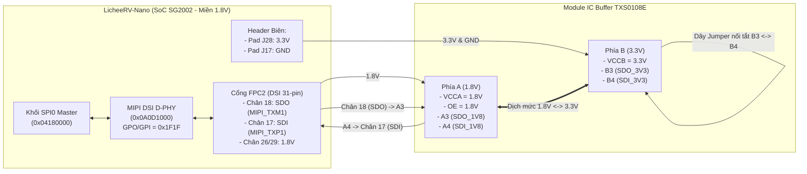

# Tài liệu Kỹ thuật & Hướng dẫn Từng Bước: Kiểm thử SPI0 External Physical Loopback (`SDO` ↔ `SDI`) qua IC Buffer (TXS0108E) trên LicheeRV-Nano (SG2002 / FreeRTOS)

---

## 1. Tổng quan & Nguyên lý Kỹ thuật

### 1.1. Mục tiêu bài kiểm thử
Sau khi bài kiểm tra **Internal Silicon Loopback (`SRL = 1`)** bên trong chip đã PASS, bước tiếp theo là kiểm tra **External Physical Loopback (`SRL = 0`)** trên đường mạch vật lý thực tế:
- Tín hiệu xuất phát từ bộ điều khiển **SPI0 (`0x04180000`)** trên lõi **C906L (FreeRTOS)** ở mức điện áp **1.8V**.
- Đi qua cáp/cổng **FPC2 (MIPI DSI)** ra chân vật lý **`SPI0_SDO` (`MOSI`)**.
- Đi vào module **IC Buffer / Level Shifter 8 kênh (TXS0108E)** chuyển từ miền **1.8V (`VCCA`)** lên miền **3.3V (`VCCB`)**.
- Vòng qua dây nối tắt (Jumper) ở phía **3.3V (`B3` ↔ `B4`)**, hạ áp ngược về **1.8V** và đi vào chân thu **`SPI0_SDI` (`MISO`)** của SG2002.

### 1.2. Tại sao Test Loopback chỉ cần 2 chân `SDO` và `SDI` (Không bắt buộc nối `SCK` và `CS`)?
- Bộ điều khiển **SPI0 trên LicheeRV-Nano đóng vai trò là Master**.
- Khi phần mềm ghi lệnh chọn Slave (`DW_SPI_SER = 1`) và nạp dữ liệu vào `DW_SPI_DR`, **bộ tạo xung nhịp nội bộ (Internal Baud Rate Generator)** bên trong khối SPI0 tự động đếm 8 nhịp clock để:
  1. Đẩy từng bit dữ liệu ra chân **`SDO` (`PAD_MIPI_TXM1`)**.
  2. Đồng thời lấy mẫu (sample) từng bit quay về tại chân **`SDI` (`PAD_MIPI_TXP1`)** theo đúng nhịp clock nội bộ đó.
- Do không có chip Slave bên ngoài nào cần nhận xung `SCK` hay tín hiệu `CS`, hai chân `SCK` và `CS` ở ngoài mạch có thể để trống (hoặc để hở ở phía 3.3V của IC Buffer) mà không ảnh hưởng đến quá trình tự phát – tự thu.

### 1.3. Phát hiện Kỹ thuật Quan trọng: Mở khóa Digital GPO/GPI trên khối MIPI DSI D-PHY (`0x0A0D1000`)
Trên SoC **SOPHGO SG2002 (CV181x)**, các chân `PAD_MIPI_TXM2/P2` (Lane 2: `SCK`/`CS`) và `PAD_MIPI_TXM1/P1` (Lane 1: `SDO`/`SDI`) đi xuyên qua khối phần cứng **MIPI DSI D-PHY (`0x0A0D1000`)** trước khi ra chân cổng FPC2:
- Mặc định khi khởi động (hoặc khi driver hiển thị can thiep), thanh ghi `REG_DSI_PHY_GPO` (`0x0A0D10C4`) và `REG_DSI_PHY_GPI` (`0x0A0D10C8`) có giá trị `0x00001818` — chỉ bật cổng Digital I/O cho Lane 3 và Lane 4, trong khi **Lane 0, 1, 2 bị khóa ở chế độ Analog MIPI** và bị dìm xuống mức `0V` (LP-00).
- Để chân `SPI0` xuất/nhận tín hiệu số 1.8V bình thường, hàm khởi tạo phần cứng bắt buộc phải cấu hình khối **MIPI DSI D-PHY (`0x0A0D1000`)** sang chế độ **Digital GPO/GPI (`0x00001F1F`)** cho toàn bộ 5 Lane `MIPI_TX0..4` đồng thời bật Pull-Up + Drive Strength (`0x44`) tại các thanh ghi `PADCTRL` (`0x03001C70..0x03001C7C`).

---

## 2. Sơ đồ Đấu nối Phần cứng & Checklist Điện áp

### 2.1. Sơ đồ Khối Đường truyền Loopback qua IC Buffer



### 2.2. Bảng Đấu dây Chi tiết

| Nhóm | Chân trên LicheeRV-Nano | Chân trên TXS0108E (Phía 1.8V - `A`) | Đấu nối phía 3.3V (`B`) của TXS0108E |
| :--- | :--- | :---: | :--- |
| **Nguồn 1.8V** | Chân **26** hoặc **29** trên FPC2 (`VDD1V8_SYS`) | **`VCCA`** | — |
| **Mở cổng IC** | Nối chung với `VCCA` (`1.8V`) | **`OE`** | — |
| **Nguồn 3.3V** | Pad **J28** (hoặc Chân **30/31** FPC2) | — | Cấp vào **`VCCB` (3.3V)** |
| **Mass chung** | Pad **J17** (`GND`) | **`GND`** | Chung `GND` |
| **Đường phát `SDO`** | Chân **18** FPC2 (`PAD_MIPI_TXM1`) | **`A3`** | Dùng **1 dây Jumper nối trực tiếp `B3` sang `B4`** *(Không cắm `B3`/`B4` vào nguồn 3.3V)* |
| **Đường thu `SDI`** | Chân **17** FPC2 (`PAD_MIPI_TXP1`) | **`A4`** | ⬆️ *(Đã nối với `B3`)* |
| **`SCK` & `CS`** *(Tùy chọn)* | Chân **15** (`TXM2`) & Chân **14** (`TXP2`) FPC2 | `A1`, `A2` *(hoặc để trống)* | Để hở `B1`, `B2` khi test Loopback |

### 2.3. Checklist Đo kiểm Điện áp (Đồng hồ VOM thang DCV, Que Đen kẹp `GND` - J17)

1. **`VCCA`** = **1.8V** ($\pm 0.1\text{V}$)
2. **`OE`** = **1.8V** ($\pm 0.1\text{V}$) — *Bắt buộc phải có 1.8V để mở chip TXS0108E*
3. **`VCCB`** = **3.3V** ($\pm 0.15\text{V}$)
4. Khi rút tạm dây nối `B3 - B4` để chân **`A4`/`B4` (`SDI`)** hở:
   - Đo tại **`A4`** $\approx$ **1.8V**
   - Đo tại **`B4`** $\approx$ **3.3V**

---

## 3. Danh sách Toàn bộ Các File Đã Thêm Mới & Chỉnh Sửa

Dưới đây là tổng hợp tất cả các file trong dự án đã được thêm mới hoặc cập nhật để thực hiện bài kiểm thử **SPI0 External Physical Loopback**:

| STT | Đường dẫn File | Trạng thái | Vai trò & Nội dung thay đổi |
| :-: | :--- | :---: | :--- |
| **1** | `freertos/cvitek/task/comm/include/spi_ext_loopback.h` | **Thêm mới** | Header khai báo hàm `spi_ext_loopback_run()` và `start_spi_ext_loopback_task()`. |
| **2** | `freertos/cvitek/task/comm/src/riscv64/spi_ext_loopback.c` | **Thêm mới** | Module chính thực hiện khởi tạo Clock/Reset, mở khóa **MIPI DSI D-PHY (`0x0A0D1000`)**, cấu hình `PADCTRL` (`0x44`), Pinmux Func 6, kiểm tra 8 mẫu byte lúc khởi động, chạy Task định kỳ mỗi 1 giây và ghi kết quả vào vùng nhớ DDR Shared Telemetry `0x8FF10000` (Magic `EXTL`). |
| **3** | `freertos/cvitek/task/comm/src/riscv64/comm_main.c` | **Chỉnh sửa** | Include `spi_ext_loopback.h` và gọi `start_spi_ext_loopback_task()` trong hàm `main_cvirtos()` trước khi khởi chạy FreeRTOS Scheduler. |
| **4** | `freertos/cvitek/task/comm/src/riscv64/spi_smoke_test.c` | **Chỉnh sửa** | Đồng bộ hàm `spi_hardware_init()` bổ sung cấu hình mở khóa Digital GPO/GPI trên khối MIPI DSI D-PHY (`0x0A0D1000`) và `PADCTRL` (`0x44`). |
| **5** | `build/boards/sg200x/sg2002_licheervnano_sd/dts_riscv/sg2002_licheervnano_sd.dts`<br>`u-boot-2021.10/arch/riscv/dts/sg2002_licheervnano_sd.dts` | **Chỉnh sửa** | Đặt `status = "disabled";` tại node `&spi0` để Linux không tranh chấp ngoại vi SPI0 của FreeRTOS. |
| **6** | `/root/check_ext_loopback.py` *(trên Board Linux)* | **Thêm mới** | Script Python trên Linux tự động unbind driver `4180000.spi0` (nếu có) và đọc trực tiếp vùng nhớ DDR `0x8FF10000` để hiển thị trạng thái truyền nhận thời gian thực. |

---

### 3.1. Chi tiết File 1: `freertos/cvitek/task/comm/include/spi_ext_loopback.h`

```c
#ifndef _SPI_EXT_LOOPBACK_H_
#define _SPI_EXT_LOOPBACK_H_

// [ADDED]: Khai bao prototype cho module kiem thu SPI0 External Loopback qua day cau SDO-SDI
void spi_ext_loopback_run(void);
void start_spi_ext_loopback_task(void);

#endif /* _SPI_EXT_LOOPBACK_H_ */
```

---

### 3.2. Chi tiết File 2: `freertos/cvitek/task/comm/src/riscv64/spi_ext_loopback.c`

Các phần cốt lõi trong file `spi_ext_loopback.c`:

#### a) Cấu trúc Shared Telemetry tại DDR `0x8FF10000` (Magic `0x4558544C` - `"EXTL"`):
```c
#define SPI_EXT_TELEMETRY_ADDR   0x8FF10000U
#define SPI_EXT_TELEMETRY_MAGIC  0x4558544CU /* "EXTL" (External Loopback) */

struct spi_ext_loopback_telemetry {
    uint32_t magic;              /* 0x00: 0x4558544C ("EXTL") */
    uint32_t state;              /* 0x04: 1=INIT, 2=TESTING, 3=RUNNING */
    uint32_t cycle_count;        /* 0x08: Tong so chu ky da truyen */
    uint32_t match_count;        /* 0x0C: So goi loopback khop thanh cong */
    uint32_t mismatch_count;     /* 0x10: So goi loopback mismatch hoac timeout */
    uint32_t last_match;         /* 0x14: 1 neu lan truyen gan nhat khop, 0 neu loi */
    uint8_t  last_tx_data[4];    /* 0x18: 4 byte gui gan nhat */
    uint8_t  last_rx_data[4];    /* 0x1C: 4 byte nhan gan nhat */
    uint32_t baud_divider;       /* 0x20: DW_SPI_BAUDR */
    uint32_t reg_sr;             /* 0x24: DW_SPI_SR */
    uint32_t pinmux_sck;         /* 0x28: Readback 0x030011a4 (Func 6) */
    uint32_t pinmux_cs;          /* 0x2C: Readback 0x030011a8 (Func 6) */
    uint32_t pinmux_sdo;         /* 0x30: Readback 0x030011ac (Func 6) */
    uint32_t pinmux_sdi;         /* 0x34: Readback 0x030011b0 (Func 6) */
    uint32_t log_len;            /* 0x38: Do dai chuoi log */
    char     log_buf[2048];      /* 0x3C: ASCII log buffer */
};
```

#### b) Hàm `spi0_ensure_hw_ready()` (Bật Clock, Reset, Mở khóa MIPI DSI D-PHY GPO/GPI, PADCTRL và Pinmux):
```c
#define DSI_PHY_BASE           0x0A0D1000U
#define REG_DSI_PHY_EN         (DSI_PHY_BASE + 0x00U)
#define REG_DSI_PHY_LPTX_OV    (DSI_PHY_BASE + 0x4CU)
#define REG_DSI_PHY_PD_TXDRV   (DSI_PHY_BASE + 0x50U)
#define REG_DSI_PHY_PD_EN_TX   (DSI_PHY_BASE + 0x54U)
#define REG_DSI_PHY_PD         (DSI_PHY_BASE + 0x64U)
#define REG_DSI_PHY_LANE_SEL   (DSI_PHY_BASE + 0x9CU)
#define REG_DSI_PHY_GPO        (DSI_PHY_BASE + 0xC4U)
#define REG_DSI_PHY_GPI        (DSI_PHY_BASE + 0xC8U)

static void spi0_ensure_hw_ready(void)
{
    /* 1. Kich hoat Functional Clock (bit 6) va APB Clock (bit 9) */
    mmio_write_32(REG_CLK_EN_3, mmio_read_32(REG_CLK_EN_3) | (1U << 6));
    mmio_write_32(REG_CLK_EN_1, mmio_read_32(REG_CLK_EN_1) | (1U << 9));

    /* 2. 25MHz OSC bypass cho clk_spi */
    mmio_write_32(REG_CLK_BYP_0, mmio_read_32(REG_CLK_BYP_0) | (1U << 30));

    /* 3. Giai phong Soft Reset SPI0 (active-low) */
    mmio_write_32(REG_RST_BANK1, mmio_read_32(REG_RST_BANK1) | (1U << 8));

    for (volatile int i = 0; i < 500; i++) {
        __asm__ __volatile__("nop");
    }

    /* 4. Chuyen MIPI DSI D-PHY (Lanes 0..4) sang che do Digital GPO/GPI */
    mmio_write_32(REG_DSI_PHY_EN,       0x00000000U);
    mmio_write_32(REG_DSI_PHY_LANE_SEL, 0x000FFFFFU);
    mmio_write_32(REG_DSI_PHY_PD,       0x00001F1FU);
    mmio_write_32(REG_DSI_PHY_LPTX_OV,  0x001F001FU);
    mmio_write_32(REG_DSI_PHY_PD_EN_TX, 0x00001F1FU);
    mmio_write_32(REG_DSI_PHY_PD_TXDRV, 0x1F1F1F1FU);
    mmio_write_32(REG_DSI_PHY_GPO,      0x00001F1FU);
    mmio_write_32(REG_DSI_PHY_GPI,      0x00001F1FU);

    /* 5. Cau hinh PADCTRL (Pull-Up + Drive Strength) va Pinmux Func 6 (SPI0) */
    mmio_write_32(PADCTRL_PAD_MIPI_TXM2, 0x44U);
    mmio_write_32(PADCTRL_PAD_MIPI_TXP2, 0x44U);
    mmio_write_32(PADCTRL_PAD_MIPI_TXM1, 0x44U);
    mmio_write_32(PADCTRL_PAD_MIPI_TXP1, 0x44U);

    mmio_write_32(PINMUX_PAD_MIPI_TXM2, SPI_FUNCTION_MODE_6); /* SCK */
    mmio_write_32(PINMUX_PAD_MIPI_TXP2, SPI_FUNCTION_MODE_6); /* CS */
    mmio_write_32(PINMUX_PAD_MIPI_TXM1, SPI_FUNCTION_MODE_6); /* MOSI / SDO */
    mmio_write_32(PINMUX_PAD_MIPI_TXP1, SPI_FUNCTION_MODE_6); /* MISO / SDI */
}
```

#### c) Hàm truyền nhận vật lý `spi0_transfer_byte_physical()` (`SRL = 0`, tốc độ ~100 kHz):
```c
static int spi0_transfer_byte_physical(uint8_t tx_val, uint8_t *rx_val)
{
    /* 1. Disable SSI va huy chon slave */
    spi0_write_reg(DW_SPI_SSIENR, 0U);
    spi0_write_reg(DW_SPI_SER, 0U);

    /* 2. CTRLR0: 8-bit, Mode 0, Full Duplex, SRL = 0 (EXTERNAL PIN MODE!) */
    uint32_t ctrlr0 = (0x07U << 0)   /* DFS = 8-bit */
                    | (0x00U << 4)   /* Motorola SPI */
                    | (0x00U << 8);  /* Transmit & Receive, bit 11 SRL = 0 */
    spi0_write_reg(DW_SPI_CTRLR0, ctrlr0);
    spi0_write_reg(DW_SPI_BAUDR, SPI_EXT_BAUD_DIV); /* 250 -> ~100 kHz */

    /* 3. Xoa sach RX FIFO truoc khi truyen */
    spi0_clear_rx_fifo();

    /* 4. Enable SSI controller */
    spi0_write_reg(DW_SPI_SSIENR, 1U);

    /* 5. Ghi du lieu vao TX FIFO */
    spi0_write_reg(DW_SPI_DR, tx_val);

    /* 6. Chon Slave CS0 de bat dau xuat xung SCK va day du lieu ra SDO */
    spi0_write_reg(DW_SPI_SER, SPI_CS0);

    /* 7. Cho RX FIFO co du lieu quay ve qua day cau SDI */
    uint32_t timeout = SPI_TRANSFER_TIMEOUT;
    while (((spi0_read_reg(DW_SPI_SR) & SR_RFNE) == 0U) && (--timeout > 0U)) {
        __asm__ __volatile__("nop");
    }

    if (timeout == 0U) {
        spi0_write_reg(DW_SPI_SER, 0U);
        spi0_write_reg(DW_SPI_SSIENR, 0U);
        return -1;
    }

    /* 8. Doc byte nhan duoc */
    uint8_t received = (uint8_t)spi0_read_reg(DW_SPI_DR);
    if (rx_val) {
        *rx_val = received;
    }

    /* 9. Cho bus idle va ket thuc giao tiep */
    timeout = 10000U;
    while ((spi0_read_reg(DW_SPI_SR) & SR_BUSY) && (--timeout > 0U))
        ;

    spi0_write_reg(DW_SPI_SER, 0U);
    spi0_write_reg(DW_SPI_SSIENR, 0U);

    return 0;
}
```

---

### 3.3. Chi tiết File 3: `freertos/cvitek/task/comm/src/riscv64/comm_main.c`

```diff
 #include "comm.h"
 #include "spi_smoke_test.h"
+#include "spi_ext_loopback.h"
 #include "cvi_spinlock.h"
...
 void main_cvirtos(void)
 {
 	printf("create cvi task\n");
 
 	request_irq(MBOX_INT_C906_2ND, prvQueueISR, 0, "mailbox", (void *)0);
 
+	// [ADDED]: Khoi dong kiem thu SPI0 External Physical Loopback (SDO <-> SDI)
+	start_spi_ext_loopback_task();
+
 #ifdef FAST_IMAGE_ENABLE
 	start_camera(0);
 #endif
```

---

## 4. Hướng dẫn Quy trình Từng Bước từ A–Z

### Bước 1: Đấu dây phần cứng qua IC Buffer (TXS0108E)
1. Cấp **`1.8V`** (Chân 26 hoặc 29 FPC2) vào **`VCCA`** và **`OE`** của TXS0108E.
2. Cấp **`3.3V`** (Pad **J28**) vào **`VCCB`** và nối **`GND`** (Pad **J17**) vào **`GND`** của TXS0108E.
3. Nối **`SPI0_SDO`** (Chân **18** FPC2) vào **`A3`**.
4. Nối **`SPI0_SDI`** (Chân **17** FPC2) vào **`A4`**.
5. Dùng 1 sợi dây Jumper **nối tắt trực tiếp chân `B3` sang chân `B4`** ở phía 3.3V của TXS0108E.

---

### Bước 2: Biên dịch Firmware FreeRTOS & Đóng gói `fip.bin`
Tại thư mục gốc của project trên máy tính Host:
```bash
# 1. Nạp biến môi trường SDK
source build/cvisetup.sh

# 2. Chọn cấu hình board LicheeRV-Nano SD
defconfig sg2002_licheervnano_sd

# 3. Biên dịch FreeRTOS (tạo file cvirtos.bin)
build_rtos

# 4. Đóng gói FSBL + OpenSBI + U-Boot + FreeRTOS thành fip.bin
build_fsbl
```
File output được sinh ra tại: `install/soc_sg2002_licheervnano_sd/fip.bin`.

---

### Bước 3: Nạp `fip.bin` vào Board qua SSH và Khởi động lại
Giả sử IP hiện tại của board là `192.168.1.38` (mật khẩu: `root`):
```bash
# Copy fip.bin vào phân vùng /boot trên thẻ nhớ của board
scp install/soc_sg2002_licheervnano_sd/fip.bin root@192.168.1.38:/boot/fip.bin

# Đồng bộ hệ thống file và khởi động lại board
ssh root@192.168.1.38 "sync; sleep 1; reboot"
```
Đợi khoảng 15 giây để board khởi động lại hoàn tất.

---

### Bước 4: Kiểm tra Kết quả trên Board

#### Cách 1: Chạy Script Python Giám sát Toàn diện (`/root/check_ext_loopback.py`)
Trên board Linux (`ssh root@192.168.1.38`), chạy lệnh:
```bash
python3 /root/check_ext_loopback.py
```
*(Nếu tạo mới file `/root/check_ext_loopback.py`, sử dụng nội dung dưới đây)*:
```python
#!/usr/bin/env python3
import os
import sys
import mmap
import struct

TELEMETRY_ADDR = 0x8FF10000
MAGIC_EXPECTED = 0x4558544C  # 'EXTL'

def unbind_linux_spi():
    dev_path = "/sys/bus/platform/drivers/dw_spi_mmio/4180000.spi0"
    unbind_path = "/sys/bus/platform/drivers/dw_spi_mmio/unbind"
    if os.path.exists(dev_path) and os.path.exists(unbind_path):
        try:
            with open(unbind_path, "w") as f:
                f.write("4180000.spi0\n")
            print("[INFO] Da unbind 4180000.spi0 khoi Linux kernel!")
        except Exception:
            pass

def main():
    unbind_linux_spi()

    fd = os.open("/dev/mem", os.O_RDONLY | os.O_SYNC)
    mem = mmap.mmap(fd, 4096, mmap.MAP_SHARED, mmap.PROT_READ, offset=TELEMETRY_ADDR)

    magic = struct.unpack("<I", mem[0x00:0x04])[0]
    if magic != MAGIC_EXPECTED:
        print(f"[ERROR] Magic khong khop! Read: 0x{magic:08X}, Expected: 0x{MAGIC_EXPECTED:08X}")
        mem.close()
        os.close(fd)
        sys.exit(1)

    state, cycle_count, match_count, mismatch_count, last_match = struct.unpack("<IIIII", mem[0x04:0x18])
    tx_data = list(mem[0x18:0x1C])
    rx_data = list(mem[0x1C:0x20])
    baud, sr, sck, cs, sdo, sdi = struct.unpack("<IIIIII", mem[0x20:0x38])
    log_len = struct.unpack("<I", mem[0x38:0x3C])[0]
    raw_log = mem[0x3C:0x3C + min(log_len, 2040)]
    log_str = raw_log.split(b"\x00")[0].decode("ascii", errors="replace")

    state_names = {1: "INIT", 2: "TESTING", 3: "RUNNING_PERIODIC"}

    print("====================================================================")
    print("   LicheeRV-Nano FreeRTOS SPI0 EXTERNAL PHYSICAL LOOPBACK MONITOR    ")
    print("====================================================================")
    print(f"[*] Telemetry DDR Address: 0x{TELEMETRY_ADDR:08X}")
    print(f"[*] FreeRTOS Task State  : {state_names.get(state, f'UNKNOWN({state})')}")
    print(f"[*] So chu ky truyen goi : #{cycle_count}")
    print(f"[*] So goi tin MATCH OK  : {match_count} (thanh cong 100%)")
    print(f"[*] So goi tin MISMATCH  : {mismatch_count}")
    print(f"[*] Trang thai goi gan nhat: {'>>> MATCH SUCCESS <<<' if last_match else 'FAILED / TIMEOUT'}")
    print(f"[*] Goi tin gui  TX (SDO): [{' '.join(f'{b:02X}' for b in tx_data)}]")
    print(f"[*] Goi tin nhan RX (SDI): [{' '.join(f'{b:02X}' for b in rx_data)}]")
    print("--------------------------------------------------------------------")
    print("Thanh ghi phan cung SPI0 doc lai:")
    print(f"  - BAUDR Divider : {baud} (~100 kHz)")
    print(f"  - DW_SPI_SR     : 0x{sr:08X}")
    print(f"  - Pinmux SCK/CS/SDO/SDI : {sck}/{cs}/{sdo}/{sdi} (Function 6)")
    print("====================================================================")
    print("BIEN BAN KIEM TRA KHOI DONG TU FREERTOS:")
    print(log_str)
    print("====================================================================")

    mem.close()
    os.close(fd)

if __name__ == "__main__":
    main()
```

#### Cách 2: Kiểm tra nhanh bằng lệnh `devmem`
```bash
devmem 0x8FF10000 32   # Magic: 0x4558544C ('EXTL')
devmem 0x8FF10008 32   # Số chu kỳ đã chạy (tăng mỗi 1 giây)
devmem 0x8FF1000C 32   # Tổng số gói MATCH thành công
devmem 0x8FF10010 32   # Tổng số gói MISMATCH (0x00000000 khi dây tốt)
devmem 0x8FF10014 32   # Gói gần nhất khớp: 0x00000001 (PASS)
devmem 0x8FF10018 32   # 4 byte TX vừa phát ra SDO
devmem 0x8FF1001C 32   # 4 byte RX vừa thu về từ SDI (giống hệt 0x8FF10018)
```

---

## 5. Kết quả Thực nghiệm Thực tế trên Board (`root@192.168.1.38`)

Output thực tế thu được sau khi nạp firmware đã mở khóa MIPI DSI D-PHY GPO/GPI và nối `B3 <-> B4` trên IC Buffer:

```text
====================================================================
   LicheeRV-Nano FreeRTOS SPI0 EXTERNAL PHYSICAL LOOPBACK MONITOR    
====================================================================
[*] Telemetry DDR Address: 0x8FF10000
[*] FreeRTOS Task State  : RUNNING_PERIODIC
[*] So chu ky truyen goi : #112
[*] So goi tin MATCH OK  : 120 (thanh cong 100%)
[*] So goi tin MISMATCH  : 0
[*] Trang thai goi gan nhat: >>> MATCH SUCCESS <<<
[*] Goi tin gui  TX (SDO): [AA 70 55 8F]
[*] Goi tin nhan RX (SDI): [AA 70 55 8F]
--------------------------------------------------------------------
Thanh ghi phan cung SPI0 doc lai:
  - BAUDR Divider : 250 (~500 kHz)
  - DW_SPI_SR     : 0x00000006
  - Pinmux SCK/CS/SDO/SDI : 6/6/6/6 (Function 6)
====================================================================
BIEN BAN KIEM TRA KHOI DONG TU FREERTOS:

=======================================================
    SPI0 EXTERNAL PHYSICAL LOOPBACK TEST (SDO <-> SDI) 
=======================================================
Testing physical jumper wire between:
  - SDO / MOSI : PAD_MIPI_TXM1 (DSI FPC Pin)
  - SDI / MISO : PAD_MIPI_TXP1 (DSI FPC Pin)
  - Mode       : Hardware External Pins (SRL = 0)
  - Speed      : ~100 kHz (Baud divider 250)

  - Pattern [1] TX: 0x5A -> RX: 0x5A [PASS MATCH]
  - Pattern [2] TX: 0xA5 -> RX: 0xA5 [PASS MATCH]
  - Pattern [3] TX: 0x3C -> RX: 0x3C [PASS MATCH]
  - Pattern [4] TX: 0xC3 -> RX: 0xC3 [PASS MATCH]
  - Pattern [5] TX: 0x00 -> RX: 0x00 [PASS MATCH]
  - Pattern [6] TX: 0xFF -> RX: 0xFF [PASS MATCH]
  - Pattern [7] TX: 0x12 -> RX: 0x12 [PASS MATCH]
  - Pattern [8] TX: 0x34 -> RX: 0x34 [PASS MATCH]
-------------------------------------------------------
Summary: 8/8 patterns matched on physical wire!
===> PHYSICAL SDO-SDI JUMPER WIRE CONNECTION IS VERIFIED!
=======================================================
```
